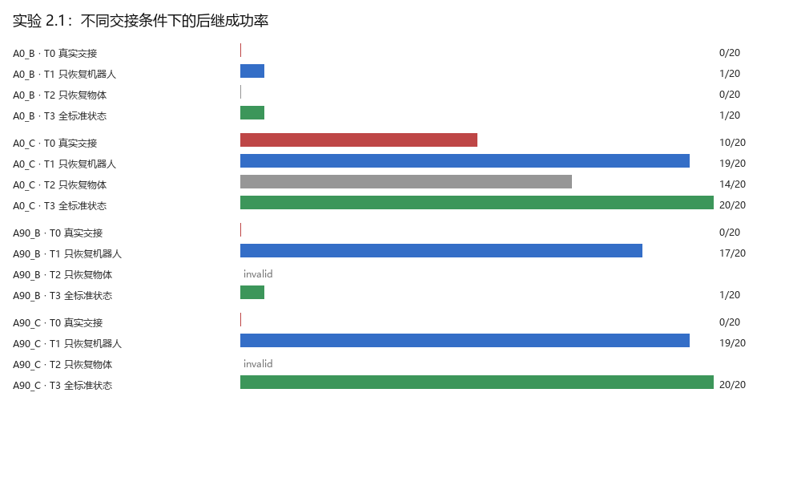
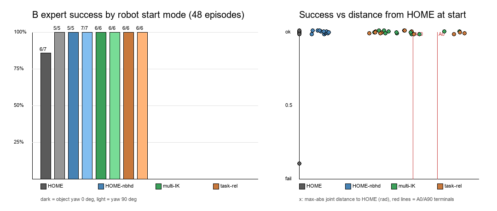
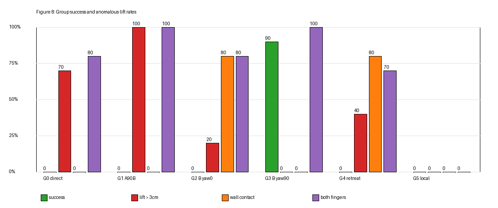

# Panda 技能交接最小实验

已在本机 Windows 11 原生 GUI 和 DIRECT 模式实际运行。无需 ROS、WSL、模型权重或真机。

## 实验 0B：独立几何敏感性检查

原实验代码和结果保持不变。新增入口 `scripts/run_experiment_0b.py`，在原环境中运行 `python scripts/run_experiment_0b.py`；默认 3 个种子 × 4 个 IK 初值 × 8 个条件，共 96 条候选记录。输出在 `results/experiment_0b/`，重跑前自动归档旧 0B 输出到 `results/experiment_0b_history/`。

B/C 的位置和朝向均不同。本次 direct 四组都成功：z1→B 为 0.604 rad / 0.881 s，z2→B 为 3.182 rad / 3.567 s；z1→C 为 3.331 rad / 3.722 s，z2→C 为 2.251 rad / 2.597 s。因此当前控制器在所测初值附近出现 **B 偏好 z1、C 偏好 z2** 的代价交叉。这不是全局最优代价、真实物体交接或 VLA 组合泛化的证明。

HOME 恢复对照中 B 为 1.688 rad / 2.010 s，C 为 2.347 rad / 2.696 s，加上恢复动作的总交接时间为 3.948 s 和 4.634 s，即从统一 HOME 起点出发 B 更省。reset 组 z1 与 z2 的数值差异只来自浮点，因恢复后起点完全相同，该组不携带实现信息。每组 12 个候选不是独立物理样本，仅 IK 初始猜测有扰动。目标探索过程已在配置中披露。

**此前的“HOME→C 全部 tracking_error”是仿真接触伪影，结论已作废。** Panda URDF 中 `panda_link7` 与 `panda_hand` 的碰撞几何长期重叠约 2.5 cm；失败判定本就把该固定连接对排除在外，但 PyBullet 仍在求解该接触，产生约 19 kN 罚函数力，相当于给第 5 关节加约 12 N·m 制动，使其在 100% 力矩处饱和、以约 0.2 rad/s 爬行，最终停在距目标 0.789 rad 处。该对现在动力学层也已关闭（`Simulation.ignored_contacts`），修复前的结果归档在 `results/experiment_0b_history/`。direct 四组数值未受影响。

实时观看入口 `scripts/watch_experiment_0b.py`：直接打开 PyBullet 窗口，按记录顺序现场执行四组 direct 交接和一组 HOME 复位对照，画面上叠加工况、阶段、实时行程/误差、末端轨迹和 B/C 目标标记；`--speed` 调速，SPACE 跳过当前停留，P 暂停，ESC 或关闭窗口退出。示例：`& ".\.conda312\python.exe" ".\scripts\watch_experiment_0b.py" --speed 0.7 --hold 4`。

离线回放入口 `scripts/visualize_experiment_0b.py`：读取上述 CSV 中 trial 0 / ik_start_index 0 的记录，重建 A 与可选 HOME 状态后用原控制器重放，离屏渲染为 GIF、关键帧拼图和末端路径图，输出在 `results/experiment_0b_visualization/`。两条入口行程、耗时和成功标志都与原始记录一致。回放是确定性场景复现，不是独立物理试验。

`scripts/diagnose_0b_reset.py` 用于复核 reset 组的逐关节追踪与力矩占用，也就是定位上面那次接触伪影的诊断入口。

详见 [0B 数据与图表](results/experiment_0b/README.md)、[0B 可视化回放](results/experiment_0b_visualization/README.md) 和 [阶段二物理交接设计（尚未实施）](docs/experiment_0b_stage2_design.md)。

## 实验 0C 第一阶段：真实接触抓取-抬升-移动-放置

只做 A 的共同任务本身，B/C 后继交接与 VLA/RL 均未实现。工件是 `0.04 × 0.04 × 0.08 m`、`0.12 kg` 的可自由移动长方体；Panda 原有双指夹爪用电机闭合（20 N/指，URDF 上限）真实夹持，流程为接近 → 预闭合 → 下降 → 闭合 → 抬升 10 cm → 移动 → 放下 → 释放。全程未调用 `resetBasePositionAndOrientation` 搬运工件，也没有固定约束或 kinematic 物体。

```powershell
& '.\.conda312\python.exe' '.\scripts\watch_experiment_0c.py' --speed 1   # 实时窗口
& '.\.conda312\python.exe' '.\scripts\run_experiment_0c.py' --episodes 5  # 数据 + GIF
```

实测：固定场景 5/5 成功，抬升 0.1000 m，双指接触力 20.00/20.00 N，相对滑移 3.45 mm，放置 xy 误差 2.83 mm，高度误差 −0.01 mm，终态静止且释放后无接触。工件起点随机平移 ±4 mm 的 5 次重复同样 5/5。摩擦 × 夹持力负对照 16 组中 9 组成功，失败全部为 `object_not_lifted`，说明成功依赖真实摩擦和夹持力，且失败判定不是恒真。

关键几何：朝下抓取时指尖在末端目标上方 1.1 cm、手掌碰撞盒底部在上方 3.5 cm，因此抓取点取 `z = 0.055`，既插入工件 3.6 cm，又让手掌离工件顶面 1 cm。最早把末端目标放到工件中心时，手掌压到工件顶面（298 N）并把工件推开，这是几何错误而非摩擦问题。

这些是确定性场景的重复运行，不是独立的物理样本，5/5 不能当作鲁棒成功率。详见 [0C 设计与结果](docs/experiment_0c_stage1.md) 和 [0C 数据说明](results/experiment_0c/README.md)。

## 实验 0D：计划条件化的物理技能交接

把 0C 的真实抓放与两个后继技能接起来：A 有两个终态 z1（工件长边沿 X）和 z2（长边沿 Y），B 从侧面推到挡板，C 从上方顶抓。工件 `0.10 × 0.04 × 0.04 m`，长边大于夹爪 0.08 m 开口，因此 z2 的工件在 C 下**几何上抓不住**。

```powershell
& '.\.conda312\python.exe' '.\scripts\watch_experiment_0d.py' --arm z1_B   # 实时窗口
& '.\.conda312\python.exe' '.\scripts\watch_experiment_0d.py' --arm z2_C   # 看几何失败
& '.\.conda312\python.exe' '.\scripts\watch_experiment_0d.py' --list       # 列出六个臂
& '.\.conda312\python.exe' '.\scripts\run_experiment_0d.py'              # 5 episode × 6 臂 + GIF
& '.\.conda312\python.exe' '.\scripts\run_experiment_0d.py' --no-gifs    # 只出数据与图表
```

可视化窗口：空格开始／结束后重放，`P` 暂停，`ESC` 退出；`--speed` 调实时倍率，`--episode` 选扰动样本，`--auto` 跳过等待。画面里绿框是当前臂的交接目标轮廓（长边方向随 z1/z2 变化），挡板位置标为 `WALL`；HUD 显示阶段、仿真时间、工件位姿/朝向、指宽与接触力。

实测（种子 20261021，同 episode 内六臂共用扰动）：z1→B 4/5、z2→B 5/5、z1→C 5/5、**z2→C 0/5**；无条件复位后 z2→B 4/5、z2→C 5/5。三个基线：固定 z1 90%（15.9 仿真秒 / 5.21 rad）、固定 z2 50%（20.2 / 7.20）、恢复公共标准状态 90%（33.1 / 10.89）。z2→C 的 5 次失败全部是 `grasp_approach_blocked`：0.10 m 长边顺指缝方向、超出 0.08 m 开口，下降时指腹撞在工件侧面。

推进中发现并修正了两个会让结果失真的实现缺陷：抓取朝向缺省成“与终态同向”导致 z2 的 90° 其实是被手指挤出来的；预闭合开口（0.024 m）小于工件宽度导致复位抓取先撞偏工件再闭合。修正后 z2 靠腕部 10° 步进真实转动，复位滑移从 23 mm 降到 ≤ 4 mm。细节与全部失败记录见 [0D 报告](results/experiment_0d/report.md)。

## 环境

原系统 Python 3.13 无合适 PyBullet wheel；尝试 Python 3.12 后发现 PyPI 的 PyBullet 3.2.7 同样没有 Windows wheel。最终使用项目独立 Conda 环境 `.conda312`，不修改 base：Python 3.12.15、PyBullet 3.2.5、NumPy 2.5.4、Pillow 12.3.0。实际包 URL 锁定在 `results/conda-explicit-win64.txt`。

硬件：16 GB 内存、RTX 5060 Laptop 约 8 GB 显存。GUI 实测由 Intel 集显 OpenGL 渲染；截图使用 TinyRenderer，不要求 CUDA。

## 运行（PowerShell，不是 Linux Shell）

在 `D:\python\simulate` 打开 PowerShell：

```powershell
Set-Location 'D:\python\simulate'
& '.\.conda312\python.exe' '.\scripts\run_demo.py'
& '.\.conda312\python.exe' '.\scripts\run_experiment.py' --trials 10 --seed 20261019
& '.\.conda312\python.exe' '.\scripts\plot_results.py'
```

演示窗口依次播放 `z1→B`、`z1→C`、`z2→B`、`z2→C` 四种直接交接，画面标注当前阶段和成功/失败原因，不写数据或截图；加 `--reset` 则每组先从 A 终态运动回 HOME 再执行后继。`Simulation.reset()` 支持在现有连接中重新初始化。实验覆盖 8 个条件（4 组直接交接及各自恢复对照），每组 10 次，总计 80 次。增加 `--trials` 可增加次数。程序覆盖同名结果；需要保留旧实验时请先复制 `results`。

如需重建环境（以下仍为 PowerShell）：

```powershell
& 'D:\miniconda3\Scripts\conda.exe' create --prefix 'D:\python\simulate\.conda312' --file 'D:\python\simulate\results\conda-explicit-win64.txt' --yes
```

仅在环境尚不存在时重建。`requirements.txt` 记录版本，但本机不要直接用 pip 安装 PyBullet；使用已验证的 Conda 包。

## 任务与成功条件

立方体固定在 `(0.55, 0, 0.025)`，边长 0.05 m。A 的公共位置目标为 `(0.43, 0, 0.34)`；z1/z2 分别使用绕竖轴不同方向的末端姿态。B 接近立方体上方 `(0.55, 0, 0.36)`；C 接近前方 `(0.55, -0.22, 0.12)`。目标均在 `src/skills.py` 中。

A 的公共任务条件是接近同一区域且无非预期碰撞；两种实现还分别要求各自的姿态追踪成功。运动通过 IK、关节插值和电机位置控制完成，只有每次试验的共同初始化使用 `resetJointState`。恢复基线通过电机移动到公共 HOME 关节角，而非瞬移。

关节追踪误差范数 < 0.06 rad、末端位置误差 < 0.025 m、姿态角误差 < 0.15 rad，且没有检测到越界或非预期碰撞，才算末端动作成功。固定时间步 1/240 s；插值后统一等待 60 步收敛。碰撞检测排除底座支撑和已知相邻连接几何重叠，并不是完备的连续碰撞检测。

## 实测结果

|条件|整链成功|平均交接时间（仿真秒，含恢复）|关节行程（rad）|
|---|---:|---:|---:|
|直接 z1→B|10/10|0.846|0.571|
|直接 z1→C|10/10|1.579|1.276|
|直接 z2→B|10/10|3.629|3.241|
|直接 z2→C|10/10|3.908|3.511|
|恢复 z1→B|10/10|3.958|3.316|
|恢复 z1→C|10/10|4.763|4.088|
|恢复 z2→B|10/10|3.967|3.326|
|恢复 z2→C|10/10|4.771|4.098|

A 在所有条件均成功，8 个条件全部 10/10。z2 直接交接时 PyBullet 的局部 IK 返回第 7 关节 5.483 rad，超出 ±2.967 rad 限位；但该值与 -0.801 rad 相差 2π，属于同一物理构型。控制器现在做 2π 等价折算后再判断限位，`results.csv` 的 `ik_wrapped` 记录该情况：只有 z2 直接交接两组为真，恢复后两组不需要折算。

**此前的“z2 直接交接 0/10 失败”结论是求解器角度未归一的假阴性，已作废。** 修正后四组直接交接均能到达 B/C，z2 的差异只体现为更大的关节行程和更长的仿真耗时（约多 2.3–3.1 秒、多 2.2–2.7 rad），不是可行性差异。z1 在 B、C 上都比 z2 更省，因此**没有出现“B 偏好 z1、C 偏好 z2”的交叉现象**；当前场景中 z1/z2 的差别只是腕部绕转量，与后继目标的几何方向没有耦合。

这些是确定性场景的重复运行，不是 10 次独立随机物理试验，不应解释为鲁棒成功概率；10 次重复结果完全一致，表中数值是确定性复现值而非分布估计。轨迹长度为逐时间步实际关节变化的欧氏范数之和，单位 rad，不是末端空间路程。`joint_tracking_error_rad` 记录关节追踪误差；`position_error_actual_m` 记录末端位置误差。

## 输出

- `results/demo.png`、`demo_log.json`：里程碑 1 的旧演示记录；当前 `run_demo.py` 不写文件。
- `results/results.csv`：逐次记录，包括 A 终态、IK 是否经 2π 折算、失败原因和恢复成本。
- `results/summary.csv`：8 组汇总，包含整链成功、`ik_wrapped_rate` 和恢复成本。
- `results/experiment_config.json`：种子、次数及时间步。
- `results/comparison.png`：由真实汇总绘制的成功率与时间对比。
- `docs/experiment_notes.md`：指标边界和学习要点。
- `docs/vla_next_step.md`：官方资料核对与下一阶段建议。

GIF 只由离线渲染脚本生成（0B 在 `results/experiment_0b_visualization/`，0C 在 `results/experiment_0c/`）；实时窗口本身不录制。`src/policy.py` 预留 `Policy.act(observation)` 抽象接口，但当前实验直接使用脚本控制器，尚未接入 VLA。

**0B 仍是技能交接的几何/运动学代理测试；0C 第一阶段才引入真实接触的物体操作，但只验证抓取-搬运-放置，不涉及 B/C 交接，也不是 VLA 未见技能组合泛化的证据。**

## 实验 1 / 1.1：SmolVLA 原子抓取放置

- 实验 1（150 条示范、15 000 步微调、初步闭环）：[docs/experiment_1.md](docs/experiment_1.md)
- 实验 1.1（严格自主评测、渲染一致性、失败诊断、受控 OOD）：[docs/experiment_1_1.md](docs/experiment_1_1.md)

关键结论：严格自主成功率 **85%**（51/60，IID held-out，chunk50，95% CI 74–92%）；旧评测的自动松爪**没有**制造假成功（对失败集补张爪反事实复跑，0 次救回）；IID 失败集中在接近-抓取段，位置 OOD 下主要变成放置误差；受控 OOD 中位置 +3 cm 降到 10%、yaw 0.25 rad 降到 0%，摩擦 0.4 仍为 100%。

```bash
# 服务器：严格评测（示例）
env GPU=0 MODE=strict SS=1 SEEDS=$(seq -s, 30000000 30000059) OUT=iid60_chunk50 bash server/e11_run.sh

# 本地汇总（生成 results/experiment_1_1/ 下的 CSV / 图 / summary.md）
python scripts/analyze_experiment_1_1.py
```

原始记录与图表在 [results/experiment_1_1/](results/experiment_1_1/README.md)。

## 实验 2：多原子技能与零样本组合

- 完整报告：[docs/experiment_2.md](docs/experiment_2.md)
- 阶段 1（统一场景与四链可行性 5/5）：[docs/experiment_2_scene.md](docs/experiment_2_scene.md)
- 阶段 2（480 集多任务数据集，校验 0 失败）：[docs/experiment_2_data.md](docs/experiment_2_data.md)
- 阶段 3/4（共享 SmolVLA 训练 20K 步 + 原子评测）：[docs/experiment_2_training.md](docs/experiment_2_training.md)
- 场景俯视图：[results/experiment_2/scene_diagram.svg](results/experiment_2/scene_diagram.svg)

**结果**：原子技能 A0 **100%**、A90 **100%**、B **40%**、C **95%**（专家 100/100/90/95）；组合 A0→B **0/20**、A90→B **0/20**、A0→C **20/20**、A90→C **0/20**。

关键结论：原子技能会做不等于组合会做。C 单独 95%，在 A90 之后掉到 0%；B 单独 40%，在 A 之后掉到 0%；而 A0→C 是 100%。失败来自**交接状态分布偏移**（B 在 A 之后把物体抓起来而不是推、C 在 A90 的旋转腕构型下抓不住），不是原子能力本身。

```bash
# 服务器：训练（单卡 A40，20K 步，约 111 分钟）
cd ~/simulate_vla
GPU=0 STEPS=20000 BATCH=8 SAVE_FREQ=2000 \
  setsid nohup bash server/train_smolvla_multi.sh > logs/e2_train.log 2>&1 &

# 原子评测与组合评测
CUDA_VISIBLE_DEVICES=3 HF_HUB_OFFLINE=1 PYTHONPATH=src venv/bin/python \
  scripts/eval_multi_atomic_vla.py \
  --policy outputs/smolvla_multi/checkpoints/020000/pretrained_model \
  --skills A0 A90 B C --episodes 20 --seed-base 40000000 \
  --out results/experiment_2/eval_atomic

CUDA_VISIBLE_DEVICES=3 HF_HUB_OFFLINE=1 PYTHONPATH=src venv/bin/python \
  scripts/eval_skill_composition.py \
  --policy outputs/smolvla_multi/checkpoints/020000/pretrained_model \
  --chains A0_B A90_B A0_C A90_C --episodes 20 --seed-base 40000000 \
  --out results/experiment_2/eval_composition

# 本地汇总
python scripts/analyze_experiment_2.py
```

## 实验 2.1：组合失败的交接状态归因

- 完整报告：[docs/experiment_2_1.md](docs/experiment_2_1.md)
- 阶段 1（核对与冻结）：[docs/experiment_2_1_audit.md](docs/experiment_2_1_audit.md)
- 阶段 2（真实交接快照与恢复验证）：[docs/experiment_2_1_snapshots.md](docs/experiment_2_1_snapshots.md)
- 阶段 3（T0/T1/T2/T3 控制变量诊断）：[docs/experiment_2_1_diagnosis.md](docs/experiment_2_1_diagnosis.md)
- 冻结配置与模型校验和：[results/experiment_2_1/frozen_config.json](results/experiment_2_1/frozen_config.json)

**结论**：组合失败的主因是前序技能留下的机器人关节构型，不是物体状态或语言条件。

| 组合 | T0 真实交接 | T1 只恢复机器人 | T2 只恢复物体 | T3 全标准 |
|---|---:|---:|---:|---:|
| A0→B | 0/20 | 1/20 | 0/20 | 1/20 |
| A90→B | 0/20 | **17/20** | 无效 | 1/20 |
| A0→C | 10/20 | **19/20** | 14/20 | 20/20 |
| A90→C | 0/20 | **19/20** | 无效 | 20/20 |

补充证据：同一状态下 B 指令产生"闭爪+水平推"、A 指令产生"张爪+抬升"（语言条件没有失效）；A0 终态到 C 训练状态的最近邻只有 0.13 rad，但 T0 仍只有 50%——关节距离不等于可执行性。



```bash
# 服务器：复跑核对
PYTHONPATH=src venv/bin/python -u scripts/audit_experiment_2_1.py \
  --dataset data/lerobot_panda_multi --diag data/_shards_exp2 \
  --results results/experiment_2 --out results/experiment_2_1/audit
```

## 实验 2.2（已完成）：交接时机与真实物理连接

- 阶段 1（交接协议审计）已完成：[docs/experiment_2_2_audit.md](docs/experiment_2_2_audit.md)
- 机器可读记录：[results/experiment_2_2/protocol_audit.json](results/experiment_2_2/protocol_audit.json)

关键结论：实验 2 的 A0→C 20/20 与 2.1 的 10/20 不能只归因于判据。2.1 的 10 次失败里，**8 次物体从未离开放置区**（交接状态差异），**2 次到达托盘后继续执行 260 tick 把 yaw 漂出容差**（判定窗口差异）。因此需要统一判据（v2.2）重跑 H0–H3，不能直接比较两套历史数字。

- 阶段 2（交接时机 H0/H2/H3）已完成：[docs/experiment_2_2_timing.md](docs/experiment_2_2_timing.md)
- 结果（20 状态）：A0→C **H0 17/20、H2 12/20、H3 11/20**（H0 vs H3 McNemar p≈0.070）；A90→C 三种时机均 0/20。等待 1.2 s 期间物理状态只变了 0.0066 rad / 0.3 mm，说明是 flow-matching 策略对交接点扰动的敏感性，而不是机械臂漂移。
- 数据：[timing_branch](results/experiment_2_2/timing_branch/)、[timing](results/experiment_2_2/timing/)；脚本：`scripts/eval_handoff_timing.py`

- 阶段 3（Physical Retreat to HOME 基线）已完成：[docs/experiment_2_2_retreat.md](docs/experiment_2_2_retreat.md)
- 结果：A90→C **0/20 → 18/20**、A90→B **0/20 → 20/20**、A0→C **10/20 → 17/20**、A0→B **0/20 → 4/20**（Oracle HOME 参考 19/17/19/1）。
- 退让质量：80/80 到达 HOME、0 碰撞、物体位移 ~2 μm、A 任务条件 80/80 保持；全程连续关节运动，无瞬移；829 个控制周期 ≈ 3.45 s 仿真时间。

- **完整报告**：[docs/experiment_2_2.md](docs/experiment_2_2.md)
- 最终结论：当前组合失败绝大部分可由"交接时机 + 一个最朴素的关节空间退让"解释或解决；A90 链由执行层完全恢复（90–100%），A0→C 到 85%，A0→B 仍是 B 在 yaw 0 上的原子短板。

## 实验 2.3（已完成）：原子技能起始状态覆盖与零样本组合

- 完整报告：[docs/experiment_2_3.md](docs/experiment_2_3.md)
- 阶段 0（数据/起点/协议审计）：[docs/experiment_2_3_audit.md](docs/experiment_2_3_audit.md)
- 阶段 1–2（多起点生成器 + B 专家冒烟）：[docs/experiment_2_3_smoke.md](docs/experiment_2_3_smoke.md)
- 阶段 3（D1/D2 等预算数据）：[docs/experiment_2_3_data.md](docs/experiment_2_3_data.md)

**审计要点**：480 集里四个技能的起始关节唯一值都是 1 行（= HOME，偏差 1.4×10⁻⁵ rad）；A0/A90 真实终态距 HOME **2.00 / 1.65 rad**。B 的原子瓶颈与物体朝向强相关：冻结 VLA 在 yaw≈0 **1/12 = 8%**、yaw≈90 **7/8 = 88%**（专家 10/12、8/8）——实验 2 的"B 40%"是两种朝向混合后的平均值。

**生成器与冒烟**：

- 新增 `src/vla/atomic_tasks/starts.py`：HOME 邻域 / 多 IK / 任务相关三类采样 + 7 项物理合法检查（限位、静态碰撞、夹爪间距、物体稳定、相机视锥、B 接近位姿 IK、关节路径粗检）。100 候选/模式的接受率 100% / 100% / 90% / 91%，拒绝仅来自限位余量。
- B 专家 48 集冒烟（4 模式 × 12，yaw 各半）：**47/48 成功**；三种多样起点 **36/36**；yaw0 23/24、yaw90 24/24；物体最大抬升 8.8 mm（没有抓起）；无 HOME 重置；起点距离覆盖 1.0–2.5 rad（覆盖 A 终态区间）。
- 结果：[results/experiment_2_3/smoke/](results/experiment_2_3/smoke/)、[results/experiment_2_3/starts/](results/experiment_2_3/starts/)；图：

```bash
# 审计（只读）
python scripts/audit_experiment_2_3.py

# 服务器：生成器合法性探测（约 1 分钟）
HF_HUB_OFFLINE=1 PYTHONPATH=src venv/bin/python -u scripts/probe_start_sampler.py \
  --per-mode 100 --out results/experiment_2_3/starts

# 服务器：B 专家多起点冒烟（48 集，约 2 分钟）
HF_HUB_OFFLINE=1 PYTHONPATH=src venv/bin/python -u scripts/smoke_multistart_b.py \
  --episodes 48 --seed-base 50000000 --out results/experiment_2_3/smoke --preview-every 6

# 本地：汇总与画图
python scripts/analyze_experiment_2_3_smoke.py
```

**训练与评测结果**（D1/D2 各 20K 步，冻结模型，统一 v2.2）：

| 评测 | D0 | D1 canonical | D2 diverse |
|---|---:|---:|---:|
| 标准原子 B | 8/20 | 9/20 | 6/20 |
| B 标准 · yaw0 / yaw90 | 1/12 / 7/8 | 1/12 / 8/8 | 0/12 / 6/8 |
| B 未知合法起点 | 6/40 | 13/40 | **18/40** |
| B 未知起点 · yaw90 | 6/20 | 11/20 | **17/20** |
| 真实 A0→B / A90→B | 0/20 / 0/20 | 0/20 / 0/20 | 0/20 / 0/20 |
| 固定 A 终态的 B | 0/20 / 0/20 | 0/20 / 0/20 | 0/20 / 0/20 |

关键结论：多样起点把 B 在**未见过的 yaw90 构型**上的成功率从 11/20 提到 17/20（McNemar p≈0.070），但 **yaw0 仍是 1/20、A→B 仍是全部 0/20**。连续组合失败时物体被抬高 3–6 cm、平移 10–15 cm——B 在 A 之后执行了"抓+搬"而不是"推"；固定 A 终态下 D0/D1 的 B 甚至不碰物体。**仅扩大机器人起点覆盖不足以修复真实技能交接**；实验 2.2 的 Physical Retreat（A90→B 20/20）仍是强 baseline。A0/A90/C 无遗忘（D1/D2 全部 100%）。

```bash
# 服务器：等预算训练（两张 A40 并行，各约 113 min）
GPU=1 STEPS=20000 BATCH=8 OUT=$HOME/simulate_vla/outputs/smolvla_e23_D1 \
  DATA=$HOME/simulate_vla/data/lerobot_panda_e23_D1 \
  setsid nohup bash server/train_smolvla_multi.sh > logs/e23_train_D1.log 2>&1 &
# D2 同理（GPU=3、OUT/DATA 换成 D2）

# 服务器：评测编排（标准原子 + 组合 + 固定快照 + 未知起点）
bash server/run_e23_evals.sh
bash server/run_e23_starts.sh

# 本地：汇总
python scripts/analyze_experiment_2_3_results.py
```

**产物**：`results/experiment_2_3/analysis/`（results.json、两张图）、`results/experiment_2_3/eval/`（逐集 JSON/CSV）、服务器 `outputs/smolvla_e23_D1/D2` 与 `data/lerobot_panda_e23_D1/D2`。

## 实验 2.4（已完成）：A→B 接触模式失效归因与多视角诊断

- 完整报告：[docs/experiment_2_4.md](docs/experiment_2_4.md)
- 结果目录与视频索引：[results/experiment_2_4/README.md](results/experiment_2_4/README.md)、[video_manifest.csv](results/experiment_2_4/video_manifest.csv)

**设置**：冻结 D2 checkpoint，PyBullet 240 Hz 物理 / 20 Hz 策略；6 组 × 10 个正式 rollout；每次 rollout 记录 240 Hz 物理状态、逐物理步接触点（body/link/力）、策略动作、成功判据时间线，以及 top / side / contact 三视角视频（180 个基础视角 + 60 个 comparison + 46 个事件剪辑）。诊断相机不参与 VLA 输入。

| 组别 | 条件 | 成功 | 抬升>3cm | 双指 | 桌面丢失 | 墙接触 | max lift |
|---|---|---:|---:|---:|---:|---:|---:|
| G0 | A0→B 直接 | 0/10 | 7/10 | 8/10 | 7/10 | **0/10** | 6.8 cm |
| G1 | A90→B 直接 | 0/10 | 10/10 | 10/10 | 10/10 | **0/10** | 9.3 cm |
| G2 | B 独立 yaw0 | 0/10 | 2/10 | 8/10 | 3/10 | 8/10 | 1.8 cm |
| G3 | B 独立 yaw90 | **9/10** | 0/10 | 10/10 | 1/10 | 0/10 | 0.6 cm |
| G4 | A0→B 退 HOME | 0/10 | 4/10 | 7/10 | 7/10 | 8/10 | 3.4 cm |
| G5 | A0→B 局部退让 | 0/10 | 0/10 | 0/10 | 0/10 | 0/10 | 0.04 cm |

**结论**：A0→B / A90→B 的主导失败是**交接后夹爪闭合、把物体夹住并抬走**（G0 7/10、G1 9/10 为 grasp_lift；双指 + 桌面丢失 + 零墙接触；抬升前 EE 目标 z 已上升 13.9/21.1 mm）。同一个 B 在独立 yaw90 起点 9/10 成功、最大抬升 0.6 cm——不是不会推。yaw0 是独立失败链：B HOME yaw0 0/10，以撞墙/翻倒/推转为主；A0 终态是 yaw0，所以退 HOME 也 0/10。预先固定的 5 cm 局部退让把夹爪退到 B 够不到的位置（5/10 完全不接触），不成立。实验 2.3 的多起点模型没有改变 A→B 的接触失效模式（Q8，5 集诊断）。



```bash
# 服务器：六组正式实验（6 进程并行）
bash server/run_e24_formal.sh

# 汇总、案例证据、跨模型诊断
PYTHONPATH=src venv/bin/python scripts/analyze_experiment_2_4.py
PYTHONPATH=src venv/bin/python scripts/case_analysis_2_4.py
PYTHONPATH=src venv/bin/python scripts/compare_models_2_4.py
```

## 实验 2.5（部分完成，时间受限）：接触前置条件与物理安全连接

- 完整报告：[docs/experiment_2_5.md](docs/experiment_2_5.md)
- D2–C3 全帧覆盖与状态对齐审计：[docs/experiment_2_5_d2_coverage.md](docs/experiment_2_5_d2_coverage.md)（已修正 action/observation 夹爪字段混用；完整观测无近邻）
- 结果目录：[results/experiment_2_5/README.md](results/experiment_2_5/README.md)

**条件**：同一冻结 D2 checkpoint，A90→B 的 5 种连接（C0 原始硬切换、C1 延迟闭爪 0.5 s、C2 安全离开、C3 Oracle 预推动、C4 退回 HOME），以及 G5 的 R0 原始局部退让 / R1 clearance-first。受时间限制，每条件 3 个配对 seed（40000000–40000002）。

| 条件 | B 成功 | max lift 均值 |
|---|---:|---:|
| C0 | 0/3 | 9.8 cm |
| C1 | 0/3 | 9.0 cm |
| C2 | 0/3 | 2.5 cm |
| C3 | 0/3 | 0.8 cm |
| C4 | **3/3** | 0.33 cm |
| R0 | 0/3 | 0.06 cm |
| R1 | 0/3 | 0.95 cm |
| G3 参考 | 9/10 | 0.58 cm |

**结论**：C1 的夹爪 gate 确实生效（执行开度最小 0.035 m，原始 0.0149 m），但 3/3 仍抬升——早期闭爪不是充分原因。C2/C3 抑制了抬升却仍 0/3，说明"离开物体/预推动"不足以恢复 B；只有 C4 连续退回 HOME 3/3 成功。G5 的 R0 连接段物体倾斜 23.9°，R1 clearance-first 只有 0.24°，说明先取得间隙再调整解决了连接安全；但 R1 的 B 仍 0/3，连接安全不等于后继可执行。每条件仅 3 个 seed，单指扫掠碰撞的具体 link 仍未证实。

```bash
# 单条件（服务器）
HF_HUB_OFFLINE=1 CUDA_VISIBLE_DEVICES=0 PYTHONPATH=src venv/bin/python \
  scripts/run_experiment_2_5.py --condition C1 --episodes 3 --seed-base 40000000 \
  --policy outputs/smolvla_e23_D2/checkpoints/020000/pretrained_model \
  --out results/experiment_2_5

# 五条件并行
bash server/run_e25_formal.sh
```

## 实验 2.6（已完成）：D2 中间状态独立启动与夹爪扩增可行性

- 报告：[docs/experiment_2_6_midstate_validation.md](docs/experiment_2_6_midstate_validation.md)
- 结果：[results/experiment_2_6/](results/experiment_2_6/)

从 D2 B 数据重建 10 个中间状态（replay q 误差 ≤5.3e-6 rad），比较原始专家后缀与冻结 D2 独立启动；并在 ep66 f39 / ep22 f39 上改变夹爪初始开度（14/25/35/40 mm）。

| 条件 | 专家 | 冻结 D2 |
|---|---:|---:|
| A 中间状态（10 个） | 9/10 | **6/10**（yaw90 5/5，yaw0 1/5） |
| B ep66 f39（4 宽度） | 3/4 | **4/4** |
| B ep22 f39（2 宽度） | 2/2 | **1/2** |

结论：冻结 D2 能从 yaw90 中间状态直接启动（5/5），但 yaw0 仅 1/5，3 个状态“专家成功、冻结失败”，支持小规模定向 A 后缀试点；B 的宽度效应非单调，专家自己也会在 25 mm 失败，只有 1 个“专家成功、冻结失败”候选，暂不足以支持正式扩增。

```bash
# 重建 + A/B（服务器）
PYTHONPATH=src venv/bin/python scripts/reconstruct_b_midstates.py --states 66:39,66:45,22:39
bash server/run_e26_A.sh
bash server/run_e26_B.sh
PYTHONPATH=src venv/bin/python scripts/analyze_experiment_2_6.py
```
