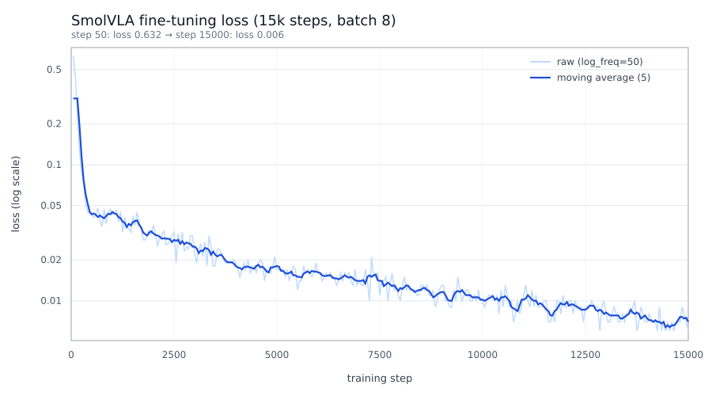

# 实验 1：SmolVLA 微调与闭环评测

## 1. 目标

在自建 PyBullet 抓取放置任务上，用自采集的 LeRobot 数据集微调 SmolVLA，回答三个问题：

1. 微调后的策略在**训练分布内**能否稳定完成任务；
2. 在**未参与训练的初始配置**上成功率下降多少；
3. 与**解析式专家**相比差距在哪，失败发生在哪个环节。

## 2. 环境

| 项 | 值 |
|---|---|
| 训练/评测主机 | 单张 NVIDIA A40 46 GB，Linux |
| Python / PyTorch | 3.10.18 / 2.6.0+cu124 |
| LeRobot | 0.3.3 |
| 仿真 | PyBullet DIRECT，240 Hz 物理步进，20 Hz 策略控制（每个动作保持 12 步） |
| 基座模型 | `lerobot/smolvla_base`（SmolVLM2-500M + 16 层 VLM + 动作专家） |
| 数据集 | `data/lerobot_panda_pick_place`，LeRobot v2.1 |

## 3. 数据集

- **规模**：150 条成功轨迹、26 317 帧，20 fps，256×256 RGB。
- **观测**：`top`（第三人称固定视角）+ `wrist`（腕部侧挂视角）；`observation.state` 为 7 个关节角 + 2 个手指实际开度（9 维）。
- **动作**：7 个关节目标角 + 1 个夹爪目标开度（8 维）。
- **任务文本**：`pick up the orange block and place it on the target position`。
- **采集**：`scripts/collect_atomic_vla_data.py`，解析式专家驱动，种子 20261021–20261170，随机化工件位置/朝向/摩擦。
- **质量校验**：`scripts/validate_atomic_dataset.py` → `results/experiment_1/validation_150/`，3 621 项检查、0 失败；动作与下一帧状态的相关系数 0.9997，单步最大动作跳变 0.036 rad。
- **统计量修复**：LeRobot 的 `aggregate_stats` 要求图像统计形状为 `(C,1,1)`，早期写入器产生的是 NHWC，导致数据集无法加载。已按 `(0,1,2)` 归约后 `squeeze + transpose(2,0,1)` 修正 `_video_stats`，并用 `scripts/repair_dataset_stats.py` 重写 `meta/episodes_stats.jsonl`；`server/probe_dataset.py` 验证 `LeRobotDataset` 可正常加载并含统计量。

## 4. 训练

| 项 | 值 |
|---|---|
| 初始化 | `lerobot/smolvla_base` |
| 训练步数 / batch | 15 000 步 / 8（4.56 个 epoch） |
| 优化器学习率 | 1e-4（动作专家），视觉编码器冻结（`freeze_vision_encoder=true`, `train_expert_only=true`） |
| 数据切分 | `eval_fraction=0.0`，150 条全部用于训练；泛化由独立测试种子单独评估 |
| 耗时 | 约 79 分钟（15:39 → 16:59，含每 1 500 步保存） |
| Loss | 0.632（50 步）→ 0.127（200 步）→ 约 0.006（15 000 步） |
| 产物 | `outputs/smolvla_panda/checkpoints/015000/pretrained_model` |
| 日志 / 曲线 | `results/experiment_1/training/train_smolvla.log`、`training_curve.csv`、`training_loss.svg` |



曲线由 `server/plot_training_curve.py` 从训练日志抽取 300 个 `log_freq=50` 记录点生成（原始点 + 5 点滑动平均，纵轴对数）。日志里的 `step` 只保留两位有效数字（`1K`/`15K`），脚本按行序号 × `log_freq` 还原真实步数。

微调后的 checkpoint 自带 `Normalize`/`Unnormalize` 统计量，可直接 `from_pretrained` 推理；基座 `smolvla_base` 的 mean/std 是 `inf`（未见过本数据集），因此**不能**作为未经微调的基线评测，本实验未报告基座成功率。

## 5. 评测协议

- **脚本**：`scripts/eval_vla_policy.py`，PyBullet DIRECT 闭环，策略每 20 Hz 观察一次。
- **成功判据**：工件抬升 ≥ 3 cm、最终位置距目标 ≤ 2 cm、抬升过程中滑落 ≤ 1.5 cm、静置时关节速度收敛且已松爪；单集上限 260 个控制周期（13 s 仿真）。
- **分布内（id）**：种子 20261021 起 20 个（与训练轨迹同种子，属"拟合/记忆"检验，**不是**泛化证据）。
- **留出（ood）**：种子 30000000 起 20 个，采集与训练均未使用。
- **执行方式**：`--n-action-steps` 控制每个动作块实际执行步数。`chunk50` 为策略默认（整块 50 步开环执行），`n10` 为每 10 步重新观察推理。评测不考虑 `n_action_steps` 之外的其他超参。
- **专家基线**：同一批留出种子，用解析式专家（`VLAExpertTask`）跑 20 集。
- **视频**：`--record-video` 以 20 fps 编码俯视帧，成功与失败分别命名。
- **延迟基准**：`server/bench_policy_latency.py`，固定输入测单次 chunk 前向与 chunk 内取动作耗时。

## 6. 结果

汇总见 `results/experiment_1/summary.md`。

### 6.1 成功率

| 组别 | 集数 | 成功 | 成功率 | 95% Wilson 区间 | 失败类型 |
|---|---|---|---|---|---|
| VLA id chunk50 | 20 | 13 | 65% | 43%–82% | not_lifted×6, hand_contact×1 |
| VLA id n10 | 20 | 15 | 75% | 53%–89% | not_lifted×4, slipped×1 |
| VLA ood chunk50 | 20 | 15 | 75% | 53%–89% | not_lifted×3, slipped×1, hand_contact×1 |
| VLA ood n10 | 20 | 10 | 50% | 30%–70% | not_lifted×8, slipped×2 |
| 专家 ood | 20 | 20 | 100% | 84%–100% | — |

- 微调后的策略在留出配置上最高 75%，明显低于专家的 100%，但已能完成完整抓取-搬运-放置（成功集平均抬升约 0.099 m、放置误差 ≤ 0.008 m，与专家同量级）。
- 分布内与留出没有出现"训练集过拟合式"差距（65%–75% vs 50%–75%），说明主要瓶颈不是记忆，而是对工件位置的视觉定位与抓取稳定性。
- n10 与 chunk50 的差异方向不一致：id 上 65%→75%，ood 上 75%→50%。同种子交叉表（ood）为：两者都成功 8、仅 chunk50 成功 7、仅 n10 成功 2、都失败 3，McNemar 精确检验 p≈0.18，**不显著**；20 集/组的样本量不足以判定执行步数优劣，因此不把 n10 作为"改进项"写入结论。

### 6.2 失败阶段

`ood n10` 的失败阶段分类（`failure_stage`）分布：

| 阶段 | 次数 | 典型表现 |
|---|---|---|
| approach/grasp | 8 | 抬升 < 1.3 cm，末态工件距目标 0.17–0.22 m，工件基本未移动 |
| lift/transport | 2 | 抬升 8–11 cm 后滑落（`object_slipped`） |
| place/release | 0 | — |

其余三组的失败阶段字段由任务在最终结算时写入（`settle`），未细分；按同一规则回看：`not_lifted` 全部属于 approach/grasp，`slipped` 属于 lift/transport，`hand_contact` 发生在接近-抓取段。合并四组 80 集（27 次失败），**约 78%（21/27）的失败是"根本没抓起工件"**，抓取成功后的放置环节只有滑落一类问题。

### 6.3 与专家对照（同 20 个留出种子）

| 指标 | 专家 | VLA ood chunk50 | VLA ood n10 |
|---|---|---|---|
| 成功率 | 100% | 75% | 50% |
| 平均抬升/m | 0.100 | 0.089 | 0.062 |
| 平均放置误差/m | 0.003 | 0.033 | 0.082 |
| 平均控制周期 | 176 | 131 | 133 |

专家用更多周期（更慢、更保守）换取稳定抓取；VLA 动作更快但失败集中在抓取前，说明其瓶颈是"看到工件并把手移到正确位置"，而非运动速度。

### 6.4 推理延迟

| 指标 | 数值 |
|---|---|
| 新 chunk 前向 mean / p50 / p95 | 288.0 / 278.8 / 354.5 ms |
| chunk 内取动作 mean / p95 | 3.5 / 3.9 ms |
| 按 n10 摊薄到每个控制周期 | ≈ 32 ms |

单次前向 288 ms，**无法**在 20 Hz（50 ms）下同步执行；必须依赖动作块缓存。n10 时平均每周期 32 ms，落在 50 ms 预算内，但仍有 355 ms 的尾部延迟，实际部署需要异步推理或降低控制频率。

评测记录的 per-tick 平均延迟为 37.9 ms，与上述摊薄估算一致。

### 6.5 关节越界与碰撞

- 策略输出在送进仿真前被 clip 到关节限位与速度范围内，**不存在越界指令**；实际跟踪误差平均 0.024 rad（约 1.4°），最大 0.344 rad（出现在快速转运段）。
- 非预期接触用"指尖接触采样数"作为代理指标：80 集中 `hand_contact` 失败 2 例（手掌/非指尖接触工件），其余集的指尖接触发生在正常抓取阶段。
- 未做独立的碰撞对（link-pair）统计，这是本实验的度量缺口，见第 8 节。

### 6.6 视频证据

`results/experiment_1/videos/`：

- `episode_30000000_ok.mp4`：成功，抓取-抬升-放置完整；
- `episode_30000012_fail_object_not_lifted.mp4`：失败，策略未接近工件，跑满 260 个周期；
- `episode_30000014_fail_object_slipped.mp4`：失败，抬起后滑落。

完整 20 集视频在服务器 `results/eval_smolvla_15k_ood_n10/episodes/videos/`。

## 7. 失败分析

1. **空抓（占全部失败约 78%）**：失败集的末态工件位置与初始位置几乎相同（距目标 0.17–0.22 m），抬升 < 1.3 cm，说明策略输出的整段轨迹没有落在工件上。视频中手臂常沿固定方向运动并在空处闭合夹爪，属于视觉定位/开环轨迹泛化失败，而非抓取力不足。
2. **抬起后滑落（4/27）**：留出 n10 组两例在 8–11 cm 高度滑落，可能是夹爪闭合时机或工件姿态导致的接触不足。
3. **非指尖接触（2 例）**：手腕/手掌先碰到工件，把工件推离原位置后才闭合。
4. **长尾耗时**：留出 n10 组的失败集平均 147 周期，其中 1 例跑满 260 周期；成功集平均 107 周期。失败不是"差一点"，而是轨迹方向性错误。

## 8. 局限

- 每组仅 20 集，成功率 95% 置信区间宽约 ±20 个百分点；n10 与 chunk50 的差异不显著，不能据此下结论。
- id 组与训练轨迹共用种子，只能说明拟合能力，不能说明泛化；泛化结论只来自 ood 组。
- 未评测基座模型（缺数据集统计量），因此没有"微调带来多少提升"的直接对照。
- 只评测了 15 000 步的单一 checkpoint，没有训练步数/数据量消融。
- 未统计逐对连杆碰撞，只用指尖接触作为代理。

## 9. 复现

```bash
# 采集 + 校验（本地或服务器）
python scripts/collect_atomic_vla_data.py --episodes 150 --seed-base 20261021
python scripts/validate_atomic_dataset.py --root data/lerobot_panda_pick_place --out results/experiment_1/validation_150

# 训练（服务器，单卡）
GPU=0 STEPS=15000 BATCH=8 WORKERS=8 \
OUT=/scratch/lijh/simulate_vla/outputs/smolvla_panda \
JOB=smolvla_panda bash server/train_smolvla.sh

# 闭环评测（留出集，n10 + 视频）
env CUDA_VISIBLE_DEVICES=0 HF_HUB_OFFLINE=1 venv/bin/python -u scripts/eval_vla_policy.py \
  --policy outputs/smolvla_panda/checkpoints/015000/pretrained_model \
  --n-action-steps 10 --record-video --episodes 20 --seed-base 30000000 \
  --out results/eval_smolvla_15k_ood_n10

# 专家基线
env CUDA_VISIBLE_DEVICES=1 venv/bin/python -u scripts/eval_vla_policy.py \
  --expert --episodes 20 --seed-base 30000000 --out results/eval_expert_ood

# 延迟基准
env CUDA_VISIBLE_DEVICES=0 HF_HUB_OFFLINE=1 PYTHONPATH=. venv/bin/python server/bench_policy_latency.py \
  --policy outputs/smolvla_panda/checkpoints/015000/pretrained_model --n-action-steps 10 --chunks 20

# 训练 loss 曲线（本地，纯标准库）
python server/plot_training_curve.py \
  --log results/experiment_1/training/train_smolvla.log --out results/experiment_1/training

# 汇总五组评测结果
python server/collect_eval_table.py \
  vla_id_chunk=results/experiment_1/eval/vla_id_chunk/eval.json \
  vla_id_n10=results/experiment_1/eval/vla_id_n10/eval.json \
  vla_ood_chunk=results/experiment_1/eval/vla_ood_chunk/eval.json \
  vla_ood_n10=results/experiment_1/eval/vla_ood_n10/eval.json \
  expert_ood=results/experiment_1/eval/expert_ood/eval.json
```

## 10. 结论

1. 自采 150 条轨迹足以让 SmolVLA 学会完整的抓取放置动作序列：留出配置最高 75% 成功率，成功集放置误差 ≤ 1 cm。
2. 与解析式专家（100%）的差距集中在**抓取前的视觉定位**，而非放置精度；约 78% 的失败是"没碰到工件"。
3. 单次策略前向 288 ms（p95 355 ms）无法同步支撑 20 Hz，部署必须用动作块缓存 + 异步推理。
4. 动作块执行步数（50 vs 10）在当前样本量下没有可辨识的一致收益，需要每组 ≥100 集才能做出可靠判断。
