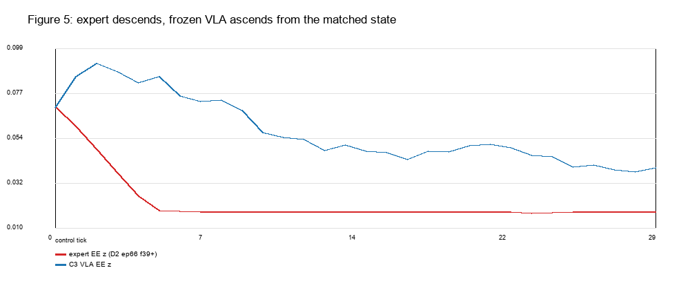
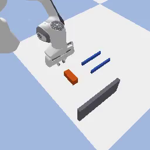
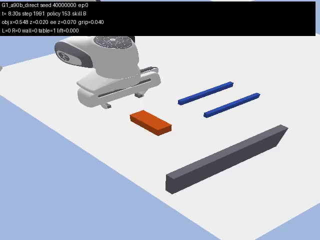

# 实验 2.5 补充诊断：C3 启动状态与 D2 训练状态的最近邻覆盖（全帧版）

## 结论（先给实际数字）

**Q1：C3 与 D2 B 训练起点的最小七关节距离是多少？对应哪个 episode？HOME 还是 diverse？**

**0.913643 rad**（seed 40000000；另外两个 C3 为 0.912133 / 0.907898），
对应 **D2 B 数据集 episode 74**（collection index 74），
**diverse**（`mode=task_relevant`，`home_distance_rad=1.0504`），`group=yaw90`，成功示范。
C3 的三个 seed 都指向同一个最近起点。

**Q2：C3 与 D2 B 所有训练轨迹中间帧的最小七关节距离是多少？对应哪条轨迹第几帧？**

- 全部中间帧：**0.118369 rad**，**episode 22，frame 39**，`progress=0.305`（长度 127）。
  另外两个 C3：0.119723 / 0.116190，同样指向 ep22 f39。
- **任务几何匹配（yaw90）的中间帧**：**0.171040 rad**，**episode 66，frame 39**，
  `progress=0.331`（长度 118）；另外两个 C3：0.172844 / 0.171860，同样 ep66 f39。
- 注意：ep22 是 **yaw0**（物体长轴 Y），与 C3 的 yaw90 任务几何不同；它只是关节空间更近。
  **ep66 才是 task-compatible 的最近中间帧。**

**Q3：最近训练起点和最近训练中间帧，哪个在关节空间更接近 C3？相差多少？**

中间帧显著更近：

- start：**0.9136 rad**；
- interior（全部）：**0.1184 rad**，比 start 近 **0.795 rad**；
- interior（yaw90）：**0.1710 rad**，比 start 近 **0.743 rad**。

**Q4：在末端—物体相对位置、姿态、夹爪开度方面，这些最近邻是否仍然接近？**

- **start ep74**：EE 世界位置差 **152.4 mm**，EE–物体相对位置差 **149.5 mm**，
  EE 姿态差 **0.0°**，物体 yaw 差 **2.19°**，墙间隙差 **3.35 mm**；
  训练夹爪开度缺失（D2 元数据未存）。
- **interior ep66 f39（yaw90，task-compatible）**：
  EE 世界位置差 **7.70 mm**，物体位置差 **6.98 mm**，
  **EE–物体相对位置差 1.87 mm**，物体 yaw 差 **2.19°**，墙间隙差 **1.73 mm**，
  夹爪 **0.0140 m（专家）vs 0.0166 m（C3）**，差 2.56 mm，且两者都是闭合状态。

所以：**起点只是关节构型“有点近”，完整物理状态并不近；任务匹配的中间帧 ep66 f39 才是真正的完整状态近邻**。

**Q5：D2 是否存在多条不同的 B 示范经过 C3 附近，还是只有个别偶然接近的帧？**

- 全帧、不筛任务：top-20 来自多条示范（ep22、12、38、52、54…），但在 yaw0/yaw90 之间混合。
- **筛到 yaw90（任务兼容）后，top-20 全部来自同一条示范 ep66 的相邻帧（f34–f43）**；
  不同示范数 = **1**。
- 因此：**存在一条训练轨迹经过了几乎相同的状态；没有多条 task-compatible 示范支持它。**
  这是“单条轨迹覆盖”，不是“多示范密集覆盖”。

**Q6：最接近的训练中间帧处于什么操作阶段？后续专家动作是什么？**

ep66 f39，`progress=0.331`，是 **approach-to-contact 的下降阶段**（wrist 图像显示手指在物体上方，尚未接触）。
后续 6 个控制帧（20 Hz）专家：

- EE z：**0.0700 → 0.060 → 0.0486 → 0.0373 → 0.0258 → 0.0186 → 0.0182 m**（单调下降）；
- 夹爪：始终保持 **0.014 m**（闭合）；
- 第 45 帧 top 图显示夹爪已到物体上方/接触位置，随后进入推动。

**Q7：最近训练帧之后，C3 的冻结 VLA 与专家动作有什么实际差异？**

从几乎相同的状态（EE 差 7.7 mm、相对几何差 1.9 mm、夹爪差 2.6 mm）出发：

| tick | 专家 EE z (m) | C3 VLA EE z (m) |
|---:|---:|---:|
| 0 | 0.0700 | 0.0696 |
| 2 | 0.0486 | **0.0917** |
| 4 | 0.0258 | **0.0820** |
| 6 | 0.0182 | **0.0757** |
| 10 | 0.0180 | 0.0573 |

- 专家：**继续下降**，夹爪保持 0.014 m，去建立推动接触；
- C3 VLA：前 2–6 个 tick **先上升 2.2 cm**，夹爪 0.0166→0.0172（仍闭合），随后才缓慢下降。
- 这不是“闭爪差异”——两者都已经闭合；差异是**垂直运动方向/阶段**。

**Q8：C3 更像是完全未覆盖的状态，还是已出现于训练数据、但模型无法可靠利用的状态？**

**在起点层面：未覆盖（outlier）。** 0.9136 rad 大于 D2 全部 120 个起点内部最近邻的 max **0.430 rad**；
C3 在起点参考分布中为 100 百分位。

**在中间轨迹/完整物理状态层面：被覆盖，而且是单条 task-compatible 轨迹覆盖。**
ep66 f39 与 C3 的 q 距离仅 **0.171 rad**，EE 差 7.7 mm、相对几何差 **1.9 mm**、
夹爪差 2.6 mm、yaw 差 2.2°；该帧在 D2 内部“episode 到其他轨迹”的距离分布中位于 **62.5 百分位**（不异常）。

**所以现有证据更支持：C3 的启动状态在训练轨迹中出现过（单条示范），但冻结 VLA 没有从该状态产生专家那样的下降/接触动作。**
这不是“完全未见过的状态”，也不是“多示范覆盖充分”；更准确的表述是：

> **起点未覆盖、中间状态被单条 task-compatible 示范覆盖，但模型未能利用该状态的动作。**

必须保留的不确定性：
- 专家帧是**一条已经执行到 33% 的轨迹的中间帧**，C3 是**新策略启动**；State Coverage ≠ Successful Launch Capability。
- 训练每帧的物体真值/接触模式没有存进 parquet；ep66 f39 的相对几何用 `start_ee`→f39 FK 与 `D2_episodes` 的**起始物体位置**计算，假设该帧物体尚未移动（wrist 图支持尚未接触，但不是逐帧物体真值）。
- 只有 3 个 C3 seed，且只有一个 task-compatible 训练 episode；不能外推到所有 C3 或所有 yaw90。

---

## 1. 数据标识与口径

| 项 | 值 |
|---|---|
| D2 checkpoint | `outputs/smolvla_e23_D2/checkpoints/020000/pretrained_model` |
| sha256 | `34a6e3080a88250302a9f0abbc01608b58097324af2c321b00b84c395fbdd58b` |
| B 训练数据 | `data/_shards_e23/B_D2`（120 episodes，14,653 frames，task `push ... positive X ... wall`） |
| D2 全集 | `data/lerobot_panda_e23_D2`（480 episodes / 68,892 frames；B 为其中 120 条） |
| 起点/场景元数据 | `results/experiment_2_3/data/D2_episodes.jsonl`（120 条 success/reason=ok） |
| C3 查询 | `results/experiment_2_5/G1/C3/seed_{40000000,40000001,40000002}` 的首个 `skill=='B'` 控制周期 |
| 关节顺序 | `panda_joint1..7`，rad |
| 距离 | `dq = ||q_C3 − q_train||_2` |
| 物体 yaw | 矩形块 4×10×4 cm，周期 π；`yaw_diff=min(|wrap(Δ)|, π−|wrap(Δ)|)` |

B shard 与 collection metadata 的起点对齐：120 条 episode 的 first-frame q 与 `D2_episodes` 的 `start_q` 最近匹配，**最大残差 1.6e-7 rad**，可认为一一对应。

## 2. 三个 C3 查询

| seed | q 距离起点 min | q 距离 interior min | interior ep/frame (progress) | yaw90 interior ep/frame | yaw90 dq |
|---:|---:|---:|---|---:|---:|
| 40000000 | 0.913643 | **0.118369** | ep22 f39 (0.305) | ep66 f39 (0.331) | **0.171040** |
| 40000001 | 0.912133 | 0.119723 | ep22 f39 (0.305) | ep66 f39 (0.331) | 0.172844 |
| 40000002 | 0.907898 | 0.116190 | ep22 f39 (0.305) | ep66 f39 (0.331) | 0.171860 |

查询状态（seed 40000000）：

```text
q = [0.70472, 0.33588, -0.28329, -2.43388, 0.24138, 2.74713, 0.99882]
EE = (0.44975, 0.18298, 0.06957)
Object = (0.54794, 0.18289, 0.01999)
Object yaw = -89.81°
Gap = 0.18199 m
Grip = 0.040 m at first B observation; first B command closes to 0.01656
```

## 3. 参考分布

| 参考 | median | p95 | max |
|---|---:|---:|---:|
| B 起点内部 NN（120） | 0.0（重复 HOME） | 0.292 | **0.430** |
| 每条 B 轨迹到其他轨迹的 interior 最小距离（120） | 0.0（HOME 近似重复） | 0.261 | **0.430** |
| **C3 start** | — | — | **0.914（超出 max）** |
| **C3 interior（yaw90）** | — | — | **0.171（约 62.5 百分位）** |

参考分布只用于校准几何密度，不是成功阈值。

## 4. 物理状态对比

### 4.1 最近起点 ep74

- q 0.9136 rad；EE 152.4 mm；相对 EE–物体 149.5 mm；
- 姿态 0.0°（FK 重建）；物体 yaw 2.19°；墙间隙 3.35 mm；
- 训练夹爪开度缺失。

### 4.2 最近 task-compatible 中间帧 ep66 f39

- episode 66（collection index 66，`task_relevant`，yaw90），起点物体 `(0.54628, 0.17611, 0.01999)`、yaw 1.519 rad；
- q 0.1710 rad；EE 7.70 mm；物体位置 6.98 mm；相对 EE–物体 **1.87 mm**；
- 姿态差：**未存逐帧姿态**；用 q FK 的 EE 方向比较，C3 与 ep66 的腕部构型接近（关节差见 CSV）。
- 夹爪 0.0140 vs 0.0166 m（差 2.6 mm，均闭合）；
- 墙间隙 0.18372 vs 0.18199 m（差 1.73 mm）；
- 体素/接触：训练无逐帧接触标签；wrist 图显示 f39 尚未接触。

## 5. 专家后续动作 vs C3 VLA

ep66 f39 后续（20 Hz，原始专家）：

```text
t=0  EE z 0.0700  grip 0.014
t=1  EE z 0.0600  grip 0.014
t=2  EE z 0.0486  grip 0.014
t=3  EE z 0.0373  grip 0.014
t=4  EE z 0.0258  grip 0.014
t=5  EE z 0.0186  grip 0.014
t=6  EE z 0.0182  grip 0.014
```

C3 VLA（同一冻结 D2 checkpoint，从 C3 首个 B tick 起）：

```text
t=0  EE z 0.0696  grip 0.0166
t=1  EE z 0.0852  grip 0.0172
t=2  EE z 0.0917  grip 0.0174
t=3  EE z 0.0876  grip 0.0172
t=4  EE z 0.0820  grip 0.0166
t=5  EE z 0.0850  grip 0.0169
t=6  EE z 0.0757  grip 0.0167
```

差异不是夹爪（两者闭合），而是**前 6 个 tick 的垂直方向**：专家下降 5.2 cm，VLA 先上升 2.2 cm 再回落。C3 的 B 最终 0/3 成功、max lift <1 cm（2.5），与“从匹配状态出发却没有建立推动接触”一致。

## 6. 图表与匹配帧

- Figure 1：起点最近邻（yaw90）柱状图。
- Figure 2：三个 C3 的 start / interior(all) / interior(yaw90) 距离。
- Figure 3：C3、最近起点、最近中间帧的七关节对比。
- Figure 4：C3 与 ep66 f39 的相对 EE–物体位置（x-z）。
- Figure 5：ep66 f39 之后专家 vs C3 VLA 的 EE z。
- Figure 6：D2 内部参考分布与 C3 距离。
- `matched_frames/`：D2 ep66 top/wrist f39 与 f45，C3 seed 40000000 top/contact f153（原始训练视频抽帧，不是重渲染）。






## 7. 交付文件

```text
results/experiment_2_5/d2_c3_coverage/
  c3_query_states.csv
  d2_b_state_manifest.csv
  initial_nn.csv
  initial_nn_yaw90.csv
  interior_nn.csv
  interior_nn_yaw90.csv
  all_frame_nn.csv
  episode_deduplicated_nn.csv
  reference_distance_distribution.csv
  nearest_trajectory_comparison.csv
  nearest_trajectory_comparison_yaw90.csv
  analysis_summary.json
  analysis_config.json
  figures/fig1..fig6
  matched_frames/
docs/experiment_2_5_d2_coverage.md
scripts/analyze_d2_c3_full.py
scripts/extract_c3_match_frames.py
```

## 8. 解释边界

- **State Coverage**：ep66 f39 证明训练中存在几乎相同的状态（q 0.171 rad，相对几何 1.9 mm）。
- **Action Coverage**：该帧之后专家有明确的下降/接触动作；但不能仅凭“专家动作存在”证明模型能产生它。
- **Successful Launch Capability**：C3 VLA 从该状态启动后 0/3，前 6 tick 方向与专家相反；这是能力问题，不是状态完全未覆盖。
- 训练帧是**已经执行 33% 的中间帧**；C3 是连接器结束后的新启动。两者即便状态相同，策略的“阶段上下文”可能不同（图像历史、动作队列不同）。
- 每帧物体/接触真值缺失：ep66 f39 的相对几何用起点物体位置近似；wrist 图显示尚未接触，但不能替代逐帧真值。
- 只有 3 个 C3 seed，task-compatible 训练轨迹只有 1 条；统计上只能作为机制证据，不是总体成功率结论。
