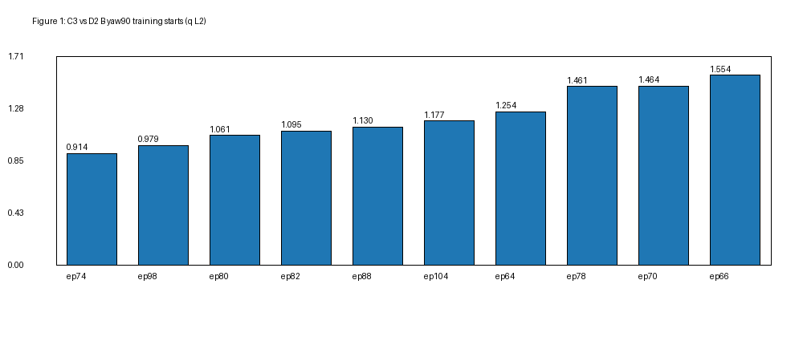
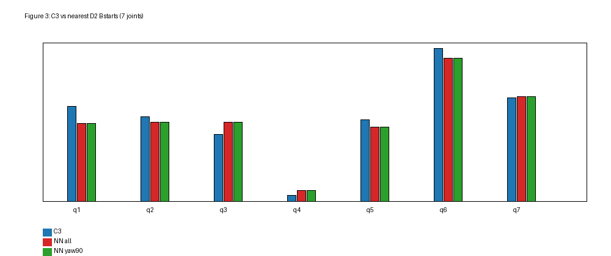
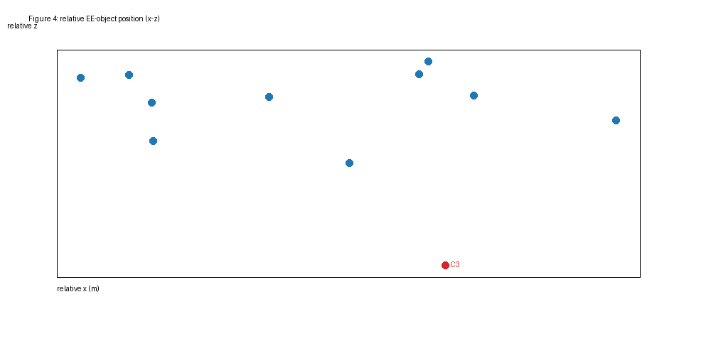
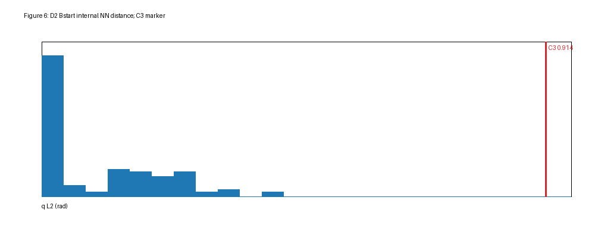

# 实验 2.5 补充诊断：C3 启动状态与 D2 训练状态的最近邻覆盖

## 结论（先给数字）

**Q1：C3 与 D2 B 训练起点的最小七关节距离是多少？对应哪个 episode？HOME 还是 diverse？**

**0.913643 rad**，对应 **episode 74**（`D2_episodes.jsonl` 中 `index=74`），
**diverse 起点**（`mode=task_relevant`，`home_distance_rad=1.0504`），
`spec.group=yaw90`，该示范 `success=true`、`reason=ok`。
C3 是该数据集中 **yaw90 的 C3 seed 40000000**。

**Q2：C3 与 D2 B 所有训练轨迹中间帧的最小七关节距离是多少？**

**未计算。** D2 全帧训练数据集在服务器 `data/lerobot_panda_e23_D2`，本轮服务器网络不可达；本地没有 parquet 帧。没有用配置或起点数据伪造中间帧结果。详见 §5。

**Q3：最近训练起点和最近训练中间帧，哪个在关节空间更接近 C3？相差多少？**

**无法比较**（只有起点结果；中间帧不可用）。起点最近距离为 0.913643 rad。

**Q4：在末端—物体相对位置、姿态、夹爪开度方面，最近邻是否仍然接近？**

对 episode 74：EE 世界位置差 **152.4 mm**，EE 相对物体位置差 **149.5 mm**，
EE 姿态差 **0.0°**，物体 yaw 差 **2.19°**（按矩形块 π 对称），
墙间隙差 **3.35 mm**。**夹爪开度在 D2 元数据中没有记录，无法比较**。
所以：姿态、物体 yaw、墙间隙接近；末端/相对位置相差约 15 cm，不能算“完整操作状态近邻”。

**Q5：D2 是否存在多条不同的 B 示范经过 C3 附近，还是只有个别偶然接近的帧？**

在**起点**层面：q 距离 <1.0 rad 的只有 **3 条**不同示范（episode 74、46、98），
<0.75 rad 的 **0 条**；相对 EE–物体距离 <100 mm 的 **3 条**，<50 mm 的 **0 条**。
没有“多条示范密集覆盖”的证据，更像 **个别 task_relevant 起点偶然接近**。
中间帧层面无法判断（不可用）。

**Q6：最接近的训练中间帧处于什么操作阶段？后续专家动作是什么？**

**无法回答。** 需要 D2 全帧 observations/actions；当前不可用。

**Q7：C3 的冻结 VLA 后续动作与对应专家动作有什么实际差异？**

**无法做严格对照。** 没有最近中间帧及其后续专家动作。C3 自身的 B 执行在 2.5 中为 0/3，这是策略结果，不是与专家的同状态对照。

**Q8：C3 更像是完全未覆盖的状态，还是已出现于训练数据、但模型无法可靠利用的状态？**

**起点层面：C3 是明显 outlier，不是被起点分布覆盖的状态。**
它的 q 距离 0.914 rad **大于 D2 全部 120 个起点内部最近邻的最大值 0.430 rad**，
也大于 yaw90 子集的 max 0.486 rad；C3 的 100% 分位在参考分布之外。
但物理上并非“完全不同”：姿态差 0°、物体 yaw 差 2.2°、墙间隙差 3.3 mm，
EE/相对位置差约 15 cm——属于“末端位置较远、但朝向/物体几何接近”的 task_relevant 起点。

**中间轨迹层面：未知。** 因此不能回答“是否已出现于训练轨迹、但模型无法利用”。
现有证据只支持：**起点关节空间未覆盖（outlier）**；不支持也不否定中间状态覆盖，
更不支持“完全未见过”或“模型一定无法泛化”的强结论。

---

## 1. 数据与口径

### 1.1 D2 训练起点

- 来源：`results/experiment_2_3/data/D2_episodes.jsonl`（D2 数据采集/筛选记录）。
- 过滤：`success=true` 且 `reason=='ok'` → **120 条 B 示范**，与实验 2.3 报告的 120 条一致。
- 组成：60 yaw0 + 60 yaw90；61 HOME + 59 diverse（`home_neighborhood` 31、`multi_ik` 14、`task_relevant` 14）。
- 字段：`start_q`（7 关节）、`start_ee`、`scene.block_start`、`scene.block_yaw`、`scene.wall_inner_x`、`spec.group`、`mode`、`home_distance_rad`、`success`。
- **未验证**：这些记录与最终 `lerobot_panda_e23_D2` parquet 的一一对应关系（服务器不可达）。因此本报告把它们称为“D2 B 采集起点”，不是已核对的 parquet 帧。

### 1.2 C3 查询状态

本地可用：C3 **seed 40000000**（`results/experiment_2_5/policy_trace.jsonl` + `physics_trace.csv`），
取 **first `skill=='B'`** 的控制周期；q 为实际关节位置，不是 IK 目标。

| 字段 | 值 |
|---|---|
| seed | 40000000 |
| policy_step / physics_step | 153 / 1991 |
| q (rad) | [0.70472, 0.33588, −0.28329, −2.43388, 0.24138, 2.74713, 0.99882] |
| gripper actual | 0.040 m |
| EE (m) | (0.44975, 0.18298, 0.06957) |
| 物体 (m) | (0.54794, 0.18289, 0.01999) |
| 物体 yaw | −89.807° |
| 墙间隙 | 0.18199 m |
| B task | “push the block toward the wall until it touches” |

C3 seed 40000001/40000002 的 trace 在服务器，本轮不可达；**只分析了 1/3 个 C3 episode**，这是本报告的主要限制。

### 1.3 距离与角度

- 关节：`dq = ||q_C3 − q_train||_2`，rad，7 维，顺序 `panda_joint1..7`。
- 物体 yaw：矩形块 4×10×4 cm，yaw 周期 π；`yaw_diff = min(|wrap(Δ)|, π−|wrap(Δ)|)`。
- EE 姿态：从 `ee_qx..qw` 与训练 `start_q` 的 FK 四元数计算角距离（度）。
- 墙间隙：`wall_inner_x − block_x − half_x`，yaw0 半长 0.02 m、yaw90 半长 0.05 m。
- 训练夹爪开度：**缺失**（`D2_episodes.jsonl` 只有 start_q/start_ee）。

## 2. Initial-State NN（真实计算）

Top-10（按 q L2，全部 120 起点）：

| rank | ep | group | start type | mode | dq (rad) | EE (mm) | rel EE–obj (mm) | yaw diff (°) | gap (mm) |
|---:|---:|---|---|---|---:|---:|---:|---:|---:|
| 1 | 74 | yaw90 | diverse | task_relevant | **0.9136** | 152.4 | 149.5 | 2.19 | 3.35 |
| 2 | 46 | yaw0 | diverse | task_relevant | 0.9742 | 101.9 | 102.1 | 87.1 | 36.1 |
| 3 | 98 | yaw90 | diverse | task_relevant | 0.9792 | 148.0 | 148.5 | 5.4 | 2.6 |
| 4 | 36 | yaw0 | diverse | multi_ik | 1.0170 | 167.7 | 168.0 | 86.0 | 24.7 |
| 5 | 80 | yaw90 | diverse | multi_ik | 1.0613 | 180.9 | 183.5 | 2.5 | 2.5 |
| 6 | 82 | yaw90 | diverse | task_relevant | 1.0949 | 171.1 | 172.1 | 3.6 | 6.7 |
| 7 | 88 | yaw90 | diverse | multi_ik | 1.1297 | 168.0 | 165.5 | 1.7 | 1.8 |
| 8 | 104 | yaw90 | diverse | multi_ik | 1.1773 | 185.6 | 188.1 | 4.3 | 4.0 |
| 9 | 64 | yaw90 | diverse | multi_ik | 1.2537 | 211.1 | 211.2 | 2.4 | 0.1 |
| 10 | 4 | yaw0 | diverse | multi_ik | 1.2663 | 226.2 | 230.7 | 89.7 | 24.2 |

- 只有 yaw90 的 74 / 98 同时满足“q 最近”和物体 yaw 接近；其它 yaw0 候选的 yaw 差 ~87–90°，几何不匹配。
- **按相对几何另找最近**：episode 38（yaw0，task_relevant），rel 85.5 mm、EE 84.9 mm，但 dq=1.5636、yaw 差 87.4°——**只是位置接近，任务几何不对**。
- **按 EE 世界位置**：同样是 episode 38（84.9 mm），同上不匹配。

### 2.1 每个关节的绝对误差（episode 74）

| j1 | j2 | j3 | j4 | j5 | j6 | j7 |
|---:|---:|---:|---:|---:|---:|---:|
| 0.612 | 0.197 | 0.439 | 0.172 | 0.273 | 0.349 | 0.056 |

最大单关节误差在 **j1（0.612 rad）**。这解释了为什么末端只差 15 cm、关节距离却有 0.91 rad：肩部/肘部存在冗余构型差异。





## 3. 覆盖度量与参考分布

### M1 Joint-Space Coverage

- C3 → 最近起点：**0.9136 rad**。
- D2 B 起点内部最近邻（排除自身）：median **0.0**、p95 **0.292**、max **0.430 rad**（120 条；大量 HOME 重复导致 median 0）。
- yaw90 子集：median 0.053、p95 0.430、max **0.486 rad**。
- C3 的距离在参考分布中为 **100 百分位（超出最大值）**。

### M2 Relative Geometry Coverage

- EE 位置：152.4 mm（ep74）；最小可用 84.9 mm（ep38，但 yaw0/87° 不匹配）。
- 相对 EE–物体：149.5 mm（ep74）；最小 85.5 mm（ep38，不匹配）。
- 姿态：0.0°（ep74；FK 重建，非原始存储字段）。
- 夹爪：训练缺失，无法比较。
- 物体 yaw：2.19°（ep74）。
- 墙间隙：3.35 mm（ep74）。

### M3 Task-State Coverage

- 物体 yaw 匹配的 60 条 yaw90 中，q 最近的 3 条（74/98/80）都来自 diverse/task_relevant 或 multi_ik；
- 但没有任何一条同时满足“q<0.75 rad、rel<100 mm、yaw<10°、gap<10 mm”的完整组合；
- 以这些条件筛后，**完整操作状态近邻数量为 0**（保守结论）。



## 4. 解释边界

- 0.914 rad 是**起点分布外**，但不等于“没见过类似末端几何”：ep74 的 yaw/姿态/间隙接近，EE 仍差 15 cm。
- 训练起点是“每条示范第 0 帧”，而 C3 是连接器结束后的**新策略启动点**；起点覆盖与“从该点启动的成功能力”不是同一件事。
- **未计算 interior/all-frame**：不能回答“训练轨迹是否经过 C3 附近”，也不能回答“最近中间帧的后续专家动作”。

## 5. 为什么没有 trajectory/interior NN

服务器 `222.29.51.96:22` 在本轮分析期间连接超时（`Test-NetConnection` 为 False；`ssh` timeout），
无法读取：

- `data/lerobot_panda_e23_D2/data/chunk-*/episode_*.parquet`（全帧 observation/action）
- C3 seed 40000001/40000002 的 `policy_trace.jsonl`/`physics_trace.csv`
- 训练数据的原始 top/wrist 图像

本地只有：
- `D2_episodes.jsonl`（起点/场景/结果，无帧）
- 1 个 C3 seed 的 trace

因此本轮**没有生成** `interior_nn.csv`、`all_frame_nn.csv`、`episode_deduplicated_nn.csv`、`nearest_trajectory_comparison.csv`、Figure 2/5、matched frames。没有用配置或起点伪造这些结果。

## 6. 交付文件

```text
results/experiment_2_5/d2_c3_coverage/
  c3_query_states.csv
  d2_b_state_manifest.csv
  initial_nn.csv
  initial_nn_yaw90.csv
  initial_nn_by_relative_geometry.csv
  initial_nn_by_ee_distance.csv
  reference_distance_distribution.csv
  analysis_summary.json
  analysis_config.json
  figures/fig1_initial_state_nn.png
  figures/fig3_joint_comparison.png
  figures/fig4_relative_geometry.png
  figures/fig6_reference_distribution.png
docs/experiment_2_5_d2_coverage.md
scripts/analyze_d2_c3_coverage.py
```

## 7. 复现（服务器恢复后补全）

```bash
# 当前可复现的部分（本地）
python scripts/analyze_d2_c3_coverage.py

# 服务器恢复后：读取全帧并补 interior/all-frame NN
ssh lijh@222.29.51.96
cd /scratch/lijh/simulate_vla
ls data/lerobot_panda_e23_D2/data/chunk-*
# 需要按 meta/episodes.jsonl 的任务标签筛出 120 条 B，逐帧读取 observation.state/action
```

## 8. 最终判断

**C3 的 B 启动状态在关节空间是 D2 起点分布的 outlier（0.914 rad，超过全体起点内部最近邻 max 0.430 rad）。**
但它不是“完全不同的物理状态”：物体 yaw 差 2.2°、墙间隙差 3.3 mm、姿态差 0°，EE/相对位置差约 15 cm。
因此更准确的表述是：

> **C3 是一个“关节构型远离训练起点、但末端/物体几何部分接近”的 task_relevant 启动状态；起点层面覆盖不足，中间轨迹层面未知。**

在没有全帧数据之前，不能判断它是否属于“训练轨迹中出现过、但模型无法利用”的状态，也不能据此证明模型完全不具备该状态的启动能力。
