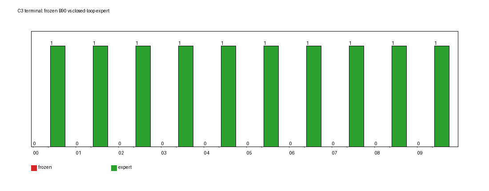
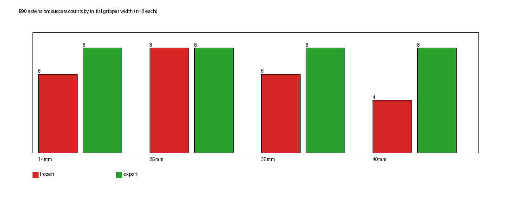

# 实验 2.6 补充：真实 C3 终态启动 B90 与 B90 夹爪扩展

## 摘要

本轮只做 yaw90 冻结 D2 验证，不训练、不改 C3、不改判据。

- **C3 真实终态**：从 A90 成功 + 原 C3 prepush 连接器结束、B 尚未执行的真实快照出发。
  - 10 个独立 C3 终态，快照恢复误差 **q=0、夹爪=0、物体=0**。
  - **独立冻结 B90：0/10**；原 C3 切换基线（2.5）也是 0/3。两者控制路径等价，独立启动没有改善。
  - **闭环 B90 专家：10/10**。同一个真实状态专家能完成，冻结 D2 不能。
- **B90 夹爪扩展**：8 条不同 yaw90 轨迹的 f39 中间状态 × 4 种夹爪开度 × 专家/冻结 D2 = **64 次真实执行**。
  - 专家 **32/32**；冻结 D2 **24/32**。
  - 开度 14 mm：6/8；25 mm：**8/8**；35 mm：6/8；40 mm：**4/8**。
  - 8 个“专家成功、冻结失败”组合，分布在 **6 条不同轨迹**。
- **C3 与 B90 状态**：10 个 C3 终态的最近 B90 状态**全部是 ep66 f39**；q 距离 0.171–0.187 rad，EE 差 4.6–11.4 mm，相对 EE–物体差 1.8–1.9 mm；C3 夹爪 40 mm。
- **接触差异**：C3 冻结 10/10 首次接触是 **左指 link9**，**8/10** 最终翻倒（tilt 29–78°）；闭环专家 8/10 首次接触是 **右指 link10**，全部成功。C3 的失败不是“没有接触”，而是接触后的抬升/翻转。

---

## 1. 设置

| 项 | 值 |
|---|---|
| checkpoint | `outputs/smolvla_e23_D2/checkpoints/020000/pretrained_model` |
| sha256 | `34a6e3080a88250302a9f0abbc01608b58097324af2c321b00b84c395fbdd58b` |
| Git 基线 | `a0d6377` + 本轮工作区 |
| 仿真 | PyBullet 240 Hz / 20 Hz 策略 / 12 substeps |
| 判据 | 统一 v2.2（gap≤2cm、\|dy\|≤2cm、dyaw≤15°、tilt≤12°、speed<0.01，1 s 静置复核） |
| 视频 | top / side / contact / comparison / events，640×480，20 fps |

未改 C3 连接器（沿用 2.5 的 `prepush`：IK 到物体后方 `(obj_x−0.10, obj_y, 0.07)`，yaw=0），未改 action chunk，未重训。

## 2. C3 真实终态如何获得

`scripts/run_experiment_2_5.py --condition C3_snapshot`：

1. 真实运行 A90 到 v2.2 成功；
2. 执行原 C3 `prepush()` 连接器（连续关节运动）；
3. 在连接器结束、第一次 B 推理之前：
   - `p.saveBullet` 保存完整物理快照；
   - 记录 q/dq、两指实际位置/速度、EE 位姿、物体位姿/线速度/角速度、夹爪目标、连接器阶段；
4. 不执行 B，直接结束。

10 个 seed（40000000–40000009）全部得到有效 C3 终态。恢复审计：

| seed | q 误差 (rad) | 夹爪误差 (m) | 物体误差 (mm) |
|---:|---:|---:|---:|
| 40000000–40000009 | **0.0** | **0.0** | **0.0** |

`C3_direct_B90/state_restore_audit.csv`。

### 2.1 C3-B0 与 C3-B1 是否等价

- C3-B0（2.5 原始切换）：连接器结束后 `run_b()`，`policy.reset()`，语言为 B；
- C3-B1（本轮独立 B90）：从快照恢复，调用同一个 `run_b()`，`policy.reset()`，同一语言、同一 checkpoint。

两者在**策略调用语义上等价**；唯一区别是 B1 经过 Bullet 快照恢复。恢复误差为 0，所以本轮把它们视为同一控制条件的独立复现，没有制造虚假的“两个不同实验”。

## 3. 实验一：C3 终态执行结果

| 条件 | n（独立状态） | 成功 | max lift 均值 | 首次接触 link | 翻倒（tilt>20°） |
|---|---:|---:|---:|---|---:|
| 原 C3（2.5，B0） | 3 | **0** | 0.83 cm | — | — |
| 独立冻结 B90（B1） | 10 | **0** | 1.91 cm | **link9 ×10** | **8/10** |
| 闭环专家 B90（B2） | 10 | **10** | 0.12 cm | link10 ×8，link9 ×2 | 0/10 |

C3 冻结 D2 的 10 个终态：

| seed | frozen 成功 | frozen max lift | frozen final tilt | expert 成功 |
|---:|---|---:|---:|---:|
| 40000000 | ❌ | 3.55 cm | 78.1° | ✅ |
| 40000001 | ❌ | 2.58 cm | 29.0° | ✅ |
| 40000002 | ❌ | 1.90 cm | 35.2° | ✅ |
| 40000003 | ❌ | 0.72 cm | 0.003° | ✅ |
| 40000004 | ❌ | 0.77 cm | 33.6° | ✅ |
| 40000005 | ❌ | 3.15 cm | 0.008° | ✅ |
| 40000006 | ❌ | 0.83 cm | 45.0° | ✅ |
| 40000007 | ❌ | 3.37 cm | 74.4° | ✅ |
| 40000008 | ❌ | 1.48 cm | 58.1° | ✅ |
| 40000009 | ❌ | 0.72 cm | 29.4° | ✅ |

**Q1：** 独立 B90 0/10，与原 C3 0/3 无区别；独立启动语义没有修复该状态。
**Q2：** 闭环专家 10/10；真实 C3 终态是**专家可执行**的。

## 4. 实验二：B90 夹爪扩展

### 4.1 状态

8 条不同 yaw90 成功 B 轨迹的 f39 中间状态：

`ep064_f039, ep066_f039, ep074_f039, ep080_f039, ep082_f039, ep088_f039, ep098_f039, ep104_f039`

每条用 replay 重建，q 误差 ≤3.9×10⁻⁶ rad；夹爪为训练观测 0.014 m。

每个状态 4 种初始开度（单指 14/25/35/40 mm），专家和冻结 D2 从同一 Bullet 快照分别启动；共 **8×4×2=64 次**。

### 4.2 初始合法性

32 个“状态×开度”组合：

- 请求宽度与实际宽度一致；
- 建立后物体位移最大 **0.158 mm**、倾角变化最大 **0.29°**；
- 全部通过 `valid=true`（阈值 2 mm / 2°），没有 `state_reconstruction_failed`；
- 没有通过移动物体或改 q 来“修正”状态。

### 4.3 结果

| 开度 | n | 专家成功 | 冻结 D2 成功 |
|---:|---:|---:|---:|
| 14 mm | 8 | **8/8** | **6/8** |
| 25 mm | 8 | **8/8** | **8/8** |
| 35 mm | 8 | **8/8** | **6/8** |
| 40 mm | 8 | **8/8** | **4/8** |
| 合计 | 32 | **32/32** | **24/32** |

逐状态冻结 D2（✅/❌，宽度 14/25/35/40）：

| state | 14 | 25 | 35 | 40 |
|---|---|---|---|---|
| ep064_f039 | ✅ | ✅ | ✅ | ✅ |
| ep066_f039 | ✅ | ✅ | ✅ | ❌ |
| ep074_f039 | ❌ | ✅ | ✅ | ❌ |
| ep080_f039 | ✅ | ✅ | ✅ | ❌ |
| ep082_f039 | ✅ | ✅ | ❌ | ❌ |
| ep088_f039 | ✅ | ✅ | ❌ | ✅ |
| ep098_f039 | ✅ | ✅ | ✅ | ✅ |
| ep104_f039 | ❌ | ✅ | ✅ | ✅ |

冻结失败 8 例：

| state | 宽度 | max lift | final tilt | final gap | 是否曾达判据 |
|---|---:|---:|---:|---:|---|
| ep066_f039 | 40 | 3.40 cm | 73.4° | 9.35 cm | 否 |
| ep074_f039 | 14 | 0.70 cm | 24.0° | 1.15 cm | 是（47） |
| ep074_f039 | 40 | 1.00 cm | 27.6° | 0.81 cm | 是（73） |
| ep080_f039 | 40 | 7.50 cm | 0.56° | 4.44 cm | 否 |
| ep082_f039 | 35 | 0.70 cm | 36.1° | 0.60 cm | 是（64） |
| ep082_f039 | 40 | 1.40 cm | 20.5° | 1.78 cm | 是（67） |
| ep088_f039 | 35 | 7.70 cm | 3.40° | 2.27 cm | 否 |
| ep104_f039 | 14 | 0.80 cm | 35.5° | 1.71 cm | 是（46） |

- **Q3：** 不再像 ep66 那样稳定；24/32 = 75%。25 mm 稳定 8/8；40 mm 只有 4/8。
- **Q4：** 宽度效应**非单调**：25 mm 最好，40 mm 最差；同一状态 ep074 在 14/40 失败、25/35 成功；ep082 在 35/40 失败。
- **Q5：** 8 个“专家成功、冻结失败”组合，分布在 **6 条不同轨迹**（66,74,80,82,88,104），比 2.6 只有 1 个候选明显更多。

### 4.4 与实验 2.6 的重复性差异

- 实验 2.6：ep66 f39 + 40 mm 冻结 D2 **成功**（max lift 0.32 cm）。
- 本轮扩展：同一状态、同一宽度、同一 checkpoint，冻结 D2 **失败**（max lift 3.40 cm、tilt 73.4°）。
- 两次都是单次 rollout，没有显式固定 policy 采样种子；这是**同一状态/配置的重复性差异**，说明冻结策略存在采样随机性，不能把单次成功/失败当成确定结论。
- 2.6 的 ep66 25 mm 专家（open-loop suffix）失败，本轮闭环专家 32/32；两者执行模式不同，不能混算。

## 5. C3 与 B90 的几何与接触差异

### 5.1 几何

10 个 C3 终态的最近 B90 状态**全部是 ep66 f39**：

| 指标 | 范围 |
|---|---:|
| q 距离 | **0.171–0.187 rad** |
| EE 世界位置差 | **4.6–11.4 mm** |
| 相对 EE–物体位置差 | **1.8–1.9 mm** |
| C3 夹爪观测 | 0.040 m |
| B90 ep66 f39 训练观测 | 0.014 m（可改为 40 mm） |

逐 seed 最近邻见 `B90_gripper_extension/geometry_vs_C3.csv`。

### 5.2 首次接触

| 条件 | 首次接触 link 分布 | palm 接触 episode/rollout |
|---|---|---|
| C3 冻结 D2 | **link9 ×10** | 1/10 |
| C3 闭环专家 | link10 ×8，link9 ×2 | 0/10 |
| B90 冻结（64 次） | link10 ×26，link9 ×6 | 3/32 rollouts |
| B90 专家（64 次） | link9 ×28，link10 ×4 | 0 |

**Q7：** C3 冻结的“左指先接触”与专家“右指先接触”是一个稳定差异；C3 8/10 翻倒、4/10 抬升 >2 cm，而专家全部成功。B90 冻结虽然也以右指为主，但多数成功，所以**首次接触 link 本身不是充分解释**；C3 的问题更可能在于接触后的抬升/翻转，而不是“没有建立接触”。

### 5.3 为什么相近状态结果不同

- C3 与 ep66 f39 的 q 差 0.171–0.187 rad、EE 差 4.6–11.4 mm、相对几何差 1.8–1.9 mm；夹爪 40 mm。
- B 的 ep66 f39 + 40 mm（2.6）曾经成功，但本轮扩展失败；说明**同状态重复 rollout 会翻转**。
- C3 10 个状态来自不同 A90 seed，q 差 0.171–0.187，全部失败；专家全部成功。
- 因此当前证据支持：**C3 的失败不能只归因于夹爪开度或初始几何“差一点”**；策略在该状态附近的采样/接触后果不稳定，而专家能可靠处理。但不能进一步断言是某个具体内部机制。

## 6. 七个问题

**Q1：从真实 C3 终态独立启动 B90，冻结 D2 能否成功？与原 C3 区别？**
**0/10，不能。** 原 C3 0/3；独立启动语义（policy reset、B 指令、快照恢复）没有改善。B0/B1 控制语义等价，B1 只是多了一次精确快照恢复。

**Q2：B90 专家能否从同一 C3 终态成功？**
**10/10 能。** 闭环 `RecordingExpert.skill_b` 从同一快照真实执行，全部达到 v2.2；说明状态本身是专家可执行的，冻结 D2 的失败不是“状态物理不可行”。

**Q3：扩大 yaw90 中间构型后，冻结 D2 是否仍像 ep66 那样稳定？**
**不再稳定。** 24/32（75%）；25 mm 8/8，40 mm 4/8；ep66 f39 + 40 mm 本轮失败（2.6 成功），存在重复性差异。

**Q4：不同夹爪初始开度如何影响接触和结果？**
非单调：25 mm 最好（8/8），40 mm 最差（4/8）；同一状态可在 14/40 失败、25/35 成功。失败包括翻倒（tilt 20–73°）、抬升（0.7–7.7 cm）和“曾达判据但静置后失败”。首次接触 link 在冻结/专家之间有系统性差异，但 link 本身不决定成功。

**Q5：是否有更多专家成功、冻结 D2 失败的合法 B90 状态？**
**有。** 8 个组合，来自 6 条轨迹（66,74,80,82,88,104）；所有初始状态物理合法（物体位移 ≤0.16 mm、tilt ≤0.29°）。

**Q6：C3 与能成功的 B90 中间状态有哪些可测差异？**
C3 与最近 B90 ep66 f39：q 0.171–0.187 rad、EE 4.6–11.4 mm、相对几何 1.8–1.9 mm、夹爪 40 mm。差异很小但非零；C3 冻结 0/10，B90 在 25 mm 8/8、40 mm 4/8。不能把差异归因于单一变量。

**Q7：C3 错误接触与 B90 正确接触在第一次接触前后有何区别？**
C3 冻结：10/10 左指 link9 首触，8/10 翻倒，4/10 抬升 >2 cm；专家：8/10 右指 link10 首触，全部成功。B90 冻结：右指 link10 为主（26/32），多数成功；说明首触 link 不是充分条件。C3 的失败发生在接触后的抬升/翻转阶段，而不是完全没有接触。

## 7. 视频与日志

- C3 20 个 episode（10 frozen + 10 expert），B90 64 个 episode，共 **84 个 episode / 456 个 mp4**（含 C3 快照阶段的 A90+连接器录制）：
  - `/scratch/lijh/simulate_vla/results/experiment_2_6/C3_direct_B90/{frozen,expert}/...`
  - `/scratch/lijh/simulate_vla/results/experiment_2_6/B90_gripper_extension/{frozen,expert}/...`
- 每个 episode 保留 physics/contact/policy/frame_index/event_summary/summary 和 top/side/contact/comparison/events。
- 5 个同步对照视频：
  - `b90_extension_videos/C3_original_vs_independent_B90.mp4`
  - `C3_frozen_vs_expert_B90.mp4`
  - `C3_vs_nearest_B90_midstate.mp4`
  - `B90_gripper_width_comparison.mp4`
  - `B90_expert_vs_frozen_D2.mp4`
- 清单：`b90_extension_video_manifest.csv`

### 7.1 单点重复：ep66 f39 + 40 mm 的 10 次冻结 D2

为区分“单次成功/失败”和真实概率，对**同一个** `ep066_f039` 快照、**同一 40 mm 初始夹爪开度**、同一 yaw90 短边推动任务，独立运行 10 次冻结 D2（每次新进程、policy 重新初始化；不是 10 个不同状态）。

- 初始夹爪实际值：10/10 都是 **0.03999999 m**；
- 初始物体位移：10/10 都是 **8.6×10⁻⁷ mm**（数值零）；
- 结果：**3/10 成功 = 30%**。

| run | 成功 | max lift | 墙接触 | final gap | final tilt | 主要失败形态 |
|---:|---|---:|---|---:|---:|---|
| 0 | ❌ | 10.24 cm | ❌ | 5.93 cm | 180.9° | 翻倒 |
| 1 | ✅ | 1.72 cm | ✅ | 1.14 cm | 0.01° | — |
| 2 | ❌ | 0.30 cm | ❌ | 5.43 cm | 0.006° | 推动不足 |
| 3 | ❌ | 2.10 cm | ❌ | 7.95 cm | 0.003° | 推动不足 |
| 4 | ✅ | 1.71 cm | ❌ | 1.77 cm | 0.02° | — |
| 5 | ❌ | 3.74 cm | ❌ | 20.05 cm | 0.003° | 推飞/未停 |
| 6 | ✅ | 0.42 cm | ❌ | 1.19 cm | 0.003° | — |
| 7 | ❌ | 2.67 cm | ❌ | 4.25 cm | 0.005° | 推动不足 |
| 8 | ❌ | 0.82 cm | ❌ | 1.51 cm | 33.9° | 翻倒 |
| 9 | ❌ | 3.29 cm | ❌ | 4.95 cm | 0.012° | 推动不足 |

- **准确率 3/10（30%）**；n=10 的 95% 区间很宽（约 7%–65%），不能把 30% 当作精确概率。
- 实验 2.6 的一次成功和 2.7 扩展的一次失败，都可以看作这个 30% 分布中的样本；单次结果不能稳定复现。
- 失败不是单一模式：5 次推动不足（gap 4–20 cm）、2 次翻倒（tilt 34°/181°）；成功 3 次中只有 1 次实际墙接触，另外 2 次靠 gap≤2 cm 达标。

## 8. 结论与限制

**支持：**
- 真实 C3 终态是**专家可执行、冻结 D2 不可执行**的状态（0/10 vs 10/10）。
- 扩大 B90 后，冻结 D2 的成功率从 ep66 的“看起来稳定”降到 24/32，且存在 8 个专家成功/冻结失败的合法组合。
- 初始夹爪开度会显著改变冻结 D2 的结果，且非单调；25 mm 最稳、40 mm 最差。
- C3 与最近 B90 状态的几何差很小（q≈0.17 rad、EE≈5–11 mm、相对≈1.8 mm），但结果差异很大，不能用“夹爪 40 mm”单独解释。

**不能支持：**
- 不能声称失败由某个具体的视觉特征或网络内部机制导致；没有做 attention/embedding。
- 不能声称后训练一定有效；本轮只证明这些状态是“专家可行、冻结失败”的候选。
- 不能把 84 次 rollout 当作 84 个独立状态：C3 是 10 个独立终态；B90 是 8 个独立状态 ×4 宽度，同状态重复不算独立轨迹。
- 冻结 D2 存在采样随机性：ep66 f39+40 mm 在 2.6 成功、本轮失败；单次结果不能当确定成功率。
- 专家闭环 32/32 与 2.6 的 open-loop suffix 失败不能混算；执行模式不同。

**下一步建议：**
- 用 8 个“专家成功、冻结失败”B90 组合中的代表性状态（尤其 ep074、ep082、ep104 的多宽度失败）做小规模闭环专家数据采集；
- C3 的 10 个终态也提供 10 条“专家成功、冻结失败”的候选，但属于 C3 连接器状态，不能直接混入训练数据；
- 训练前先重复 rollout 3 次/状态，估计采样方差，避免把一次失败当稳定结论。
