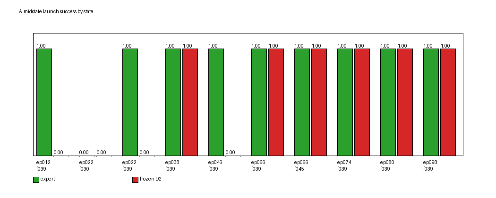
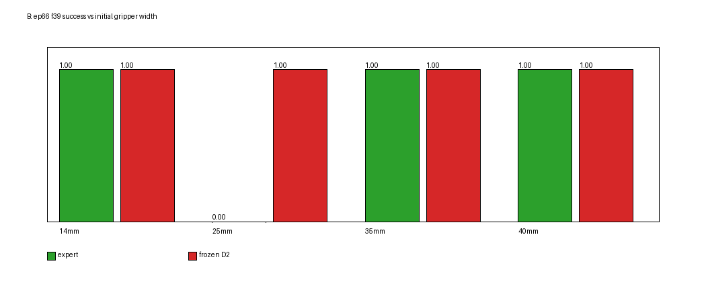

# 实验 2.6：D2 中间状态的独立启动能力与数据扩增可行性验证

## 摘要

本轮只做冻结 D2 的受控启动实验，不训练、不改权重、不改 C3。

- 从 D2 的 120 条成功 B 示范中选 **10 个中间状态**（5 个 yaw90、5 个 yaw0），用**原始数据集动作 replay** 重建 Bullet 快照。10/10 的关节 replay 误差 ≤ **5.3×10⁻⁶ rad**，夹爪误差 ≤1×10⁻⁶ m。
- **A（中间状态独立启动）**：专家后缀 9/10 成功；冻结 D2 独立启动 **6/10**（yaw90 **5/5**，yaw0 **1/5**）。
- **B（改变夹爪开度）**：在 ep66 f39（yaw90）上，14/25/35/40 mm 四种合法开度，冻结 D2 **4/4 成功**，专家 3/4（25 mm 失败）；在 ep22 f39（yaw0）上，25 mm 专家/冻结都成功，35 mm 专家成功、冻结失败。所有 12 个初始状态物理合法，建立时物体位移 0 mm。
- **C3 对照**：C3 的 B 启动状态 q 与 ep66 f39 差 0.171 rad，夹爪观测 0.040 m；B 的 ep66 f39 + 40 mm 正好覆盖这个“同 q、开夹爪”状态，冻结 D2 成功。因此 **C3 的失败不能只归因于“夹爪张开”**，还剩下 q/EE 0.171 rad / 7.7 mm 的差异或历史/随机性。
- **扩增建议**：A 的 yaw0 后缀有 3 个“专家成功、冻结失败”的明确状态，值得小规模试点；yaw90 5/5 冻结成功，不需要大规模 A 扩增。B 的夹爪变体只有 1 个“专家成功、冻结失败”候选，且专家本身会在某些开度失败，证据不足，暂不宜扩增。

---

## 1. 设置与 checkpoint

| 项 | 值 |
|---|---|
| checkpoint | `outputs/smolvla_e23_D2/checkpoints/020000/pretrained_model` |
| sha256 | `34a6e3080a88250302a9f0abbc01608b58097324af2c321b00b84c395fbdd58b` |
| Git | `03f227d` + 本实验工作区 |
| 训练数据 | `data/_shards_e23/B_D2`（120 episodes / 14,653 frames） |
| 仿真 | PyBullet 240 Hz / 20 Hz 策略 / 12 substeps |
| 判据 | 统一 v2.2（gap≤2cm、\|dy\|≤2cm、dyaw≤15°、tilt≤12°、speed<0.01，静置 1s 复核） |
| 视频 | top / side / contact / comparison / events，640×480，20 fps |

未修改 D2 checkpoint、未重新训练、未改 C3 连接器、未调整 action chunk。

## 2. 中间状态重建

### 2.1 方法

D2 B 训练数据只含 `observation.state`（9 维）、`action`（8 维）、top/wrist 视频；**没有逐帧物体真值或 Bullet 快照**。

重建流程（`scripts/reconstruct_b_midstates.py`）：

1. 用 `D2_episodes.jsonl` 的 `scene.block_start/block_yaw` 重建场景；
2. 把机器人设到该 episode 第一帧的实际 q/finger；
3. 按数据集 `action[t]` 以 12 个物理步/动作 replay；
4. 在目标 frame 保存 `p.saveBullet` 快照；
5. 对比 replay 的 q/finger 与数据集 `observation.state`。

### 2.2 重建误差

10/10 状态有效：

| state | ep/frame | q 误差 (rad) | 夹爪误差 (m) | group |
|---|---|---:|---:|---|
| ep066_f039 | 66/39 | 1.2e-7 | 6.7e-10 | yaw90 |
| ep066_f045 | 66/45 | 1.2e-7 | 2.3e-10 | yaw90 |
| ep022_f030 | 22/30 | 5.0e-8 | 6.5e-10 | yaw0 |
| ep022_f039 | 22/39 | 8.6e-8 | 6.6e-10 | yaw0 |
| ep012_f039 | 12/39 | 1.4e-7 | 5.3e-10 | yaw0 |
| ep038_f039 | 38/39 | 2.1e-7 | 4.4e-10 | yaw0 |
| ep074_f039 | 74/39 | 1.2e-7 | 7.1e-10 | yaw90 |
| ep098_f039 | 98/39 | 1.2e-7 | 1.9e-9 | yaw90 |
| ep046_f039 | 46/39 | 5.2e-6 | 1.0e-6 | yaw0 |
| ep080_f039 | 80/39 | 2.6e-7 | 3.1e-7 | yaw90 |

**限制**：q 与夹爪 replay 精确，不代表物体的逐帧历史完全一致；物体状态由 replay 的物理动力学给出，无法与训练时逐帧真值比对。快照包含当时的物体位姿/速度，仿真继续执行是自洽的。

## 3. A：真实中间状态独立启动

### 3.1 结果

| state | group | 专家后缀 | 冻结 D2 | 冻结 max lift | 冻结墙接触 | 冻结 final tilt |
|---|---|---|---:|---:|---:|---:|
| ep012_f039 | yaw0 | ✅ | ❌ | 1.29 cm | ✅ | 0.0° |
| ep022_f030 | yaw0 | ❌ | ❌ | 1.59 cm | ✅ | 54.8° |
| ep022_f039 | yaw0 | ✅ | ❌ | 3.69 cm | ✅ | 40.5° |
| ep038_f039 | yaw0 | ✅ | ✅ | 0.35 cm | ❌ | 3.8° |
| ep046_f039 | yaw0 | ✅ | ❌ | 3.08 cm | ✅ | 69.8° |
| ep066_f039 | yaw90 | ✅ | ✅ | 0.26 cm | ❌ | 0.01° |
| ep066_f045 | yaw90 | ✅ | ✅ | 0.85 cm | ❌ | 0.02° |
| ep074_f039 | yaw90 | ✅ | ✅ | 0.13 cm | ❌ | 0.005° |
| ep080_f039 | yaw90 | ✅ | ✅ | 0.43 cm | ❌ | 0.01° |
| ep098_f039 | yaw90 | ✅ | ✅ | 0.31 cm | ❌ | 0.005° |

- 专家：**9/10**；唯一失败是 ep022_f030（final tilt 13.6° >12°，且墙接触）——这是一个边界状态；实验 2.6 的 expert suffix 从 f30 开始，可能已经错过了正确接触时机，也可能是 replay 控制历史差异。该状态从 Q2 的“专家可行”分母中剔除。
- 冻结 D2：**6/10**；在 9 个 expert-capable 状态中 **6/9**。
- **yaw90：冻结 5/5**；**yaw0：冻结 1/5**。
- 冻结失败的共同形态：墙接触 + 抬升/翻转；ep012 是墙接触但未翻转（tilt 0°），ep022_f039/ep046 在墙边翻倒（40.5°/69.8°），ep022_f030 也翻倒（54.8°）。

### 3.2 关键观察

- D2 **确实具备**从部分真实中间状态直接启动的能力，尤其是 yaw90 的接近/预推动状态。
- yaw0 的中间状态对冻结 D2 明显更不稳定：5 个里 4 个失败，失败均涉及墙接触和抬升/翻倒。
- 同一个中间状态，专家可以继续完成，但冻结 D2 重新启动会失败（ep012、ep022_f039、ep046），这是 Q2 的直接证据。

## 4. B：改变夹爪初始开度

### 4.1 状态合法性

所有 12 个 B 初始状态：

- 请求宽度与实际宽度一致（14.0/25.0/35.0/40.0 mm，误差 <0.1 mm）；
- 建立后物体位移 **0.0 mm**、倾角变化 **0.0°**；
- 未发生手掌/手指非法穿插（建立 10 个物理步后物体状态不变）；
- 因此 `valid=true`，没有 `state_reconstruction_failed`。

### 4.2 结果

**ep66 f39（yaw90）**

| 初始宽度 | 专家 | 冻结 D2 | 冻结 max lift | 冻结墙接触 | 冻结 final tilt |
|---:|---|---|---:|---:|---:|
| 14 mm | ✅ | ✅ | 0.61 cm | ❌ | 0.004° |
| 25 mm | ❌ | ✅ | 0.49 cm | ❌ | 0.013° |
| 35 mm | ✅ | ✅ | 0.33 cm | ❌ | 0.003° |
| 40 mm | ✅ | ✅ | 0.32 cm | ❌ | 0.009° |

- 冻结 D2 **4/4**；专家 3/4。
- 专家在 25 mm 失败：max lift 3.93 cm、tilt 18.2°、墙接触；说明**不是所有“合法夹爪开度”都是专家可执行状态**。
- 冻结 D2 在 40 mm（与 C3 的夹爪观测相同）仍成功，说明“开夹爪”本身不等于失败。

**ep22 f39（yaw0）**

| 初始宽度 | 专家 | 冻结 D2 | 冻结 max lift | 冻结墙接触 | 冻结 final tilt |
|---:|---|---|---:|---:|---:|
| 25 mm | ✅ | ✅ | 0.62 cm | ✅ | 0.011° |
| 35 mm | ✅ | ❌ | 0.71 cm | ✅ | 19.35° |

- 冻结 D2 在 yaw0 上对宽度敏感：25 mm 成功，35 mm 失败（tilt 19.35°）。
- 专家两个宽度都成功。
- 这说明 **夹爪开度会改变冻结 D2 的接触/倾倒结果，且不是单调关系**。

## 5. 与 C3 的关系

C3 的 B 启动状态（实验 2.5）：

- q 与 ep66 f39 的关节距离 **0.171 rad**；
- EE 差 **7.7 mm**，相对 EE–物体差约 **1.9 mm**；
- 夹爪观测 **0.040 m**；
- C3 的冻结 D2：**0/3 成功**，max lift 0.8 cm，无墙接触。

A/B 对照：

- A 的 ep66 f39（夹爪 0.014）冻结 D2 **成功**；
- B 的 ep66 f39 + 40 mm（同 q/物体，夹爪 0.040）冻结 D2 **成功**；
- 所以 **“夹爪张开到 40 mm”单独并不能解释 C3 失败**。C3 剩余的差异是 q 0.171 rad / EE 7.7 mm、连接器带来的状态历史，以及策略采样随机性。
- 也不能说 C3 与 B 的 40 mm 状态“完全相同”：B 是从 ep66 f39 快照精确恢复，C3 是连接器终点，q/EE 仍有差距。
- C3 专家能力未在本轮测试（没有 C3 Bullet 快照）；不能声称专家一定能从 C3 状态完成 B。

## 6. 六个问题

**Q1：D2 能否从自己成功 B 示范的中间状态重新启动，并完成剩余推动？**

**能，部分能。** 10 个状态中 6 个成功；9 个 expert-capable 状态中 6 个成功。yaw90 5/5，yaw0 1/5。

**Q2：是否存在原专家能继续完成、但重新启动的 D2 无法完成的中间状态？**

**存在。** 3 个明确状态：ep012_f039、ep022_f039、ep046_f039（yaw0）；专家后缀成功，冻结 D2 失败。ep022_f030 是专家也失败的边界状态，不计入。

**Q3：改变中间状态的夹爪开度，会怎样改变 D2 的初始动作、接触位置和最终推动结果？**

- ep66（yaw90）：冻结 D2 四个宽度都成功，差异主要是抬升 0.32–0.61 cm，墙接触 0；专家在 25 mm 会失败（lift 3.93 cm、tilt 18.2°）。
- ep22（yaw0）：25 mm 冻结成功，35 mm 冻结失败（tilt 19.35°）；专家两个都成功。
- 结论：宽度效应**非单调**，且与物体 yaw/接触几何耦合；不能简单说“越开越差”或“越开越好”。

**Q4：专家能否从这些新的夹爪状态成功完成 B？哪些状态不适合后续训练？**

专家 5/6 成功。**ep66 + 25 mm 不适合**：专家自己失败（lift 3.93 cm、tilt 18.2°）。其余 5 个状态专家成功；其中 ep22 + 35 mm 是“专家成功、冻结失败”的候选，但只有 1 个状态。

**Q5：A 和 B 的哪类物理状态与 C3 更接近？冻结 D2 的行为与 C3 有什么异同？**

- 与 C3 最接近的是 **B 的 ep66 f39 + 40 mm**（同 q/物体、同开度 40 mm）；冻结 D2 成功，而 C3 0/3。
- A 的 ep66 f39（14 mm）也接近，但夹爪观测不同。
- 因此 C3 的失败**不能只归因于夹爪开度**；剩余 q/EE 差异（0.171 rad / 7.7 mm）或连接器状态历史/采样随机性仍可能是原因。本轮不能进一步分离。

**Q6：下一轮是否有必要分别尝试 A 的中间轨迹截取后训练，以及 B 的新增成功示范后训练？**

**有证据，但只支持小规模、定向试点，不支持大规模后训练。**

- **A**：yaw0 有 3 个“专家成功、冻结失败”的状态，且 yaw0 总体 1/5，说明 yaw0 中间状态是真实的能力缺口，值得做 A 的定向 suffix 试点。yaw90 5/5 冻结成功，没有理由大规模扩增 yaw90。
- **B**：只有 ep22 + 35 mm 这 1 个“专家成功、冻结失败”的候选；ep66 + 25 mm 专家自己失败，不能作为监督数据。B 的证据量（n=6）不足以支持正式扩增；应先扩大合法宽度/状态组合，确认“专家可行且冻结失败”的比例。

## 7. 视频与日志

- 32 个新 episode（A 20 + B 12），共 **157 个 mp4**：
  - `/scratch/lijh/simulate_vla/results/experiment_2_6/A_midstate_launch/{expert,frozen}/...`
  - `/scratch/lijh/simulate_vla/results/experiment_2_6/B_gripper_variation/{expert,frozen}/...`
- 每个 episode 保留 top/side/contact/comparison/events、physics/contact/policy、frame_index、event_summary、summary。
- 视频清单：`results/experiment_2_6/video_manifest.csv`
- 重建快照：`A_midstate_launch/reconstructed/*.bullet`

### 对照视频（服务器）

- `results/experiment_2_6/videos/A_expert_vs_frozen_D2.mp4`（ep22 f39：专家成功 / 冻结失败）
- `results/experiment_2_6/videos/B_expert_vs_frozen_D2.mp4`（ep66 f39 25 mm：专家失败 / 冻结成功）
- `results/experiment_2_6/videos/B_different_gripper_initializations.mp4`（ep22 f39 冻结：25 mm 成功 / 35 mm 失败）
- `results/experiment_2_6/videos/C3_vs_D2_midstate.mp4`（C3 失败 / ep66 f39 冻结成功）

## 8. 限制

- A 的 n=10，B 的 n=6；每个宽度只有 1 次，不能给稳定成功率。
- 专家 suffix 是 open-loop replay；ep022_f030 专家失败说明 replay 到 f30 后继续不一定等价于原始闭环专家。
- 只有 10 个中间状态，来自 10 条不同示范；没有覆盖全部 120 条。
- B 的“初始状态合法”只检查了建立后 10 个物理步的物体位移/倾角，不是完整扫掠碰撞检查。
- C3 没有专家对照；C3 与 B 40 mm 的比较受 q/EE 0.171 rad/7.7 mm 影响。
- 没有做视觉输入/图像嵌入分析；视频是真实仿真渲染。
