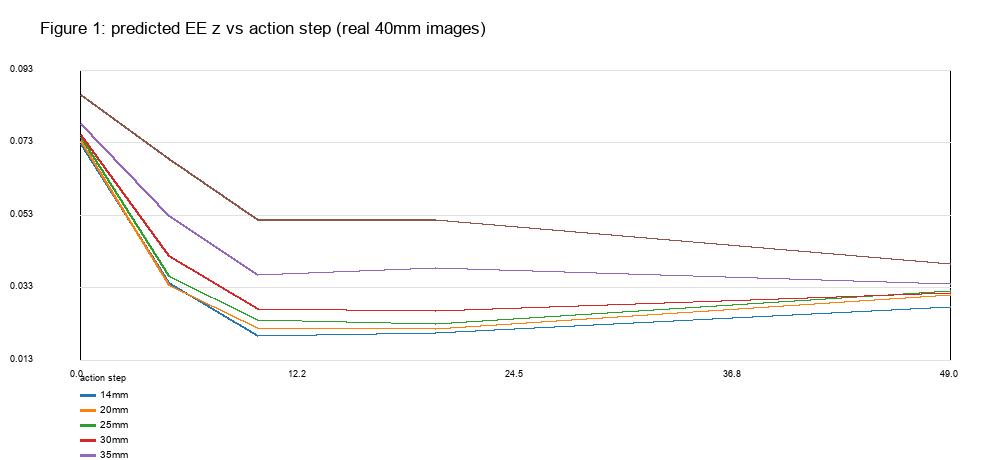
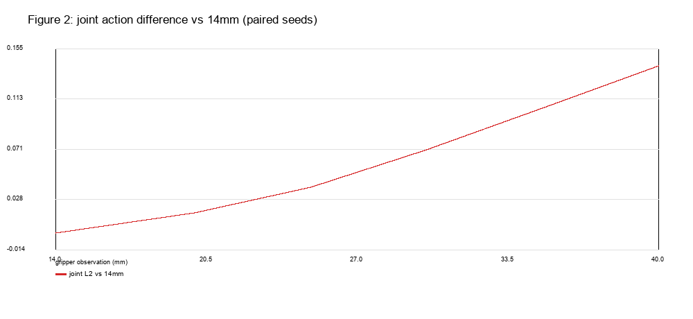
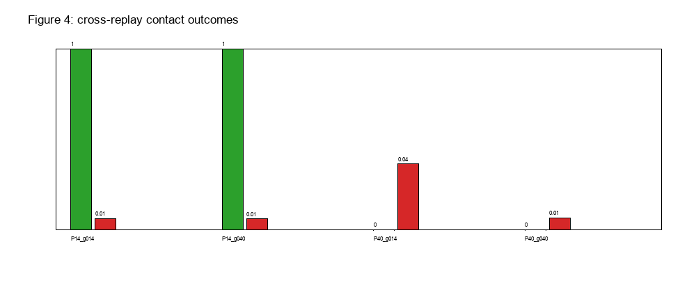
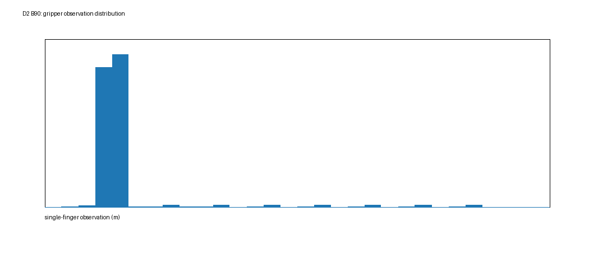
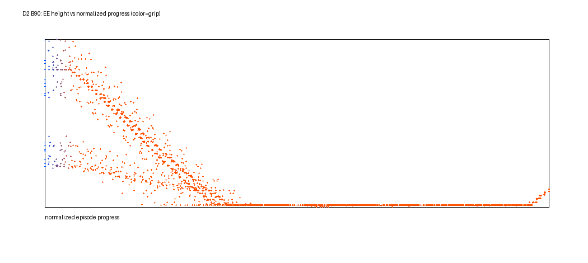
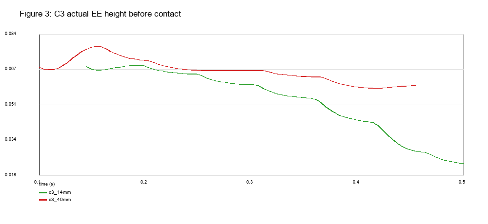

# 实验 2.7：C3 中夹爪状态影响 VLA 接近动作与物理接触的因果机制

## 直接回答

**Q1：固定图像、七关节、指令和采样种子，仅改夹爪本体观测，是否会系统性改变七关节动作？**

**会，而且是单调、可重复的。** 在 real40 图像集、20 个成对种子上，相对 14 mm 的七关节动作 L2 差：

| 夹爪观测 | 20 mm | 25 mm | 30 mm | 35 mm | 40 mm |
|---|---:|---:|---:|---:|---:|
| joint L2 (rad) | 0.0174 | 0.0388 | 0.0705 | 0.1051 | **0.1412** |
| 标准差 | 0.0004 | 0.0011 | 0.0019 | 0.0028 | 0.0044 |

real14 图像集几乎相同（40 mm：0.1401 rad）。**夹爪数值本身就把动作块推离 14 mm 的动作。**

**Q2：14→40 mm，预测末端下降/前进时序是否可重复地变化？**

**是。** 固定图像/七关节/种子，只改夹爪观测，预测 EE z 在动作块前 10 步的下降量单调减小：

| 夹爪 | 14 | 20 | 25 | 30 | 35 | 40 |
|---|---:|---:|---:|---:|---:|---:|
| Δz first10 (cm) | **−5.31** | −5.17 | −5.08 | −4.82 | −4.16 | **−3.48** |
| EE z at step10 (cm) | 1.95 | 2.18 | 2.39 | 2.71 | 3.64 | **5.15** |
| EE z at step5 (cm) | 3.43 | 3.37 | 3.61 | 4.17 | 5.27 | **6.84** |

两组真实图像（real40 / real14）都给出相同趋势；没有明显突跳，近似连续单调。

**Q3：随机性有多大？干预是否明显超过采样波动？**

20 个种子下，40 mm 的 joint L2 均值 **0.1412**、std **0.0044**；Δz 均值 **−3.48 cm**、std **0.78 cm**。夹爪从 14→40 的效应（0.141 rad / 1.83 cm）远大于同条件种子波动（约 32× / 2.3×）。**干预效应是系统性的，不是单次采样噪声。**

**Q4：把 14 mm 轨迹用于 40 mm 初始物理夹爪，还能建立正确侧向推动吗？**

**能。** P14 动作序列（64 步开放环重放）+ 40 mm 初始夹爪：成功，首次接触 **link10 @0.7375 s**，法向 (0.980, −0.197, −0.030)（近水平），final gap **12.8 mm**、dy **14.2 mm**、tilt 0.007°，max lift 0.59 cm。P14+14 mm 同样成功（gap 9.2 mm，法向近水平）。**张开的初始夹爪不必然导致失败。**

**Q5：把 40 mm 轨迹用于 14 mm 初始夹爪，还会出现顶部/异常接触吗？**

**会。** P40 动作序列（260 步）+ 14 mm 初始夹爪：失败，首次接触 **link9 @0.6458 s**，法向 **(0.052, 0, −0.999)**（几乎纯竖直向下，顶部接触），接触时 EE z **47.8 mm**，final gap **170.5 mm**（几乎没有推动），max lift 3.62 cm。P40+40 mm 同样失败（法向相同、gap 171.7 mm、lift 0.65 cm）。**即使闭合夹爪，P40 的机械臂轨迹仍然从顶部接触。**

**Q6：C3 的错误接触主要跟随机械臂路径，还是夹爪几何/闭合时序？**

**主要跟随机械臂运动路径。** 同样 P14 路径，14/40 mm 都成功且首次接触都是 link10、法向近水平；同样 P40 路径，14/40 mm 都失败且首次接触都是 link9、法向近竖直（−0.999）。初始夹爪只改变 P40 的抬升（3.62 vs 0.65 cm），没有改变“顶部接触、没有推动”的结局。C3 原始 40 mm 的顶部接触（EE z 47.8 mm、法向近似 −Z）与 P40 路径一致；但原始 40 mm 闭环的大幅翻转（tilt 78°）没有在 P40 开放环重放中复现（max lift 0.65 cm），说明闭环反馈/动作历史仍有额外作用。

**Q7：D2 B90 训练数据中，夹爪开度与接近阶段有统计关联吗？**

**有，但部分是任务机械结构造成的。** 14,653 帧 / 120 条示范：

| 夹爪观测 | 帧数 | 平均 progress | 平均 EE z |
|---|---:|---:|---:|
| <16 mm | 13,800 | 0.529 | 8.45 cm |
| 16–25 mm | 373 | 0.060 | 42.6 cm |
| 25–35 mm | 380 | 0.016 | 43.5 cm |
| ≥35 mm | 100 | 0.000 | 46.2 cm |

B 示范从 35 mm 开始、第一步就命令 0.014 m，所以“张开→早期、闭合→后期”的关联至少部分是示范协议本身决定的；不能据此直接断言模型学到了语义阶段标签。

**Q8：C3 附近的机械臂构型 + 40 mm 夹爪联合状态，在 D2 中有多少覆盖？**

**零覆盖。** 训练数据夹爪最大 **35.0 mm**，没有任何 40 mm 帧。C3 关节附近（q≤0.75 rad）有 584 帧 / 14 条示范，夹爪范围 **12.75–14.10 mm**，≥30 mm 帧数 **0**；q≤0.30 rad 有 323 帧 / 10 条示范，同样 0 帧 ≥30 mm。**C3 的 q + 40 mm 是训练分布外组合；C3 的 q + 14 mm 才有覆盖。**

**Q9：是否支持“模型把夹爪状态过度关联于操作阶段”？**

**支持“夹爪本体观测会系统性条件化动作”，但不足证明内部语义阶段。** 固定图像/七关节后仅改一个本体数字，动作就单调变化；训练数据里夹爪与 progress 强相关；C3 的 40 mm 联合状态无覆盖。这些支持“阶段关联/分布外状态”的解释，但不能排除：局部状态敏感性、训练数据机械耦合、动作块开环放大、以及单状态/单图像集的限制。没有 attention/embedding 证据。

**Q10：如果之后验证数据扩增，应先补哪类状态—动作监督？**

应先补 **“C3 附近关节构型 + 张开夹爪（30/35/40 mm）”的专家动作**，尤其是从这些状态下降到侧面接触（而不是顶部）的专家轨迹。本轮证据：这类联合状态在 D2 中 0 覆盖；P14 路径证明张开夹爪下侧向推动物理可行；P40 路径证明错误机械臂路径即使闭爪也无法推动。**不建议**先大规模补 14 mm 状态（已有 584 帧近邻覆盖）；也不在本轮执行训练。

---

## 1. 设置

| 项 | 值 |
|---|---|
| checkpoint | `outputs/smolvla_e23_D2/checkpoints/020000/pretrained_model` |
| sha256 | `34a6e3080a88250302a9f0abbc01608b58097324af2c321b00b84c395fbdd58b` |
| Git 基线 | `ca743ef` + 本轮工作区 |
| 任务 | `push the orange block along the positive X direction to the wall` |
| action chunk | 50（未修改） |
| 成功判据 | v2.2；另外单独记录 `actual_wall_contact` |
| 反事实采样 | 20 seeds/条件，固定 torch/cuda seed，成对 |
| 真实快照 | C3 seed 40000000（A90+C3 连接器结束，B 未执行） |

## 2. 实验 1：固定输入、只改夹爪本体观测

### 2.1 方法

- 从 C3 快照恢复，分别建立 real40（手指 40 mm）和 real14（14 mm）两套真实图像/七关节观测；
- 固定该套图像与七关节，将模型输入 `observation.state` 的两个手指值改为 14/20/25/30/35/40 mm；
- 同一 seed 下 `policy.reset()`、`torch.manual_seed(seed)`、`cuda.manual_seed_all(seed)`，调用 `predict_action_chunk` 保存完整 50 步 chunk；
- 用 FK 计算动作目标对应的 EE z（几何预测，不是实际执行）。

输入清单：`observation_intervention/input_manifest.csv`；每个 chunk 见 `paired_action_chunks/`。

### 2.2 结果

- 40 mm 与 14 mm 的动作 L2 差 0.141 rad，方向是“下降更少、更早停在较高位置”；step10 EE z 从 1.95 cm 升到 5.15 cm。
- real14 与 real40 图像集结果几乎一致（40 mm：0.1401 vs 0.1412 rad），说明这个效应不是由两套图像差异驱动的；但反事实状态与真实图像不一致，仅用于敏感性诊断。

## 3. 实验 2：P14/P40 轨迹 × 14/40 mm 初始夹爪

### 3.1 条件

- **P14**：C3+14 mm 的闭环成功 rollout（run00，64 个 B 动作）；
- **P40**：C3+40 mm 的闭环失败 rollout（seed40000000，260 个 B 动作）；
- 从同一 C3 快照恢复，初始手指 14 或 40 mm；
- **统一夹爪协议**：所有四个条件从 tick0 起把夹爪目标设为 0.014 m；只有初始实际开度不同；
- 只重放七关节目标，不重新调用 VLA。标记为 `Open-Loop Action Replay Diagnostic`。

### 3.2 结果

| 条件 | 成功 | max lift | final gap | final dy | 首次接触 | 接触时间 |
|---|---|---:|---:|---:|---|---:|
| P14 + 14 mm | ✅ | 0.61 cm | 9.2 mm | 10.7 mm | link10 | 0.7375 s |
| P14 + 40 mm | ✅ | 0.59 cm | 12.8 mm | 14.2 mm | link10 | 0.7375 s |
| P40 + 14 mm | ❌ | 3.62 cm | 170.5 mm | −8.4 mm | link9 | 0.6458 s |
| P40 + 40 mm | ❌ | 0.65 cm | 171.7 mm | 10.2 mm | link9 | 0.6458 s |

接触法向与接触高度（P14/P40 各自两宽度几乎相同）：

| 条件 | normal (x,y,z) | EE z @contact | 接触时实际夹爪 |
|---|---|---|---:|---:|
| P14 + 14 mm | (0.991, −0.126, −0.035) | 19.9 mm | 14.0 mm |
| P14 + 40 mm | (0.980, −0.197, −0.030) | 19.9 mm | 14.2 mm |
| P40 + 14 mm | (0.052, 0.000, **−0.999**) | **47.8 mm** | 14.0 mm |
| P40 + 40 mm | (0.052, 0.000, **−0.999**) | **47.8 mm** | 16.0 mm |

- P14 路径的接触法向几乎水平，P14+40 仍是侧向接触并成功；
- P40 路径的接触法向几乎竖直向下，即使初始 14 mm 也是顶部接触并失败。

- **P14 路径对 14/40 mm 都成功**；初始夹爪没有破坏侧向推动。
- **P40 路径对 14/40 mm 都失败**；闭合夹爪也没有恢复推动。
- P40+14 的抬升更大（3.62 cm），说明初始夹爪会影响抬升/接触细节；但“是否推动”由机械臂路径决定。
- 与原始闭环的差异：原始 C3+40 是大幅翻转（tilt 78°、lift 10.2 cm），P40 开放环重放没有复现；开放环不能替代闭环，接触动力学受反馈/动作历史影响。

## 4. 实验 3：D2 B90 训练数据

- 120 条 B90 / 14,653 帧；夹爪最大 **35 mm**，40 mm 帧 **0**。
- 夹爪与阶段关联强（见 Q7 表），但 B 示范协议本身就是“从 35 mm 开始、第一步闭合”，因此不能直接当作语义阶段标签。
- C3 附近覆盖：
  - q≤0.75 rad：584 帧 / 14 条示范，夹爪 **12.75–14.10 mm**，≥30 mm **0**；
  - q≤0.30 rad：323 帧 / 10 条示范，夹爪最大 14.04 mm，≥30 mm **0**。
- 因此 **C3 q+40 mm 是训练分布外联合状态；C3 q+14 mm 有覆盖。**

## 5. C3 实际接触对比

| 指标 | C3 14 mm | C3 40 mm |
|---|---|---|
| 首次接触 link | **robot_link10** | **robot_link9** |
| 首次接触时间 | 0.746 s | 0.613 s |
| 接触时 EE z | **19.9 mm** | **47.8 mm** |
| 接触法向 | (0.95, −0.32, −0.02) ≈ 水平 | (0.05, 0, −1.0) ≈ 竖直向下 |
| 接触时实际夹爪 | 14.5 mm | 17.3 mm |
| 最终倾斜 | 0.01° | 78.1° |

这与实验 1 的预测方向一致：40 mm 观测使模型少下降约 3 cm，C3 40 mm 在 0.5 s 时 EE z 57.6 mm，14 mm 为 24.0 mm；最终 40 mm 从顶部（−Z）接触、翻转。**因果链的第一段（观测→动作→高度）在本轮有直接证据；最后一段（接触→翻转）由真实接触日志确认。**

## 6. 因果链判定

| 环节 | 证据 | 判定 |
|---|---|---|
| 夹爪观测 → 七关节动作 | 同图/同 q/同 seed，仅改夹爪，L2 0→0.141 rad 单调 | **成立** |
| 动作 → 预测 EE 高度 | step10 EE z 1.95→5.15 cm | **成立（几何预测）** |
| 预测高度 → 实际接触模式 | C3 14 接触 EE 19.9 mm/水平；40 47.8 mm/竖直 | **成立（真实日志）** |
| 接触模式 → 推动成败 | C3 14 成功；40 78°翻转失败 | **成立** |
| 初始夹爪几何是否是唯一原因 | P14 路径 + 40 mm 仍成功；P40 路径 + 14 mm 仍失败 | **不是；机械臂路径是主因，夹爪调制抬升** |
| 模型内部“阶段语义” | 仅有行为/数据关联，无 attention/embedding | **不能断言** |

## 7. 限制

- 反事实只用了 C3 seed40000000 一个状态、两套真实图像；20 个种子是策略采样，不是 20 个状态。
- 反事实图像与修改后的夹爪数值不一致，只用于敏感性诊断，不能当作真实输入。
- 交叉重放是开放环；原始闭环的翻转/抬升没有被完全复现，不能把重放失败直接等同于闭环 VLA 失败。
- 训练数据无逐帧物体真值；阶段用 progress/EE z 估计，不是接触标签。
- 只有 1 条 P14 和 1 条 P40 源轨迹；没有覆盖多条源轨迹的方差。
- 未做视觉嵌入/attention 分析；不能证明模型内部把夹爪当作阶段变量。

## 8. 视频

`/scratch/lijh/simulate_vla/results/experiment_2_7/videos/`

- `C3_14mm_vs_40mm.mp4`
- `C3_first_contact_comparison.mp4`
- `cross_replay_P14_vs_P40.mp4`
- `cross_replay_gripper_comparison.mp4`

## 9. 交付物

- 反事实：`results/experiment_2_7/observation_intervention/`（input_manifest、paired_action_chunks、action_statistics、analysis.json）
- 交叉重放：`results/experiment_2_7/crossed_action_replay/`（四条件日志/视频、contact_statistics.csv）
- 训练数据：`results/experiment_2_7/d2_training_analysis/`（state_distribution、local_coverage、nearest_c3_frames、图）
- 图：`results/experiment_2_7/figures/fig1..fig6`
- 汇总：`summary.json`、`config.json`
- 代码：`scripts/exp27_observation_intervention.py`、`exp27_cross_replay.py`、`exp27_training_analysis.py`、`exp27_summary.py`
