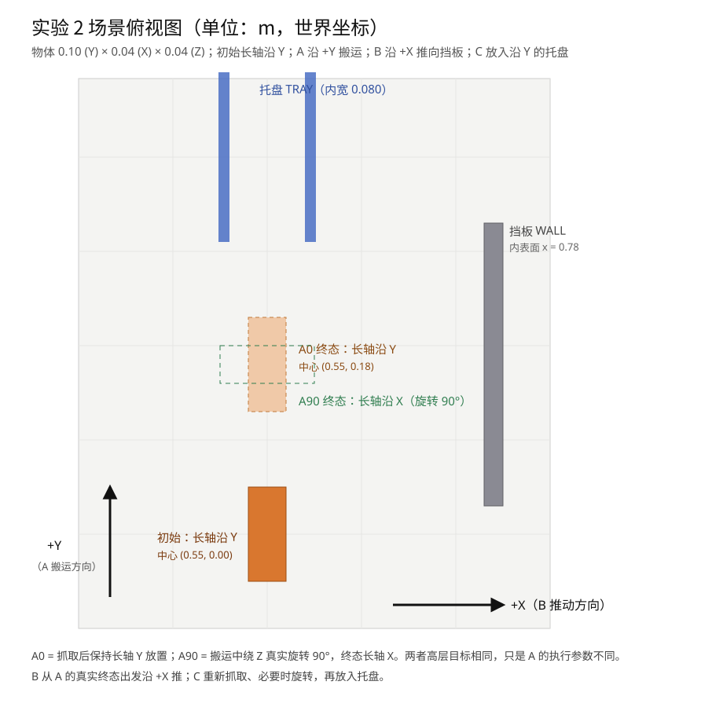

# 实验 2 · 阶段 1：统一场景与物理可行性

## 1. 目的

在采集任何 VLA 数据之前，先把**坐标系、物体几何、A0/A90 定义、B 的挡板与 C 的托盘**固定下来，并用专家脚本验证四条组合链在物理上确实可完成：

- A0→B、A90→B、A0→C、A90→C。

本阶段不训练模型，也不把专家成功率当作科研结论；它只回答"场景是否成立、专家能否稳定产生示范"。

结论：**四条链在 5 个不同初始种子下全部 5/5 完成**（位置扰动 ±6 mm）。场景成立，可以进入示范采集。



## 2. 坐标约定（固定，不再交换）

| 轴 | 含义 |
|---|---|
| +X | 桌面横向；B 把物体推向挡板的方向 |
| +Y | A 搬运物体的主要方向 |
| +Z | 竖直向上 |

物体初始平放：**长轴沿 Y（10 cm）、短轴沿 X（4 cm）、高 4 cm**。A0/A90 一律以物体真实朝向为准，不看画面里"看起来横还是竖"。

## 3. 几何与参数

| 元素 | 参数 |
|---|---|
| 长方体 | 0.10 (Y) × 0.04 (X) × 0.04 (Z) m，质量 0.15 kg，摩擦 1.2 |
| 初始中心 | (0.55, 0.00, 0.021) |
| A 放置区 | (0.55, 0.18, 0.021)，不区分 A0/A90 的中心 |
| 抓取高度 | EE z = 0.031 → 指面底 0.020（物体半高） |
| 挡板 | 内表面 x = 0.78，y ∈ [0.03, 0.33]，高 0.12 m（固定） |
| 托盘 | 中心 (0.55, 0.40)，两条导轨内宽 0.080 m，导轨高 0.024 m、长 0.18 m |

夹爪几何（实测，用于后续所有脚本）：指面底在 EE 下方 11.2 mm，指面前沿在 EE 前方 14.5 mm，手掌前沿 35.6 mm、手掌宽 71.2 mm。

## 4. A0 / A90 的定义

| | A0 | A90 |
|---|---|---|
| 抓取 | 夹爪 yaw +90°，两指沿 X 夹 4 cm 短边 | 同 A0 |
| 搬运 | 保持长轴 Y，沿 +Y 移动 | 搬运中绕 Z 真实旋转 90°（腕部 yaw +90°→0°），长轴变 X |
| 终态 | 中心 (0.55, 0.18)，yaw ≈ 0 | 同中心，yaw ≈ ±90° |

两者是**同一个高层任务 A 的两种可控执行参数**，不是两个任务；放置中心与成功判据完全相同。

旋转通过 12 个位置/姿态插值点逐点求 IK、再走关节空间实现，物体只靠夹持随腕部转动，没有瞬移或固定约束。

## 5. B / C 的场景设计

- **B**：从 A 的真实终态出发，夹爪不完全闭合（开口 28 mm），从 -X 侧贴住物体，分 6 段沿 +X 推进，直到物体前缘离挡板 4 mm。允许指侧/手掌与物体接触（推不是抓）。
- **C**：重新抓取，按长轴方向选择抓姿；A90 终态需要再把物体转回长轴 Y，然后从上方放入托盘、释放、撤离。

推动的成功判据：前缘距挡板 ≤20 mm、侧移 ≤20 mm、yaw 变化 ≤15°、倾角 ≤12°、静止。

## 6. 实现过程中发现的三个几何坑

这些都会直接影响后续 VLA 数据，记录在此以免重犯：

1. **托盘不能太窄**：手掌宽 71.2 mm，最初 60 mm 内宽的托盘在"下放"阶段必然撞导轨。已改为 80 mm。
2. **推的位置不能高于质心**：最初在 z=0.031（物体上半部）推，物体被顶得爬上前指面、倾角到 49°。改为 z=0.018、并分成 6 段推进后才稳定。
3. **推的目标要扣除指面前沿**：指面前沿在 EE 前方 14.5 mm，直接把"物体中心目标"当成 EE 目标会把物体压到墙上再挤翻。现在按"物体后表面 − 14.5 mm"给 EE 目标。

## 7. 可行性结果（5 个种子 × 4 条链）

| 链 | A 成功 | 后继成功 | 整链成功 |
|---|---:|---:|---:|
| A0→B | 5/5 | 5/5 | **5/5** |
| A90→B | 5/5 | 5/5 | **5/5** |
| A0→C | 5/5 | 5/5 | **5/5** |
| A90→C | 5/5 | 5/5 | **5/5** |

种子 7000–7004，初始位置扰动 ±6 mm。A 的终态误差：A0 约 0.6 mm / yaw 0°，A90 约 2.3 mm / yaw −89.7°。

## 8. 推动指标的初步对比（待验证假设）

| 指标 | A0→B | A90→B |
|---|---:|---:|
| 初始前缘距离 | 0.209 m | 0.180 m |
| 实际推动距离 | 0.203 m | 0.171 m |
| 终态前缘间隙 | 0.4 mm | 8.5 mm |
| Y 方向侧移 | −0.6 mm | −0.3 mm |
| Yaw 变化 | 0.085 rad (4.9°)，sd 0.099 | 0.011 rad (0.6°)，sd 0.010 |

专家数据**方向性地支持**"A90 推短端面更稳"的假设（yaw 扰动小一个量级），但 A0 同样 5/5，且这是专家、n=5，**不能写成结论**。真正的判断要等 VLA 的配对实验。

C 的对照：A0→C 托盘中心误差 1.7 mm、A90→C 0.1 mm；A90 多出的 90° 旋转让整链墙钟时间从约 0.7 s 增到 1.9 s（仿真内时间另计）。

## 9. 局限

- 每条链只有 5 次、扰动仅 ±6 mm，还没有覆盖更大范围的位置/朝向。
- 托盘内宽 80 mm 对 40 mm 宽的物体偏松，姿态约束主要由成功判据（yaw ≤12°）承担，而不是靠导轨限位。
- 专家抓取姿态固定在"物体长轴附近"；C 从 A90 终态出发依赖显式转腕，这恰好是 VLA 最难学的部分，需要在阶段 4 重点看。
- 本阶段没有相机渲染检查；数据采集前会复用 1.1 的 `check_render_consistency` 口径再核一次。

## 10. 文件

| 文件 | 内容 |
|---|---|
| `src/vla/atomic_tasks/scene2.py` | 统一场景、几何常量、yaw 工具 |
| `src/vla/atomic_tasks/experts.py` | A0/A90/B/C 专家与成功判据 |
| `scripts/feasibility_experiment_2.py` | 四链可行性脚本 |
| `scripts/probe_gripper_geometry.py` | 夹爪几何实测 |
| `results/experiment_2/scene_diagram.svg` | 带 X/Y 箭头的俯视示意图 |
| 服务器 `results/experiment_2/feasibility/` | 逐次 JSON、汇总、终态截图 |

## 11. 复现

```bash
# 服务器
cd ~/simulate_vla
PYTHONPATH=. venv/bin/python -u scripts/feasibility_experiment_2.py --trials 5 \
  --out results/experiment_2/feasibility

# 单条链调试
PYTHONPATH=. venv/bin/python -u scripts/feasibility_experiment_2.py --chain A90_C --trials 1
```

## 12. 下一步（阶段 2）

1. 用同一套 `scene2` 与专家采集 A0/A90/B/C 四类独立示范（先各 10 条冒烟，再各 100–150 条）。
2. B/C 的初始状态分布要覆盖两种物体朝向与 A 终态附近的机器人构型，但**不能**把 A→B / A→C 连续轨迹放进训练集。
3. 数据采集前先跑一次渲染一致性检查，确认采集与后续 VLA 评测的相机口径一致。
