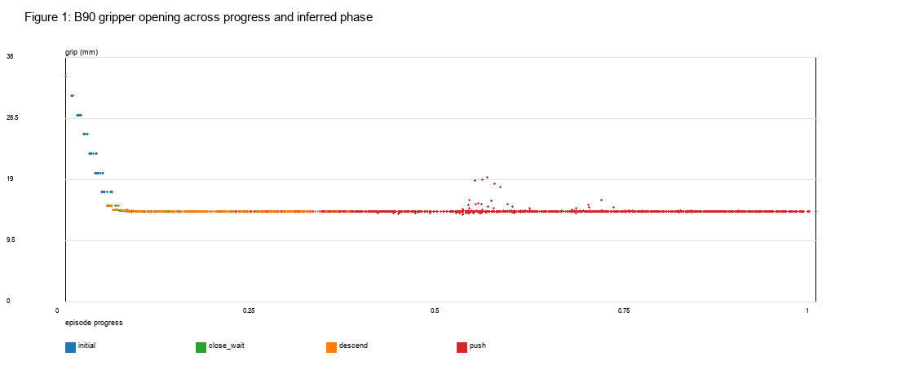
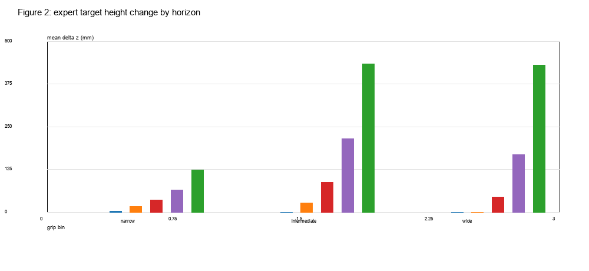
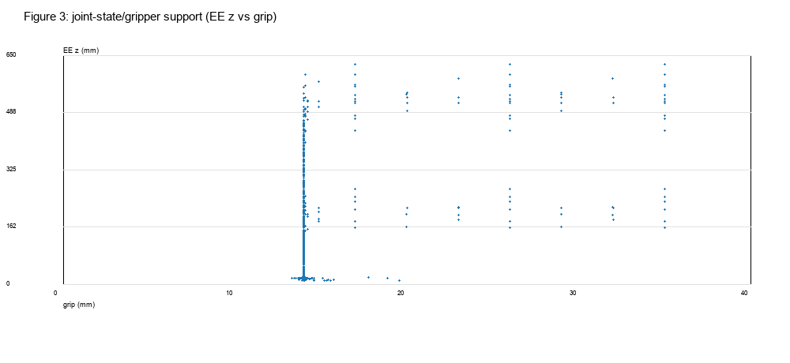
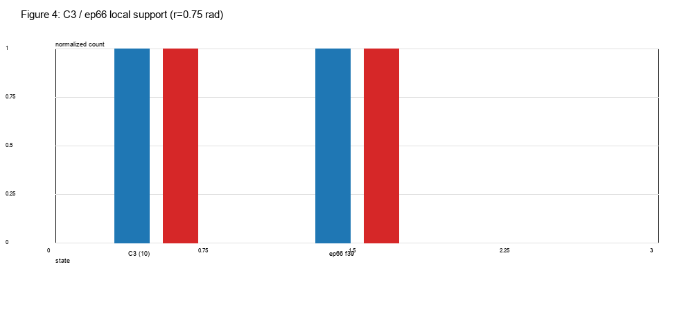
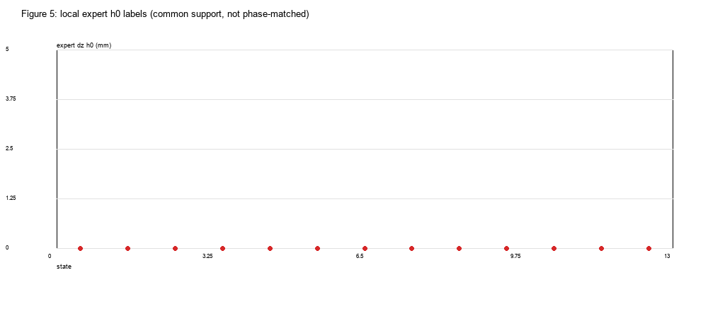
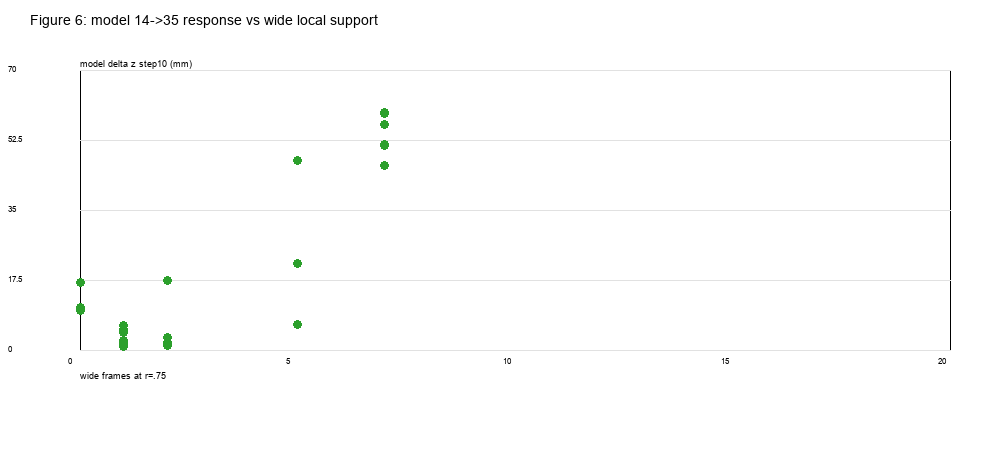
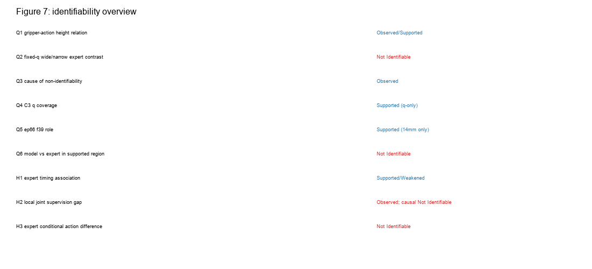

# 实验 2.10：D2 原子技能数据中的夹爪—机械臂条件动作关系审计

## 1. Executive Summary

- **D2 全量 480 集 / 68,892 帧**；B90（yaw90）为 **60 集 / 7,016 帧**，B0（yaw0）60 集 / 7,637 帧；A0/A90/C 各 120 集。B90 动作是**绝对七关节目标 + 夹爪目标**，20 Hz；`observation.state[0:7]=q`，`[7:9]=双指实际位置`。
- **B90 中夹爪开度与专家动作高度没有简单的全局单调关系，主要是阶段结构。** 实际开度分箱：
  - Narrow（12.5–16.5 mm）：6,585 帧 / 60 eps，覆盖 close_wait 152、descend 1,771、push 4,662；
  - Intermediate（20–30 mm）：228 帧 / 60 eps，**全部在 initial 阶段**；
  - Wide（34.5–35.5 mm）：60 帧 / 60 eps，**全部在 initial 阶段**。
- **“宽夹爪→高目标”只在当前步成立，未来 horizon 反转。** wide 的 Δz_target：h0 **0.0 mm**、h9 **−44.4 mm**、h19 **−167.4 mm**；14 mm 的 h0 **−3.45 mm**、h9 **−34.8 mm**、h19 **−65.5 mm**。宽夹爪帧仍然有明确的未来下降监督。
- **C3 的七关节邻域有覆盖，但 q×wide 联合覆盖为零。** 10 个 C3 终态在 r=0.75 有 126–147 帧 /3–4 eps，但 **wide 帧全部为 0**；ep66 f39 在 r=0.75 有 1,731 帧/52 eps，也 **全部是 narrow**，wide=0。
- **不存在可比较的固定状态宽/窄专家对照。** 43 个查询状态在 r=0.30 的 common support 为 **0/43**；r=0.50/0.75 的 13 行虽有 wide 帧，但 wide 只有 5–7 帧且全在 initial 阶段，narrow 跨越 close_wait/descend/push，**阶段不匹配**，不能估计“同一构型下宽夹爪专家动作差异”。
- **模型侧 14→35 mm 响应在 32 个 2.8 状态上全部为正，均值 +15.75 mm（0.93–59.33）；C3 为 +16.96 mm（14→40 +32.0 mm）。** 但专家数据中没有对应的 wide 35/40 标签，**无法验证模型响应是否符合专家**。这是 Not Identifiable，不是“模型偏离专家”的证明。
- **H1：Supported（有时序关联），但不是“宽=高”**；H2：**Observed 局部缺口，因果 Not Identifiable**；H3：**Not Identifiable**。

---

## 2. Dataset Audit

| 技能 | episodes | frames | language |
|---|---:|---:|---|
| A0（long side Y） | 120 | 16,164 | pick up ... aligned Y |
| A90（long side X） | 120 | 21,450 | pick up ... aligned X |
| B90（push yaw90） | **60** | **7,016** | push ... positive X |
| B0（push yaw0） | 60 | 7,637 | push ... positive X |
| C（tray） | 120 | 16,625 | pick up ... into tray |
| **TOTAL** | **480** | **68,892** | |

- 训练数据 manifest：`data/lerobot_panda_e23_D2`（480 集，68,892 帧，20 Hz）。
- 本轮主分析只读 `data/_shards_e23/B_D2` 的 **yaw90 60 集**；B0 不作为 B90 条件关系混入。
- 动作标签：`action[0:7]` 绝对关节目标，`action[7]` 夹爪目标；`action[t]` 与 `observation.state[t+1]` 的 q 接近（控制器目标），但与下一帧实际夹爪不同，已区分。
- FK：Panda link 11，world +Z，单位 m；本表另存 mm 字段。

---

## 3. Global Gripper–Action Distribution

| 分箱 | frames | eps | EE z mean | phase initial | close_wait | descend | push | Δz h0 | h4 | h9 | h19 | h49 |
|---|---:|---:|---:|---:|---:|---:|---:|---:|---:|---:|---:|---:|
| Narrow 12.5–16.5 | 6,585 | 60 | 88.7 mm | 0 | 152 | 1,771 | 4,662 | −3.45 | −17.2 | −34.8 | −65.5 | −122.7 |
| Intermediate 20–30 | 228 | 60 | 450.9 | **228** | 0 | 0 | 0 | 0.00 | −27.2 | −86.6 | −214.4 | −432.9 |
| Wide 34.5–35.5 | 60 | 60 | 447.8 | **60** | 0 | 0 | 0 | 0.00 | 0.00 | −44.4 | −167.4 | −429.5 |

- **wide/intermediate 只出现在 initial**；narrow 才覆盖真正下降/推动阶段。
- wide 的 h0=0 不等于“未来保持高度”：h9/h19 已明显向下。
- 因此“夹爪宽 = 高位/早期”是**阶段关联**，不是“宽夹爪对应更高未来目标”的普遍规则。

### H1 时序事实

- 夹爪闭合指令在 t=0；实际开度降至 16 mm 的中位时刻 **0.35 s**。
- 专家动作目标首次持续下降（<−5 mm，3 帧）的中位时刻 **0.30 s**；low（EE<0.05 m）中位 **2.00 s**。
- **下降目标在 0.30 s 已开始，早于实际夹爪完全闭合 0.05 s**；不是严格的“先闭爪、再下降”，而是闭爪与实际下降重叠。
- wide 帧 60/60 在 t≈0（initial），但其未来 h9/h19 目标仍下降。

**Q1 答案：没有简单的全局单调关系；关系随 horizon/阶段强烈变化。** h0 的“宽→较少下降”只在 initial，future horizon 反转；阶段/高度/夹爪强混杂。

**Q2 答案：No。** 没有固定 q/阶段下的宽窄专家对照（见下）。

---

## 4. Local Joint × Gripper Coverage

查询状态 43 个：10 个 C3 终态、ep66 f39、32 个 2.8 中间状态。

- **r=0.30 rad：common support = 0/43。**
- r=0.75 rad：13 行有 wide 帧，但 wide 仅 **5–7 帧 /5–7 eps**，全部 initial；narrow 从 close_wait 到 push 都有。**标签阶段不可比。**
- C3（10 个）：
  - r=0.30：11–13 帧 /1 eps，全部 narrow；
  - r=0.75：126–147 帧 /3–4 eps，全部 narrow；
  - **wide 帧 = 0（所有半径）**。
- ep66 f39：
  - r=0.30：32 帧 /2 eps，全 narrow；
  - r=0.75：1,731 帧 /52 eps，**全 narrow；wide=0**。

**Q3 答案：主要原因是缺少共同覆盖（尤其 wide 35 mm）与阶段/物体几何不可比；不是简单的“帧数少”或“样本独立性不足”单一原因。**

**Q4 答案：** C3 在**七关节 q-only**意义上有覆盖（r=0.75，3–4 eps），但在**q×wide 联合**意义上 **0 覆盖**；q×narrow 有覆盖。

**Q5 答案：** ep66 f39 是 C3 的最近训练帧（q 约 **0.171 rad**，EE 差约 **7.7 mm**），且是真实 B90 训练帧；它支持“C3 q 附近有 14 mm 专家动作监督”，但**不能支持** C3+35/40 的条件动作，因为该邻域 wide=0。

---

## 5. Model Response and Expert Comparison

模型侧（2.8 已保存 chunk；observation-only；固定图像/q/种子）：

- 32 个状态 14→35 mm step10：均值 **+15.75 mm**，范围 **+0.93～+59.33 mm**，**32/32 为正**。
- C3 seed40000000：14→35 **+16.96 mm**，14→40 **+32.04 mm**（2.7 反事实）。
- 14→40 为训练范围外（B90 观测无 40 mm），只作敏感性分析。

专家侧：

- 43 个状态 r=0.30：0 common support；r=0.75 的 wide 只有 5–7 个 **initial** 帧。
- 因此 **没有可比较的“同 q、同阶段、宽 vs 窄”专家动作标签**。
- `supported_policy_expert_comparison.csv` 中 13 行全部标记 `comparison_valid=False`，原因是 wide 只覆盖 initial、high EE，narrow 覆盖 descent/push；阶段不匹配。

**Q6 答案：Not Identifiable。** 在有 q 覆盖的区域没有 wide 专家标签；在有 wide 帧的邻域，wide 仅是 initial，无法与 narrow 的 descent/push 动作比较。模型 14→35 的正响应不能由现有专家数据证实或否定。

---

## 6. Hypotheses

| 假设 | 支持证据 | 反面证据 | 关键混杂 | 判断 |
|---|---|---|---|---|
| **H1 专家时序关联** | wide 60/60 在 initial；close cmd 0 s、实际闭合 0.35 s、下降目标 0.30 s；narrow 覆盖 descend/push | 下降目标早于实际闭合 0.05 s；wide 的 h9/h19 仍明显向下；不是“宽=高” | 阶段、EE 高度、q | **Supported（时序关联）/ Weakened（简单宽高规则）** |
| **H2 局部联合监督缺失** | C3 wide=0；ep66 wide=0；r=0.30 common=0/43 | 缺口本身不预测模型响应方向；没有 wide 标签可证明“缺少正确动作” | 状态定义、40 mm 外推 | **Observed 缺口；因果 Not Identifiable** |
| **H3 专家条件动作差异** | wide 与 narrow 在不同阶段/高度出现 | 无固定 q/阶段共同覆盖；wide 仅 initial | 物理状态、共同覆盖 | **Not Identifiable** |

---

## 7. Q1–Q8 Direct Answers

| Q | Answer | Evidence | Limitation |
|---|---|---|---|
| **Q1** 夹爪—专家动作高度稳定关系？ | **No / phase-dependent** | wide only initial; h0 narrow −3.45 vs wide0; h19 wide −167 vs narrow −65 | 阶段/高度混杂 |
| **Q2** 控制 q/高度/阶段后能否比较？ | **No** | 0/43 common at0.30; 13 rows only 5–7 wide initial frames | 无 phase-matched wide/narrow |
| **Q3** 为什么不能？ | **共同覆盖缺失 + 阶段/物体不可比** | C3/ep66 wide=0; object frame unavailable | 不是单一原因 |
| **Q4** C3 q / q×gripper 覆盖？ | q-only **yes**（3–4 eps at0.75）；q×wide **0** | 126–147 narrow, 0 wide | q-only 不等于物理状态 |
| **Q5** ep66 f39 的角色？ | 真实训练近邻（q≈0.171, EE≈7.7mm）；支持 14mm 监督，不支持 +35/+40 | 1,731 narrow/52 eps; wide0 | 不能推断未观测宽度 |
| **Q6** 有支持区域内模型 vs 专家？ | **Not Identifiable** | 无同 q/同阶段 wide 标签 | 模型 +15.75mm 无法对照 |
| **Q7** H1/H2/H3？ | H1 Supported（时序）/Weakened（宽=高）；H2 缺口 Observed、因果 Not Identifiable；H3 Not Identifiable | 见上表 | — |
| **Q8** 最小新增观测？ | **C3/ep66 附近、固定 q/EE/阶段、真实 35 mm 的专家动作**，至少 3 个独立 episode；需物体几何与动作标签 | wide=0 是明确缺口 | 仅定义缺口，不生成 |

---

## 8. Limitations

- 逐帧物体姿态/接触标签缺失；只能用 q/EE/动作推断阶段，阶段标签是 **inferred**。
- C3 10 个终态是同一 A90/connector 族，不是独立 held-out 状态。
- 2.8 的 32 个状态来自训练轨迹中间帧，不是独立测试状态；模型响应是 observation-only 反事实（图像固定）。
- 40 mm 在 B90 训练中不存在；14→40 只能作范围外敏感性，不是专家监督事实。
- 共同支持阈值（每类≥3 eps、≥5帧）是探索性；结论是“当前数据不可识别”，不是“永远不可识别”。
- 所有相关性为描述性；没有因果识别。

---

## 9. 结论

**Observed：**
- B90 60 集/7,016 帧；wide 只在 initial（60 帧/60 eps），intermediate 只在 initial；narrow 覆盖 close/descend/push。
- C3 的 q 邻域有 narrow 监督，wide 为 0；ep66 f39 同样 wide=0。
- 没有任何固定 q/阶段的宽窄专家对照。

**Supported：**
- H1 的时序关联：宽夹爪主要是 initial 阶段的观测；未来 horizon 并不保持高位。
- H2 的监督缺口事实：C3/ep66 附近没有 wide 35 mm 数据。

**Weakened：**
- “宽夹爪对应更高未来专家目标”作为普遍规则。
- “数据缺口已经解释 C3 特定方向错误动作”作为因果结论。

**Not Identifiable：**
- 固定 q/阶段下 35 vs14 的专家条件动作差异。
- 模型 14→35 正响应是否符合专家。
- C3+35/40 的“正确专家动作”。

**最小信息缺口（Q8）：** C3 q/EE/阶段附近、真实 35 mm 的独立专家 B90 数据（≥3 episodes），带同步 RGB、q、grip、绝对动作标签和物体几何；先补 35 mm，不是 40 mm。仅定义，不执行。
