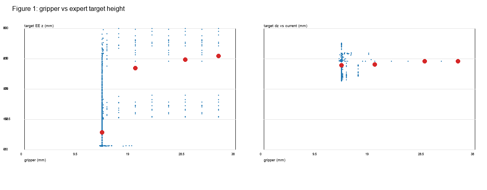
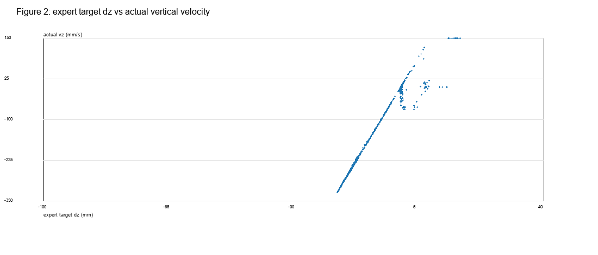
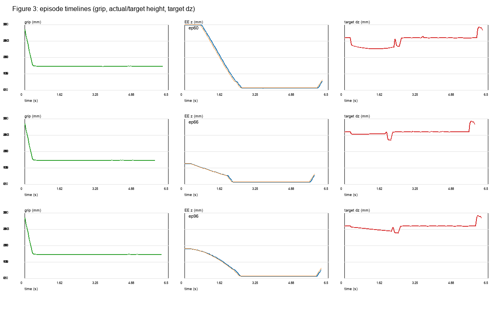
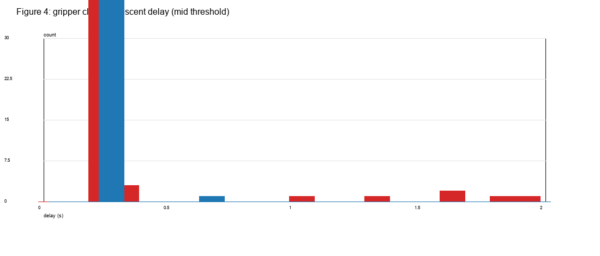
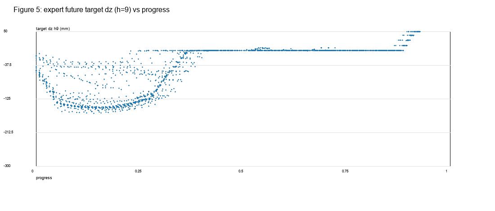
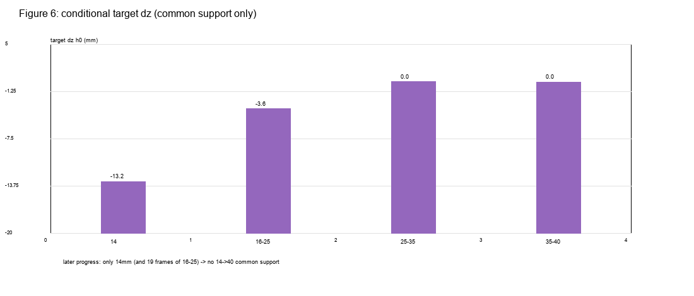
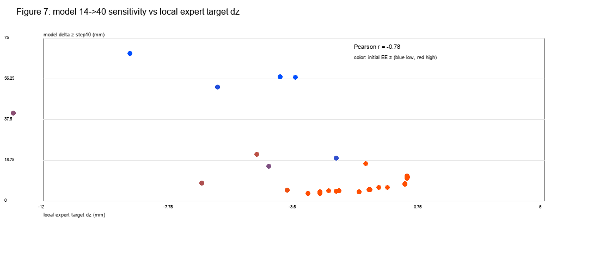
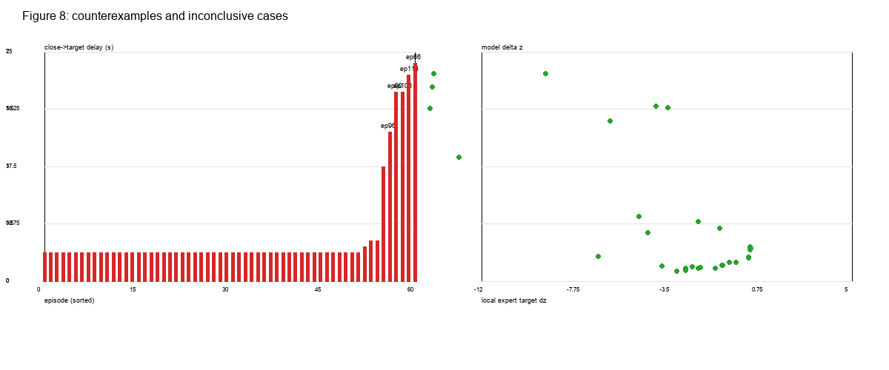

# 实验 2.8-S1：D2 专家动作目标高度与夹爪状态的时序关联分析

## 1. Executive Summary

- **D2 B90 的专家动作监督中，夹爪开度与“目标高度”的全局统计关系很弱，且被任务阶段强烈混杂。** 7,016 帧 / 60 条 yaw90：夹爪观测与当前专家目标高度变化 `Δz_target` 的 Pearson **0.088**、Spearman **−0.031**；与下一帧实际垂直速度的 Pearson **0.098**、Spearman **−0.049**。  
- **按夹爪分箱看，14 mm 的当前目标更常向下，宽夹爪更少向下**：h0 的 `Δz_target` 均值在 14 mm 为 **−3.46 mm**、16–25 mm 为 **−2.81 mm**、25–35 mm 为 **0.00 mm**、35 mm 为 **0.00 mm**；目标下降比例分别为 **31.9%、30.2%、0%、0%**。但 25–35/35 mm 的帧几乎都位于轨迹最开头（手臂静止），这不是“宽夹爪导致保持高度”的干净证据。  
- **夹爪闭合在时间上稳定早于明显下降**：60/60 条 episode 的“闭合→目标下降”时间差为正，中位 **0.25 s**、均值 **0.384 s**，范围 0.25–1.90 s；“闭合→实际下降”中位 **0.25 s**、均值 0.257 s，范围 0.25–0.65 s。主阈值与两套替换阈值方向一致，但有 4 条 episode 在最强阈值下没有目标下降事件，ep66 的延迟 1.90 s 是明显反例。  
- **控制 progress 后，只有最开始 0–15% 的区间存在多夹爪共同覆盖**：该区间有 14/16–25/25–35/35 mm 四组；14 mm 的 `Δz_target` 为 **−13.2 mm**，16–25 为 **−3.6 mm**，25–35 与 35 为 **0.00 mm**。15% 之后几乎只有 14 mm，无法估计固定进度下的 14→40 专家效应。  
- **与实验 2.8 的模型响应只有部分方向一致，不能视为同一效应**：早期阶段的专家监督方向（宽夹爪→较少向下）与模型“宽夹爪→预测更高目标”方向一致；但 32 个状态的模型 14→40 敏感性与局部专家目标 `Δz_target` 的相关为 **−0.775**，与初始 EE 高度为 **+0.921**，说明二者都被状态/高度混杂。40 mm 在专家数据中完全不存在，不能检验模型 35→40 的外推。  
- **现有数据不能证明“夹爪数值本身”是模型高度响应的原因。** 它支持“训练监督中存在与阶段强耦合的夹爪—目标高度统计结构”，但固定构型、固定进度下的 14→40 共同覆盖不足，且 40 mm 为零覆盖。

## 2. Data and Action Label Verification

### 2.1 数据

| 项 | 值 |
|---|---|
| 数据集 | `data/_shards_e23/B_D2` |
| 主分析 | B90 yaw90：**60 episodes / 7,016 frames** |
| yaw0 | 60 episodes，仅作辅助，未混入主统计 |
| 帧率 | 20 Hz，`Δt=0.05 s`（timestamp 唯一差值） |
| 来源映射 | collection 成功记录 `ok[i]`，yaw90 对应 i=60..119；避免 HOME 重复起点误配 |
| 动作标签 | parquet `action[0:7]` 七关节绝对位置目标；`action[7]` 夹爪目标 |
| 观测 | `observation.state[0:7]` 七关节；`[7:9]` 双指实际位置 |
| FK | PyBullet Panda，link 11，世界坐标 +Z 向上 |

### 2.2 动作标签核查

- `action[t][0:7]` 与 `observation.state[t+1][0:7]` 的差在多个帧上约 **1×10⁻⁵ rad**（早期），说明它是控制器下一时刻的七关节目标，而不是当前观测的复制。
- `action[t][7]=0.014` 与 `observation.state[t+1][7]≈0.032` 不同，说明夹爪目标是**指令**，不是下一帧实际开度。
- 因此本报告分别保留：
  - `q_obs` / `q_target`（当前观测与专家目标）；
  - `z_obs` / `z_target`（FK 高度）；
  - `Δz_target=z_target−z_obs`（目标相对当前高度的变化）；
  - `vz_actual`（下一帧实际 FK 高度差 / Δt，mm/s）。
- `Δz_target` 不是实际位移；`vz_actual` 不是模型动作目标速度。

### 2.3 未来 chunk 对齐

- 训练标签为未来动作块：对帧 t 的 horizon k，取同一 episode 的 `action[t+k]`；`valid = (t+k < episode_length)`。
- **不跨 episode 拼接，不填充 padding**；无效行在 `expert_chunk_targets.csv` 中 `valid=0`。
- horizon 取 **0/4/9/19/49**，与实验 2.8 的模型汇总步一致。
- 由于 `action[t]` 本身已接近 `obs[t+1]` 的控制器目标，h0 与下一帧实际高度有强相关（`Δz_target` 与 `vz_actual` 的 Pearson **0.987**）；因此两者不能当作独立测量。

## 3. Expert Target Height Analysis（RQ1–RQ2）

### 3.1 全局

- 7,016 帧；`Δz_target` 均值 **−3.32 mm**（专家目标平均略低于当前实际高度）。
- 夹爪观测与 `Δz_target`：Pearson **0.088**，Spearman **−0.031**（Spearman 已处理大量 14 mm 并列值）。
- 夹爪观测与 `vz_actual`：Pearson **0.098**，Spearman **−0.049**。
- 目标绝对高度 `z_target` 随夹爪增大而显著升高（14 mm ≈85 mm，35 mm ≈463 mm），但这是因为宽夹爪帧几乎全在轨迹开始、EE 还在高位；**不能把绝对高度当作夹爪效应**。

### 3.2 夹爪分箱

| 夹爪 | 帧数 | episode | `z_target` 均值 | `Δz_target` h0 | 目标下降比例 | 实际 vz 均值 |
|---|---:|---:|---:|---:|---:|---:|
| 14 mm | 6,577 | 60 | 85.4 mm | **−3.46 mm** | **31.9%** | −67.5 mm/s |
| 16–25 mm | 199 | 60 | 403.6 mm | −2.81 mm | 30.2% | −54.5 mm/s |
| 25–35 mm | 192 | 60 | 444.1 mm | **0.00 mm** | **0%** | 0.0 mm/s |
| 35–40 mm | 48 | 48 | 462.6 mm | **0.00 mm** | **0%** | 0.0 mm/s |

- **h0 的直观方向**：14 mm 更常向下，25–35/35 mm 几乎不动；但这与“宽夹爪只出现在起点”完全重合。
- **h9/h19 并不保持该方向**：h19 的 25–35 mm 组为 **−107.7 mm**，比 14 mm 的 **−79.6 mm** 更向下；h49 各组都在 −148～−180 mm。  
  说明“宽夹爪→更少下降”只在**当前步/最早期**成立，不能推广到整个未来 chunk。




**RQ1 答案：Mixed。** 绝对目标高度与宽夹爪强相关，但这是阶段/高度混杂；相对目标变化 `Δz_target` 的全局相关很弱，分箱方向在 h0 存在、在 h9/h19 反转/消失。

**RQ2 答案：Mixed。** h0 宽夹爪（25–35/35）确实更常“保持高度”，14 mm 更常向下；但宽夹爪样本几乎全是轨迹起点，且未来 horizon 不保持该规律。不能声称“宽夹爪使专家抬高手臂”。

## 4. Temporal Analysis（RQ3）

### 4.1 事件定义

- 夹爪闭合：首次 `grip ≤ initial_grip − 2 mm` 且持续 2 帧。
- 目标下降：首次 `Δz_target < −5 mm` 且持续 3 帧（主阈值）；稳健性另测 −2/−10 mm。
- 实际下降：首次 `vz_actual < −50 mm/s` 且持续 3 帧（主阈值）；另测 −20/−80 mm/s。

### 4.2 结果

- 60/60 episodes 的闭合事件都在 **0.05 s**（第一步夹爪目标已为 0.014 m，实际开度从 35 mm 开始收窄）。
- 主阈值：目标下降首次在 **0.30 s**（60/60），实际下降首次在 **0.30 s**（60/60）。
- 闭合→目标下降：中位 **0.25 s**，均值 **0.384 s**，范围 **0.25–1.90 s**；60/60 为正。
- 闭合→实际下降：中位 **0.25 s**，均值 **0.257 s**，范围 **0.25–0.65 s**；60/60 为正。
- 稳健性：
  - 低阈值（−2 mm / −20 mm/s）：目标/实际均 60/60，目标中位 0.25 s，实际中位 0.25 s。
  - 高阈值（−10 mm / −80 mm/s）：目标 56/60（4 条无事件），实际 60/60；目标中位 0.25 s、最大 2.25 s；实际中位 0.25 s。
- **反例**：ep66 的闭合→目标下降延迟 **1.90 s**；ep96 的闭合→实际下降延迟 **0.65 s**。其余 episode 的延迟集中在 0.25 s。




**RQ3 答案：Yes（描述性时序稳定），但不能推出因果。** 闭合先于明显下降 0.25 s 左右，跨 60 条 episode 方向一致；但事件定义依赖“初始−2 mm / −5 mm / −50 mm/s”阈值，且夹爪目标在第一步就已闭合，闭合与下降可能都由同一示范阶段驱动。

## 5. Conditional and Local Analysis（RQ4、RQ6）

### 5.1 Progress 分层

| progress | 可用夹爪组 | 14 mm Δz_target | 16–25 Δz_target | 25–35 Δz_target | 35 Δz_target | 结论 |
|---|---|---|---:|---:|---:|---:|---|
| 0–15% | 14 / 16–25 / 25–35 / 35 | **−13.2** | −3.6 | 0.00 | 0.00 | 有共同覆盖；宽夹爪更少向下 |
| 15–30% | 仅 14 | −13.5 | — | — | — | 不可估计 |
| 30–50% | 仅 14 | −3.5 | — | — | — | 不可估计 |
| 50–100% | 14 + 19 帧 16–25（4 eps） | +1.4 | +4.4（19 帧） | — | — | 16–25 样本太少，不可靠 |

- 只有在 **0–15%** 有足够的 14/16–25/25–35/35 四组；此区间内目标下降方向与“宽夹爪更少下降”一致。
- 15% 之后几乎只有 14 mm；因此 **固定 progress 下的 14→40 专家效应 `not_estimable_due_to_insufficient_overlap`**。
- 50–100% 的 19 帧 16–25 来自 4 条 episode，不能当作可靠条件对照。

### 5.2 32 个中间状态的局部 q 邻域

- q≤0.30 rad：中位 **1,457 帧 / 53 episodes**；只有 **5/32 状态**具备 14 mm 与 35 mm 各 ≥5 帧的共同支持；40 mm 为 **0**。
- q≤0.75 rad：中位 3,879 帧 / 60 episodes；9/32 状态有共同支持；29/32 有 near-35。
- 局部夹爪最大值通常为 14 mm；只有早期 HOME 附近出现 35 mm 起点。




**RQ4 答案：Not estimable / Inconclusive。** 全局弱相关；0–15% 内有方向性，但 15% 之后几乎没有多开度共同覆盖；不能把全局相关解释为夹爪的独立效应。

**RQ6 答案：只对早期有部分多开度覆盖；晚期/固定构型不可估计。** 40 mm 在任何邻域都不存在。

## 6. Comparison with Experiment 2.8（RQ5）

32 个 state 的模型 14→40 敏感性（step10）与局部专家统计：

- 模型敏感性与局部专家 `Δz_target` 的相关：**−0.775**。
- 模型敏感性与初始 EE 高度：**+0.921**。
- 模型敏感性与局部 near-35 帧数：描述性正相关（早期状态）。

关键状态：

| state | 阶段 | 模型 Δz (mm) | 局部专家 Δz (mm) | 局部 near35 | 初始 EE z |
|---|---|---:|---:|---:|---:|
| ep082_f010 | early | **+67.9** | −9.07 | 6 | 0.180 m |
| ep080_f025 | approach | **+3.28** | −3.04 | 0 | 0.019 m |
| ep080_f055 | push | +10.60 | +0.34 | 0 | 0.018 m |
| ep066_f039 | precontact | +21.29 | −4.77 | 0 | 0.070 m |

- **方向一致的部分**：在 0–15% progress 内，专家 14 mm 的目标比 25/35 mm 更向下（−13.2 vs 0 mm），而模型把 40 mm 相对 14 mm 预测得更高。两者都表现为“宽夹爪→较少下降”。
- **不一致/不可比的部分**：32 个状态上的模型敏感性与局部专家 `Δz_target` 是负相关；高敏感状态（如 ep082 f10）局部专家目标更向下，而不是更“保持高度”。这是因为模型敏感性和专家目标高度都随初始 EE/阶段变化，属于不同统计量。
- 40 mm 在训练中为零，无法检验模型 35→40 的外推是否与专家一致。

**RQ5 答案：Mixed。** 早期 aggregate 方向与模型一致；状态级相关方向相反；40 mm 无数据。不能把专家观察相关当作模型反事实导数。




## 7. Limitations

- 专家数据是观察性的；夹爪、progress、EE 高度、构型高度混杂，不能证明夹爪的因果作用。
- 40 mm 训练帧为 0；35 mm 也只有 48 帧（48 条 episode 起点）。
- 局部不同开度共同覆盖不足，不能做固定 q 的 14→40 条件估计。
- 相邻帧高度相关，不能当独立样本；episode 数是 60，但条件组往往只有少数 episode。
- `action` 是控制器关节目标，不是实际执行轨迹；`Δz_target` 不是实际位移/速度。
- 动作目标 h0 与下一帧实际高度高度相关（r≈0.987），两者不是独立测量。
- 反事实观测图像与修改后夹爪数值不一致；本补充没有新的物理一致反事实轨迹，也没有重新运行 Direct 组合。
- 事件检测阈值敏感性存在；ep66 的 1.90 s 延迟是明显反例。

## 8. Direct Answers to RQ1–RQ6

| RQ | Answer | Supporting Evidence | Counterevidence | Limitation | Confidence |
|---|---|---|---|---|---|
| **RQ1** 宽夹爪是否对应更高目标/更少下降？ | **Mixed** | h0：14 mm Δz −3.46 mm、下降率31.9%；25–35/35 mm Δz 0、下降率0% | h19 25–35 组 −107.7 mm，比14 mm −79.6 mm 更向下；全局 Pearson 0.088 / Spearman −0.031 | 宽夹爪只出现在起点，绝对高度受初始 EE 混杂 | 中 |
| **RQ2** 宽夹爪是否更少下降监督？ | **Mixed** | h0 分箱方向一致；14 mm 目标下降比例更高 | h9/h19 不保持；35 mm 仅48帧且静止 | 无40 mm；horizon依赖 | 中 |
| **RQ3** 闭合是否早于下降？ | **Yes（描述性）** | 60/60 闭合→目标下降为正；中位0.25 s；实际下降中位0.25 s；三套阈值方向一致 | ep66 延迟1.90 s；ep96 实际0.65 s；高阈值4条无目标事件 | 事件阈值依赖；闭合/下降可能同受阶段驱动 | 中高 |
| **RQ4** 控制 progress/构型后关联是否仍存在？ | **Not estimable / Inconclusive** | 0–15% 内四组有方向性；14 mm −13.2 vs 25–35 0 | 15% 后几乎仅14 mm；q0.30 仅5/32共同支持；40 mm 0 | 共同覆盖不足 | 高（对“不足”本身） |
| **RQ5** 与2.8模型响应是否一致？ | **Mixed** | 早期方向一致；模型14→40全为正 | 32状态模型敏感性 vs 局部专家Δz 为 −0.775；与EE +0.921 | 统计量不同；40 mm 无监督 | 中 |
| **RQ6** 数据能否区分A–D？ | **No（不能完整区分）** | 可排除“40 mm 专家监督存在”的假设；可直接观察阶段混杂 | 无固定q多开度覆盖；无40；无干预 | 观察数据，不能识别A/B/C/D | 高 |

## 9. Conclusions

### A. Directly observed facts

- 7,016 帧/60 yaw90：14 mm 帧 6,577；40 mm 帧 **0**；35 mm 帧仅48。
- h0 目标下降比例：14 mm 31.9%，16–25 30.2%，25–35 0%，35 0%；`Δz_target` 均值 −3.46/−2.81/0/0 mm。
- 但 h9/h19 宽夹爪组并不稳定地“更少下降”；h19 的25–35组比14组更向下。
- 60/60 闭合→目标下降为正，中位0.25 s；实际下降中位0.25 s；ep66 1.90 s、ep96 0.65 s 是反例。
- progress 0–15% 有四组共同覆盖；15% 后仅14 mm（除19帧16–25）。
- q≤0.30 仅5/32状态有14 mm+35 mm共同支持；40 mm为零。

### B. Plausible interpretations（未验证）

- 训练监督可能包含“宽夹爪通常在早期、目标较高/较少下降；闭合后进入下降”的时序结构；模型可能利用了这种统计关联。
- 但宽夹爪帧几乎全是起点，且初始 EE 高度同时影响目标高度与模型敏感性；不能把关联归因于夹爪数值本身。
- 早期方向与模型响应一致，但状态级相关相反，说明“阶段/高度”是共同驱动因素的有力候选。

### C. Unresolved questions

- 固定 q、固定 progress 下 14→40 的专家目标差异（无共同覆盖）。
- 40 mm 专家动作是什么（完全没有数据）。
- 模型内部是否把夹爪当作阶段变量（无 attention/embedding 证据）。
- 视觉—本体不一致是否改变真实闭环。
- 这些统计结构是否是 Direct A90→B90 失败的因果机制。

## 10. Artifacts

```text
results/experiment_2_8/supplement_s1/
  data/
    expert_target_dynamics.csv        # 7,016 frames
    expert_chunk_targets.csv          # 35,080 frame×horizon (valid mask)
    gripper_target_statistics.csv
    episode_timing_events.csv
    timing_summary.csv
    conditional_target_statistics.csv
    local_target_coverage.csv
    model_expert_comparison.csv
  figures/fig01..fig08
  report.md
```

代码：

- `scripts/exp28s1_target_height.py`
- `scripts/exp28s1_visualize.py`

原始数据：`data/_shards_e23/B_D2`（60 条 yaw90 / 7,016 帧）。

复现：

```bash
# 服务器
HF_HUB_OFFLINE=1 PYTHONPATH=src venv/bin/python scripts/exp28s1_target_height.py
# 本地
python scripts/exp28s1_visualize.py
```
