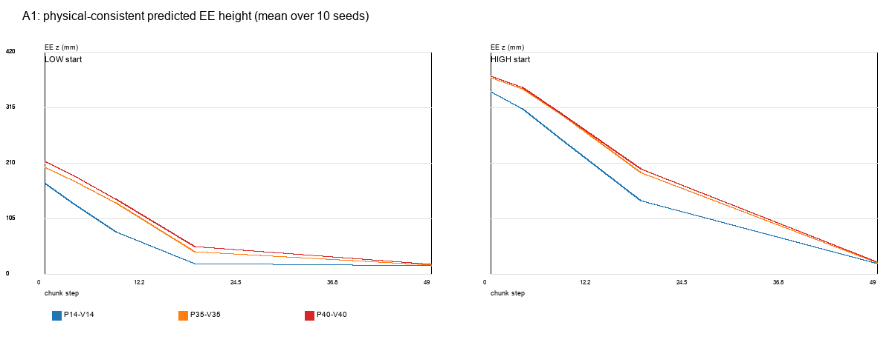
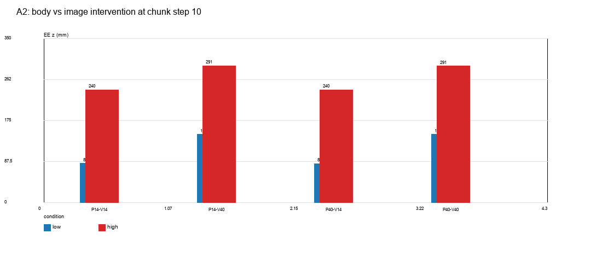
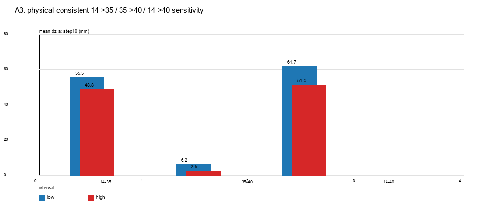
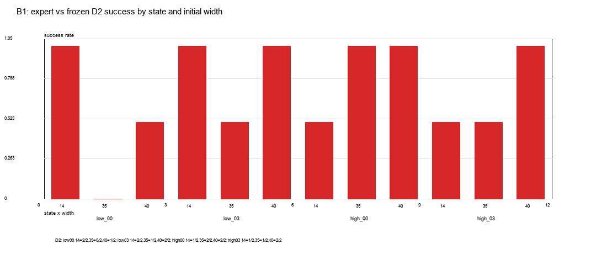
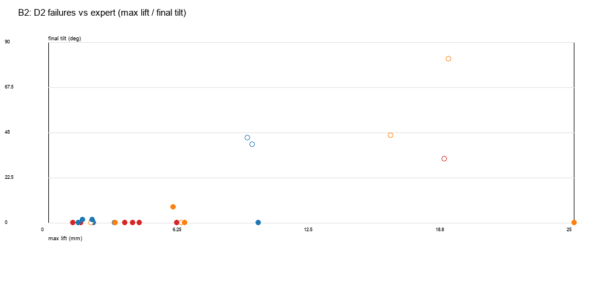
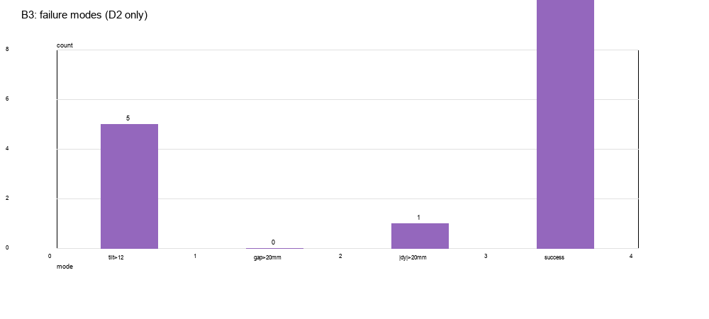

# 实验 2.9 A/B：物理一致性与低位联合状态专家—D2 对照

## 0. 结论摘要

- **A：在物理一致输入下，夹爪开度仍然系统性影响冻结 D2 的预测高度。** 10 个新生成状态（5 低起点 /5 高起点）、4 种真实开度、5 种图像/本体交叉条件、10 个成对种子。物理一致 14→40 mm 的 step10 高度差：低起点 **+61.7 mm**，高起点 **+51.3 mm**，10/10 状态为正。
- **A：本体观测起主导作用，图像夹爪几乎不起作用。** 固定本体 14 mm，把图像从 14 换到 40，step10 只变化 **−0.5 mm（低）/−0.3 mm（高）**；固定图像 14 mm，把本体从 14 换到 40，变化 **+62.0/+51.4 mm**。
- **A：35 mm 不是安全的中间值，已经接近 40 mm 的响应。** 14→35 占主要高度差（低 +55.5 / 高 +48.8 mm），35→40 仅 **+6.2 / +2.5 mm**，但两者都远高于 14 mm。
- **B：专家 E0/E1 在 4 个状态 ×3 个宽度全部成功（12/12 +12/12）；冻结 D2 为 17/24。** D2 成功率：14 mm **6/8**、35 mm **4/8**、40 mm **7/8**。
- **B：存在“专家成功、D2 失败”的低位状态，但不是所有状态/所有宽度。** `low_00` 的 35 mm 为 **D2 0/2**、专家成功；`high_03` 的 35 mm 为 1/2；但 `high_00` 的 35 mm 为 2/2，`low_03` 为 1/2。
- **B：失败并非统一的“顶部接触”。** 7 个 D2 失败中 5 个是 tilt>12°（31.9–81.8°），1 个是侧向 dy 32.4 mm，1 个是 yaw 变化约 16.2°；D2 首次接触多为 link10，法向 z 分量小（−0.02～−0.05），不是 C3 那种纯 −Z 顶部接触。
- **是否进入 C：No-Go。** 见 §5；低 35 mm 只有 1 个状态出现 0/2，且 2 个种子；35 mm 在其他状态正常，40 mm 反而 7/8。证据不足以支持“Low-35 定向数据”假设，且不做 C。

---

## 1. 实验 A：物理一致状态下的夹爪敏感性

### 1.1 状态生成

- 新物体种子 **92,000,000+**，yaw90，未使用 D2 训练/测试起点。
- 5 个 Low-Start：EE z **0.165–0.209 m**，在物体后方 **0.12 m**，距物体 xy **0.12 m**，物体上方 **0.14–0.19 m**。
- 5 个 High-Start：EE z **0.320–0.388 m**，在物体后方 **0.20 m**，距物体 xy **0.20 m**，物体上方 **0.30–0.37 m**。
- 所有状态在 14/25/35/40 mm 下重新渲染图像；`physical_validity.csv` 40/40 宽度配置有效，最大物体位移 **1.4×10⁻⁶ mm**，无机器人—物体接触。

### 1.2 模态交叉

5 个条件：P14-V14、P35-V35、P40-V40、P14-V40、P40-V14；10 个成对种子。物理一致条件为前三个；后两个只用于离线反事实推理。

### 1.3 结果

| step10 EE z | Low | High |
|---|---:|---:|
| P14-V14 | **83.2 mm** | **239.8 mm** |
| P35-V35 | **138.7 mm** | **288.6 mm** |
| P40-V40 | **144.9 mm** | **291.1 mm** |
| P14-V40 | 145.2 mm | 291.2 mm |
| P40-V14 | 82.7 mm | 240.1 mm |

物理一致敏感性（step10，5 个状态均值，全部为正）：

| 区间 | Low | High |
|---|---:|---:|
| 14→35 | **+55.5 mm** | **+48.8 mm** |
| 35→40 | **+6.2 mm** | **+2.5 mm** |
| 14→40 | **+61.7 mm** | **+51.3 mm** |

**模态结论：**

- 固定本体 14 mm，图像 14→40：**−0.5 mm（低）/ −0.3 mm（高）**。
- 固定本体 40 mm，图像 40→14：**−0.4 mm（低）/ −0.1 mm（高）**。
- 固定图像 14 mm，本体 14→40：**+62.0 mm（低）/ +51.4 mm（高）**。
- 因此在本设置中，**本体夹爪数值是主导因素，图像夹爪变化几乎不改变动作**。这是模型输入敏感性，不是物理图像一致性结论。

---

## 2. 实验 B：专家—D2 配对

### 2.1 设计

- 4 个状态：`low_00`、`low_03`、`high_00`、`high_03`。
- 宽度：14/35/40 mm；每个配置：
  - E0 原始专家 `skill_b()`
  - E1 状态感知专家（低起点不强制经过 0.07 m，当前高度水平接近后下降）
  - 冻结 D2，2 个独立进程（无固定 policy 种子，作为采样重复）
- 总计 48 次真实执行：12 E0 +12 E1 +24 D2。
- 统一 v2.2 判据，另记真实墙接触；专家与 D2 使用同一快照/宽度。

### 2.2 成功与动作

| 条件 | 成功 |
|---|---:|
| E0 原始专家 | **12/12** |
| E1 状态感知专家 | **12/12** |
| 冻结 D2 | **17/24** |

D2 按宽度：

| 宽度 | D2 成功 |
|---|---:|
| 14 mm | **6/8** |
| 35 mm | **4/8** |
| 40 mm | **7/8** |

逐状态：

| 状态 | 宽度 | E0 | E1 | D2 |
|---|---:|---:|---:|---:|
| low_00 | 14 | ✅ | ✅ | 2/2 |
| low_00 | 35 | ✅ | ✅ | **0/2** |
| low_00 | 40 | ✅ | ✅ | 1/2 |
| low_03 | 14 | ✅ | ✅ | 2/2 |
| low_03 | 35 | ✅ | ✅ | 1/2 |
| low_03 | 40 | ✅ | ✅ | 2/2 |
| high_00 | 14 | ✅ | ✅ | 1/2 |
| high_00 | 35 | ✅ | ✅ | 2/2 |
| high_00 | 40 | ✅ | ✅ | 2/2 |
| high_03 | 14 | ✅ | ✅ | 1/2 |
| high_03 | 35 | ✅ | ✅ | 1/2 |
| high_03 | 40 | ✅ | ✅ | 2/2 |

专家 E1 与 E0 均成功；E1 在低起点直接低位水平接近，不经过固定 0.07 m。专家在 35/40 mm 下也没有因为宽夹爪而失败。

### 2.3 接触与失败

D2 的 7 个失败：

| 状态 | 宽度 | 失败原因 | tilt | gap | dy | 首次 link | normal z |
|---|---:|---|---:|---:|---:|---|---:|
| low_00 | 35 | 侧向偏移 | 0.014° | 3.8 mm | **32.4 mm** | link10 | −0.042 |
| low_00 | 35 | yaw 旋转 | 0.01° | 9.5 mm | 1.6 mm | link10 | −0.024 |
| low_00 | 40 | tilt | **31.9°** | 1.8 mm | 11.4 mm | link10 | −0.038 |
| high_00 | 14 | tilt | **39.1°** | 15.4 mm | −2.0 mm | link10 | −0.027 |
| high_03 | 14 | tilt | **42.5°** | 18.8 mm | 6.4 mm | link10 | −0.000 |
| high_03 | 35 | tilt | **43.5°** | 8.4 mm | −0.9 mm | link10 | −0.023 |
| low_03 | 35 | tilt | **81.8°** | 16.2 mm | −3.3 mm | link10 | −0.054 |

- 失败模式：5 次 tilt>12°、1 次侧向 dy>2 cm、1 次 yaw 变化约 16.2°（gap/dy 看似合格但 v2.2 未过）。
- **没有一次是 C3 那种法向纯 −Z 的顶部接触**；D2 首次接触多为右指 link10，法向 z 分量很小。
- 专家首次接触 link9/10，抬升通常 <1 mm；D2 在 high_03 35 mm 抬升 20.7 mm、low_03 35 mm 19.0 mm。
- 低 00 +35 mm 的两次 D2 失败均以 3.8/9.5 mm gap 结束，但一次 dy 32.4 mm、一次 yaw 旋转，说明不是“没推到墙”，而是侧向/旋转失败。

### 2.4 视频

- `videos/B_low00_g35_expert_vs_D2.mp4`
- `videos/B_low00_D2_g14_vs_g35.mp4`
- `videos/B_high03_g35_expert_vs_D2.mp4`
- `videos/B_low00_g40_expert_vs_D2.mp4`

---

## 3. 对 A/B 问题的回答

1. **物理一致输入下夹爪开度是否仍影响 D2 高度？** 是。10/10 状态，14→40 平均 +61.7 mm（低）/ +51.3 mm（高）。
2. **低/高起点是否不同？** 低起点幅度略大（+61.7 vs +51.3），方向相同；35→40 都很小（+6.2/+2.5）。
3. **视觉与本体分别起什么作用？** 本体主导；图像夹爪变化 <1 mm。
4. **专家在低起点 14/35/40 的正确动作？** E0/E1 都成功；E1 在低位直接水平接近再下降，E0 仍经 0.07 m；两者均成功。专家 35/40 下没有失败。
5. **D2 哪些动作偏离专家、哪些合理？** D2 在 low_00 35（两次）和 low_00 40 偏离并失败；在 high_00 35/40、low_03 40、high_03 40 与专家不同但成功。不能仅凭高度差判错。
6. **不合理高度响应是否导致错误接触/失败？** 部分：low_00 35/40、high_03 35、low_03 35、high_00 14、high_03 14 失败；但失败多为 tilt/yaw/侧向，非顶部接触。相关性存在，非单一机制。
7. **35 与 40 是否不同类型？** 本数据中 35 mm D2 4/8，40 mm 7/8；35 更差，但样本小且状态依赖（high_00 35 为 2/2）。不能声称 40 才是唯一问题。
8. **是否存在足以支持定向训练的状态—动作缺口？** 只有 `low_00 +35 mm` 出现专家成功、D2 0/2；`low_03 +35` 为 1/2，`high_00 +35` 为 2/2。没有多个独立状态的一致缺口，且每格 2 个 D2 种子。**No-Go。**

---

## 4. 限制

- 只有 4 个 B 状态、每状态/宽度 2 个 D2 采样；成功率差异的置信区间很宽。
- D2 采样未固定 policy 随机种子；E0/E1 各 1 次。
- A 的 10 个状态是新生成的，但仍是单一物体/场景族；B 只取其中 4 个。
- 反事实图像/本体交叉仅用于离线推理，不是真实闭环。
- 专家 E1 是手工状态感知路径，不是唯一有效路径；E0/E1 都成功，不能把 E1 当“唯一正确”。
- 未训练、未做 C；没有 Direct A90→B90 的新评测。
- 失败接触法向只记录 z 分量；未做接触点局部坐标的完整分解。

---

## 5. C 阶段判断：No-Go

证据：

- 4 个状态中只有 1 个（low_00）在 35 mm 出现专家成功、D2 0/2；另一个低状态 low_03 为 1/2，高位 high_00 为 2/2。
- 40 mm 的 D2 成功率为 7/8，并不比 35 mm 差；不能支持“40 mm 是唯一问题”。
- 2 个 D2 种子不足以稳定估计状态级成功率。
- 失败机制是 tilt/yaw/侧向，不是统一的顶部接触；单靠 Low-35 数据无法针对这些多机制。

因此不进入 C，不生成 `targeted_ft/` 训练结果。若后续继续，应先扩大 B 到更多独立状态和更多 D2 种子，并固定 policy 种子，确认 Low-35 缺口是否可重复。
