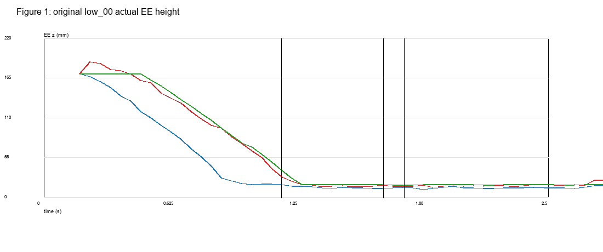
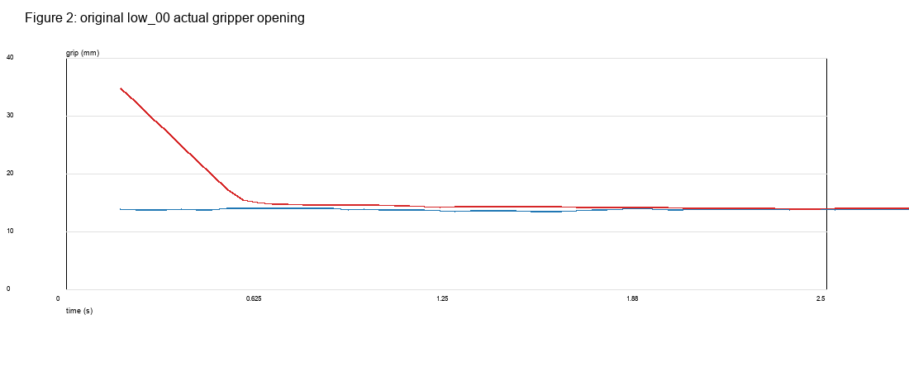
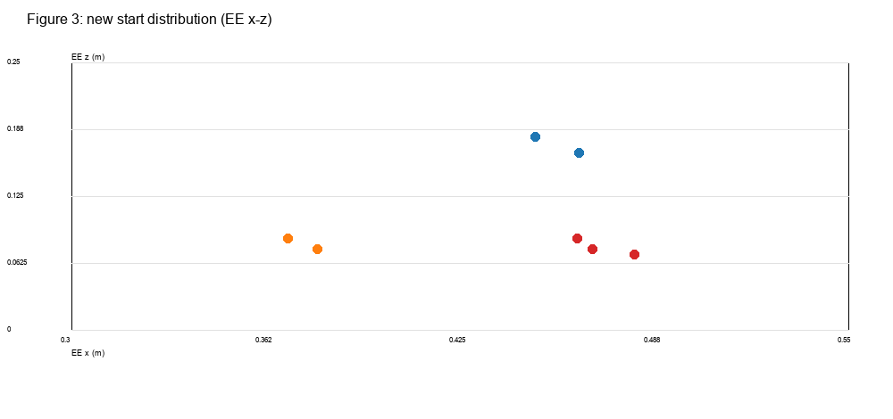
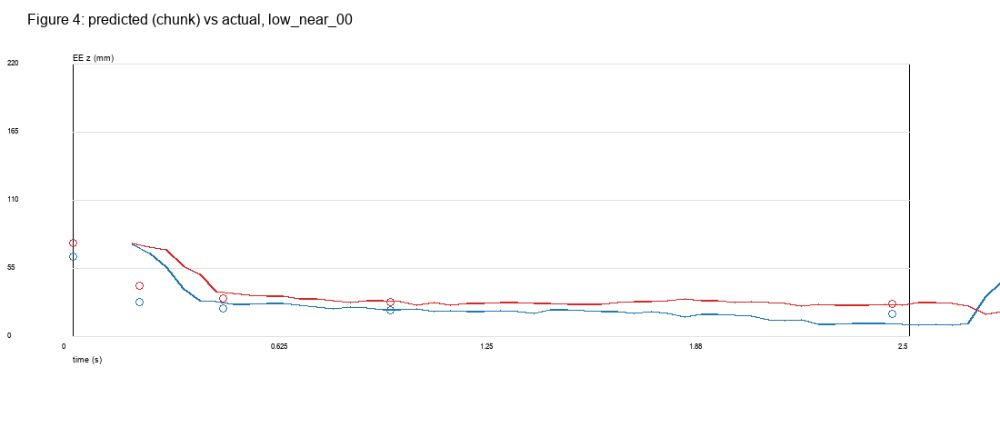
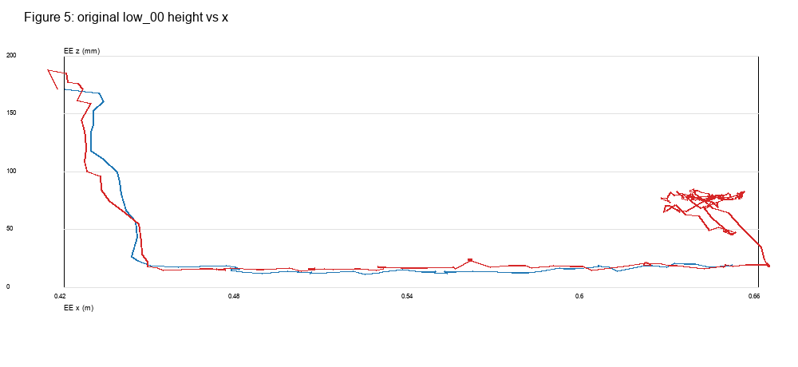
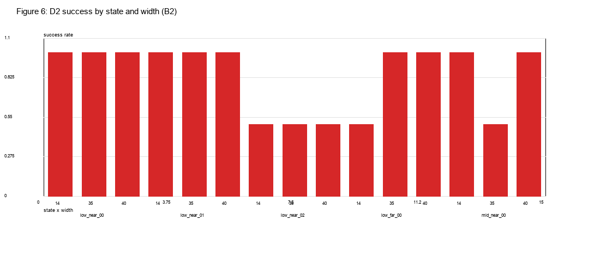
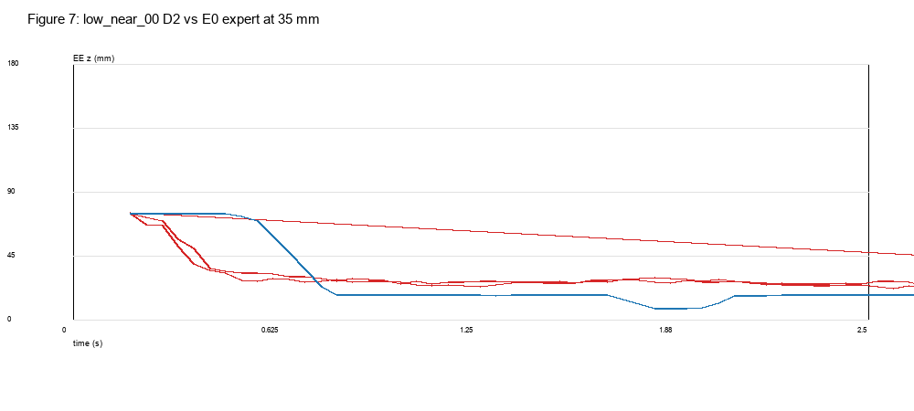
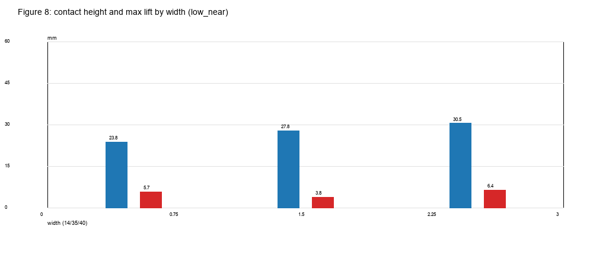
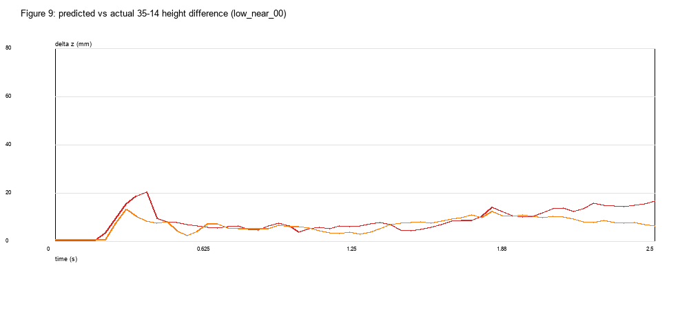

# 实验 2.9-B2：真实低位接近状态下的闭环轨迹与接触机制

## 1. Executive Summary

1. **原先 low_00 的 14 mm 与 35 mm 实际轨迹并不“高度接近”。** 0.5 s 时 EE z 分别为 **114.7 vs 160.5 mm**（差 45.8 mm），1.0 s 时 **18.4 vs 70.3 mm**（差 51.9 mm）；首次接触高度才接近（17.5 vs 16.3 mm），但 35 mm 的接触晚 **0.50 s**，路径长 **0.259 vs 0.209 m**。差异在接近段一直存在，直到最后快速下降才在接触高度上“收敛”。
2. **实验 A 的预测差确实被执行了。** low_00 的离线预测 step10 为 **71.3 mm（14）vs 129.0 mm（35）**；实际 35 mm 在早期保持更高、更晚下降。没有证据显示闭环在接触前把两条路径逐渐修正为同一高度。
3. **真正 Low-Near 的预测敏感性反而更小。** 新 Low-Near（EE z 0.070–0.085 m）14→40 step10 仅 **+9.9 mm**（3/3 正）；旧 Low（0.165–0.209 m）为 **+61.7 mm**，Mid-Near 为 **+62.2 mm**。低位靠近物体时，模型预测的高度响应缩小，而不是放大。
4. **真实 Low-Near 下 D2 没有出现稳定失败。** 3 个 Low-Near ×3 宽度 ×2 次 =18 次 D2，**15/18 成功**；low_near_00 与 low_near_01 均 6/6，low_near_02 为 3/6。没有“35/40 mm 稳定失败”的模式；35 与 40 的成功率甚至不低于 14。
5. **专家 E1 不适合作为低位“正确参考”。** E1 在 Low-Near 的 18 次中只成功 **6/18**，总 30 次为 18/30；E0 在 Low-Near 为 **7/9**。E1 的低位分支确实触发（EE≤0.10 m，approach_z 0.070–0.080 m），但其路径在多个状态失败，不能把它当作唯一正确专家。**C 阶段 No-Go。**

---

## 2. Original low_00 Recheck

数据：`data/original_low00_recheck.csv`、`data/original_low00_trajectories.csv`。

| run | contact t | contact EE z | z@0.5s | z@1.0s | min pre-contact z | path length |
|---|---:|---:|---:|---:|---:|---:|
| D2 14 | 1.179 s | 17.5 mm | **114.7 mm** | **18.4 mm** | 17.5 | 0.209 m |
| D2 35 r0 | 1.683 s | 16.3 mm | **160.5 mm** | **70.3 mm** | 14.6 | 0.259 m |
| D2 35 r1 | 1.692 s | 25.7 mm | 160.8 mm | 87.4 mm | 23.1 | 0.261 m |
| E1 14/35 | 1.788 s | 17.1 mm | 167.4 mm | 72.8 mm | 17.0 | 0.207 m |

- 35 mm 在前 1 s 明显更高、下降更慢；接触高度接近只是因为最后阶段快速下降。
- 14 mm 接触更早、路径更短；35 mm 接触更晚、路径更长。
- E1 在 14/35 下轨迹完全相同，因为专家第一步就把夹爪目标设为 0.014 m；宽度只影响初始几帧，后续被专家闭合覆盖。

**RQ1 答案：不接近；早期路径不同，仅在接触高度附近收敛。** 不是“路径相近但速度不同”，而是 35 mm 保持高位更久、随后更陡地下降。

---

## 3. Start-State Design

新增 7 个状态，新种子 93,000,000+，yaw90：

| kind | n | EE z | EE-object dx | 说明 |
|---|---:|---:|---:|---|
| Low-Near | 3 | **0.070–0.085 m** | **−0.07～−0.09 m** | 物体后方 7–9 cm，接近推动区域 |
| Low-Far | 2 | 0.075–0.085 m | −0.18～−0.19 m | 同高度，更远 |
| Mid-Near | 2 | 0.165–0.180 m | −0.08～−0.09 m | 同近位置，更高 |

- 物体仍在 x≈0.54、y≈0.18；所有状态在 14/35/40 mm 下有效：**21/21** 宽度配置通过，最大物体位移 **7×10⁻⁷ mm**，无机器人—物体接触。
- 所有状态是新的 IK 构型，不是 D2 训练轨迹；未瞬移物体/机器人。

---

## 4. Policy Prediction Analysis（A3）

新状态 14/35/40，10 个成对种子：

| kind | 14→35 | 35→40 | 14→40 |
|---|---:|---:|---:|
| Low-Near (n=3) | **+7.3 mm** | **+2.6 mm** | **+9.9 mm** |
| Low-Far (n=2) | +17.9 | +6.9 | +24.8 |
| Mid-Near (n=2) | +54.0 | +8.2 | **+62.2** |

- Low-Near 仍为正，但 **远小于** 旧 Low（+61.7）和 Mid-Near（+62.2）。
- 35→40 在所有类型都小于 14→35；没有 35→40 的特殊放大。
- 因此“低位靠近物体”不会自动放大预测高度响应；相反，当前真正低位状态下响应缩小。

---

## 5. Closed-Loop Motion Analysis

### 5.1 预测差 vs 实际差

- low_00 预测 step10：14 71.3 mm、35 129.0 mm（**+57.7 mm**）。
- 实际 0.5 s：14 114.7、35 160.5（**+45.8 mm**）；1.0 s：18.4 vs 70.3（**+51.9 mm**）。
- 预测方向被实际执行了：35 保持更高；直到 1.2–1.7 s 才快速下降。
- 没有逐步闭环收敛；接触高度接近是**末段快速下降**的结果，不是早期差异被平滑修正。

### 5.2 同 X 位置

14 mm 在较早 x 位置已经接近推动高度；35 mm 在相同 x 上更高，直到更靠近物体才下降。两条路径在接触点附近才汇合。

### 5.3 新 Low-Near 闭环

- D2 30 次：**25/30**；Low-Near 18 次 **15/18**。
- Low-Near 00/01 均 **6/6**；Low-Near 02 **3/6**。
- 按宽度：14 **8/10**、35 **8/10**、40 **9/10**。
- 没有 35/40 的稳定失败；40 反而略好。

**RQ2 答案：** 预测差在前几步存在并被执行；没有证据显示闭环在接触前将 35 的高度差逐渐消除；接触高度的接近来自末段陡降。
**RQ3 答案：** 真正 Low-Near 下预测响应仍为正但更小（+9.9 mm），实际未出现宽度导致的稳定失败。
**RQ4 答案：** Low-Near 的预测敏感性低于 Low-Far/Mid-Near；实际 D2 成功率 Low-Near 15/18、Low-Far 5/6、Mid-Near 5/6，没有“越近越差”的证据。

---

## 6. Expert Comparison

- **E0 原始专家**：Low-Near 3 状态 ×3 宽度 =9 次，**7/9**；仅 low_near_02 的 14/35 失败。
- **E1 状态感知专家**：总 30 次 **18/30**；Low-Near 18 次仅 **6/18**：
  - low_near_00：14/35 成功，40 **0/2**；
  - low_near_01：14/35 **0/2**，40 成功；
  - low_near_02：全部 **0/2**。
- E1 的低位分支确实触发（初始 EE≤0.10 m，approach_z 0.070–0.080 m），但它并没有稳定优于 E0；多个状态失败。
- E0 的固定流程（先闭合到 14 mm，再到 0.07 m、0.018 m）在 low_near_00/01 全部成功；low_near_02 是物理/几何边界，E0 也只有 1/3。

**RQ5 答案：** 在真正低位状态下，E0 仍是更可靠的参考；E1 的低位直接水平路径不是普遍正确，不能作为唯一专家。低位状态可能需要先撤离/调整，而不是强行水平接近。

---

## 7. Contact and Task Results

D2 的 5 个失败：

| state | width | reason | tilt | gap | dy | contact z |
|---|---:|---|---:|---:|---:|---:|
| low_far_00 | 14 | 侧向偏移 | 0.006° | 13.2 mm | **21.7 mm** | 17.5 |
| low_near_02 | 14 | 侧向偏移 | 0.004° | 12.4 mm | **23.3 mm** | 25.6 |
| low_near_02 | 35 | tilt | **42.2°** | 7.4 mm | −5.5 mm | 26.8 |
| low_near_02 | 40 | tilt | **33.0°** | 13.1 mm | 0.7 mm | 39.4 |
| mid_near_00 | 35 | tilt | **25.1°** | 14.9 mm | −4.2 mm | 20.8 |

- 3 次 tilt、2 次侧向 dy>20 mm。
- **没有一次是 C3 的纯 −Z 顶部接触**；接触 z 在 17–39 mm。
- Low-Near 00/01 没有 D2 失败；Low-Near 02 是困难状态，但 E0（1/3）和 E1（0/6）也失败，不能归因于 D2 特有。

---

## 8. Hypothesis Evaluation

- **“原 low_00 的 14/35 轨迹接近”**：**被否定**。早期高度差 45–52 mm，接触时间差 0.5 s，路径不同；只在接触高度附近收敛。
- **“预测差没有被执行”**：**被否定**。35 mm 实际保持更高，符合预测方向。
- **“真正 Low-Near 会放大高度响应”**：**被否定/削弱**。Low-Near 14→40 仅 +9.9 mm，低于旧 Low 和 Mid-Near。
- **“Low-Near +35/40 稳定导致 D2 失败”**：**未被支持**。Low-Near D2 15/18，00/01 全成功；40 9/10。
- **“低位需要专门专家路径”**：**部分支持**。E1 低位分支在 low_near_02 和 low_near_01 的 14/35 失败；但 E0 固定流程在 00/01 成功，说明并非所有低位都需要特殊路径。
- **“低位宽夹爪是明确后训练目标”**：**No-Go**。没有多个独立状态上“专家稳定成功、D2 稳定失败”的 Low-Wide 模式；E1 本身不稳定，不能作为监督来源。

**RQ6 答案：** 没有发现 D2 在 Low-Near 稳定偏离专家并导致错误接触；仅在 low_near_02 出现混合失败，且专家也失败。
**RQ7 答案：** 证据不足，No-Go。缺少：更多独立 Low-Near 状态、稳定专家（E0 或修正版 E1）、固定 policy seed 的多重复、以及明确的专家成功/D2 失败配对。

---

## 9. Limitations

- B2 只有 3 个 Low-Near、1 个 Low-Far、1 个 Mid-Near 进入物理 rollout；另两个状态只做了预测。
- 每个 D2 状态/宽度 2 次；无固定 policy seed，重复不是独立状态。
- E1 低位路径是启发式，不是唯一正确专家；其失败率高，不能用作训练数据。
- 策略查询的精确时间未记录；只能从 `n_action_steps=50` 推断重查询间隔，`policy_query_events.csv` 明确标注 `not_logged`。
- 预测来自离线成对推理；实际 rollout 未固定相同 policy 噪声，预测 vs 实际只能做方向/阶段对照。
- 接触点局部坐标、冲量等未完整保存；只用法向 z/接触 link/接触高度。
- 只评估独立 B90，不是 Direct A90→B90。

---

## 10. RQ1–RQ7 直接回答

| RQ | Answer | Evidence | Counterevidence | Confidence |
|---|---|---|---|---|
| **RQ1** 原 low00 14/35 轨迹是否接近？ | **No / 仅接触处收敛** | z0.5 114.7 vs160.5；z1.0 18.4 vs70.3；contact 17.5 vs16.3；contact t 1.18 vs1.68 | 接触高度接近 | 高 |
| **RQ2** 预测差是否被执行？ | **Yes，前段存在；无平滑闭环收敛** | 预测 +57.7 mm；实际 +45.8/+51.9 mm；35 保持高位至1.2s | 接触高度接近 | 高 |
| **RQ3** 真 Low-Near 是否仍正响应？ | **Yes，但更小** | 14→40 +9.9 mm（3/3）；旧 Low +61.7；Mid +62.2 | 35/40 实际成功率高 | 中高 |
| **RQ4** Low-Near vs Far/Mid？ | **Near 预测更小；实际无“越近越差”** | 预测9.9/24.8/62.2；D2 15/18、5/6、5/6 | low_near_02 3/6 | 中 |
| **RQ5** 专家正确路径？ | **E0 更可靠；E1 低位分支不稳定** | E0 7/9；E1 6/18 Low-Near；E1 在 01/02 多失败 | E1 在 low00 14/35 成功 | 中 |
| **RQ6** D2 是否稳定偏离专家并错误接触？ | **No stable case** | D2 25/30；Low-Near 00/01 6/6；low_near_02 失败但 E0/E1 也失败 | low_near_02 tilt | 中 |
| **RQ7** 是否支持后训练干预？ | **No-Go** | 无多状态专家成功/D2失败；E1不可靠；2 seeds | — | 高（对“证据不足”） |

---

## 11. Go/No-Go

**No-Go。** 本轮没有发现可重复的“Low-Near + 35/40 mm 专家成功、D2 稳定失败”模式；相反：

- D2 在 Low-Near 00/01 全宽度成功；
- 40 mm 成功率高于 35 mm；
- E1 低位专家本身在多个状态失败，不能作为定向数据来源；
- low_near_02 的失败同时出现在 E0/E1，属于状态边界而非 D2 特有；
- 原 low00 的 14/35 轨迹并不接近，预测差确实被执行，但这是“高路径延迟下降”，不是 Low-Near 的稳定失败机制。

因此不做 C，不新增训练数据，不训练。
