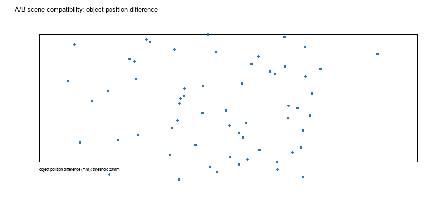
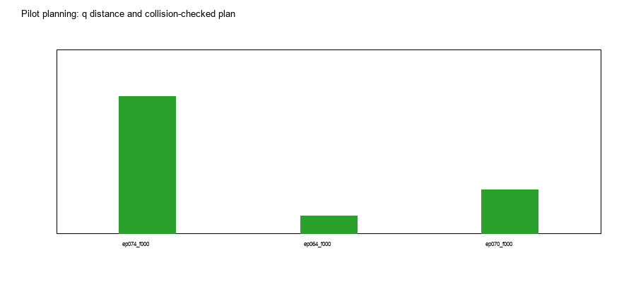
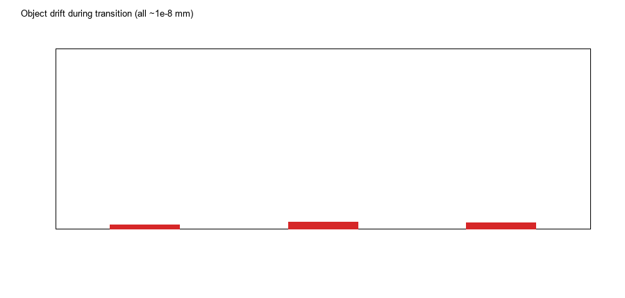
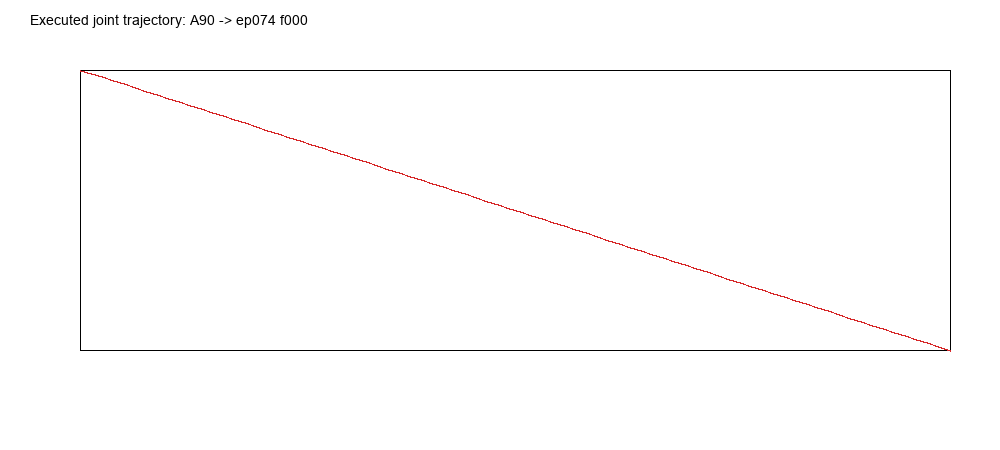
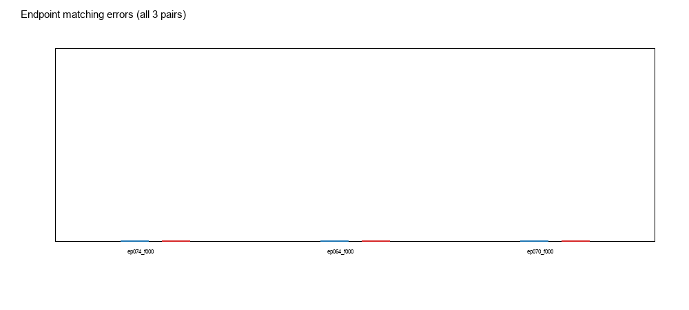
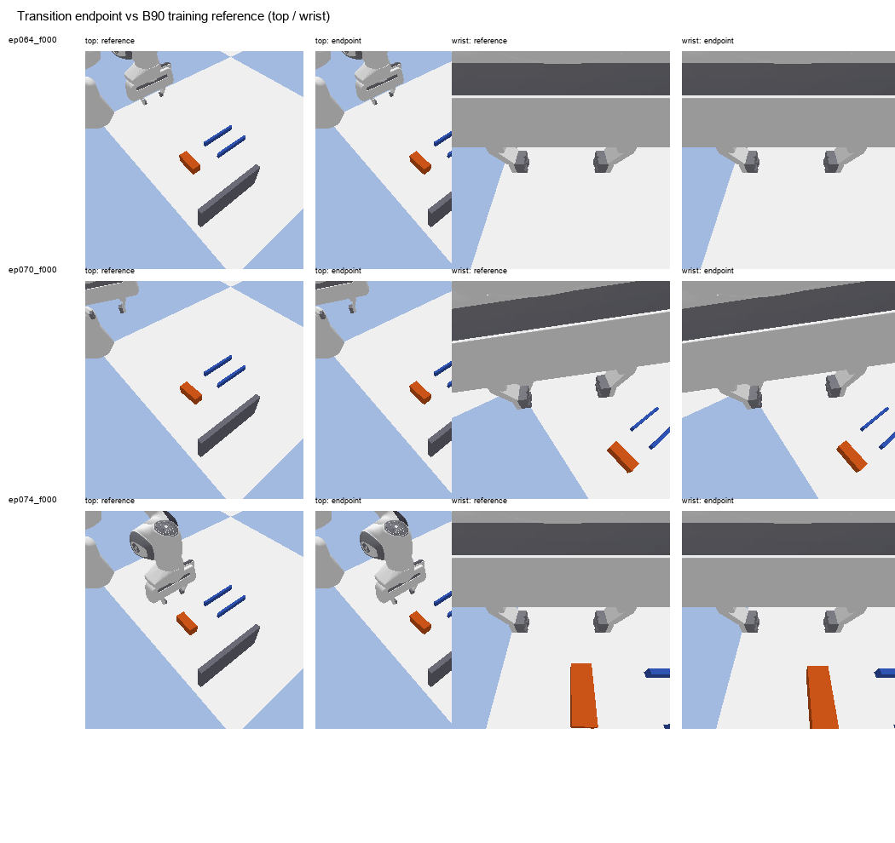
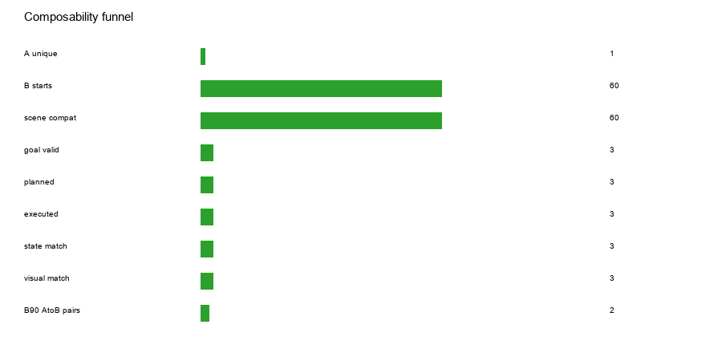

# 实验 3：真实 A90 终态 → 数据集 B90 起点的过渡规划与可组合性边界

## 1. Executive Summary

- **5 个 A90 成功终态快照的 q 与物体位姿完全相同**（同一确定性专家、同一 PLACE），实际只有 **1 个唯一 A 终态**；本实验的 A 侧独立状态数是 1，不是 5。
- B90 yaw90 有 **60 个真实 episode 起点**。在 20 mm / 10° 的**宽松**场景阈值下 60/60 “兼容”；但物体位置差为 **1.5–17.9 mm**，没有任何精确匹配。由于不能 teleport 物体，transition 只移动机械臂，A 场景中的物体仍停在 A 放置点。
- Pilot 选 3 个 B 起点（ep074 f000、ep064 f000、ep070 f000）：**3/3 目标静态有效、3/3 规划成功、3/3 执行完成**。
- 执行结果：q L2 误差 **5×10⁻⁶–8×10⁻⁶ rad**，EE 位置误差 **0.0016–0.0037 mm**，物体漂移 **~10⁻⁸ mm**；A 的任务结果未被破坏。
- 视觉：top MAE **0.058–0.574**，wrist MAE **0.0002–3.21**（ep074 物体偏 14.9 mm，腕部差异最大）。机器人状态很接近，但**物体场景没有精确匹配**。
- 冻结 D2 接续：AtoB **3/9**，B 参考 **6/9**。逐对：ep074 0/3 vs 1/3；ep064 1/3 vs 2/3；ep070 2/3 vs 3/3。D2 仍失败，但不能单独归因于 transition——A/B 的物体位置差仍然存在。
- **能力边界：** 1 个唯一 A 终态 ×60 个近似兼容 B 起点 → 3 个 pilot 规划/执行/机器人状态匹配 → 2/3 配对至少一次 B90 成功；**0 个精确物体场景匹配**。

---

## 2. RQ1–RQ8 直接回答

| RQ | Answer | Evidence |
|---|---|---|
| **RQ1** 是否存在场景兼容 B 起点？ | **宽松兼容 60/60；精确匹配 0** | 物体位置差 1.5–17.9 mm；yaw axis 差异小；不能移动物体 |
| **RQ2** 目标 q 是否可达？ | **3/3 pilot 可达** | 目标静态无碰撞；碰撞检查直线路径；RRT fallback 未使用 |
| **RQ3** 规划路径能否实际执行？ | **3/3** | 密集关节命令执行，q L2 ≤8×10⁻⁶ rad，EE ≤0.0037 mm |
| **RQ4** 是否保持 A 结果？ | **是** | 物体漂移 ~10⁻⁸ mm；无物体推动/碰撞 |
| **RQ5** 机器人状态能否匹配？ | **是** | q/EE/gripper 设置到 B 记录的 35 mm；物体状态不匹配 |
| **RQ6** 视觉能否匹配？ | **近似匹配** | top MAE 0.058–0.574；wrist 0.0002–3.21；ep074 因物体偏 14.9 mm 最差 |
| **RQ7** D2 能否接续？ | **部分/混合** | AtoB 3/9 vs Bref 6/9；ep074 0/3；ep064 1/3；ep070 2/3 |
| **RQ8** 边界？ | 见下方 funnel | 1 A /60 近似兼容 /3 pilot /3 执行 /3 机器人匹配 /0 精确场景 /2 配对有成功 |

---

## 3. A90 终态集合

- `SkillExpert.skill_a90()` 在 5 个场景种子上都成功。
- 但 5 个记录 q 完全相同：
  `0.6417456, 0.2961442, -0.3335537, -2.1009291, 0.1384475, 2.3768123, 1.0069058`
- 物体最终都是 `(0.549967, 0.182251, 0.019988)`，yaw≈−89.67°。
- 原因：A90 的 place target 固定为 PLACE，专家确定性；种子只改变初始物体，最终回到同一放置点。
- **因此 A 终态统计的独立样本量是 1，不是 5。** 报告不把 5 个快照当作 5 个独立 A 成功案例。

---

## 4. B90 起点与场景兼容性

- B90 yaw90：60 个真实 `observation.state[0]` 起点；q 直接来自数据，不是 IK。
- 物体位置 x 0.538–0.562、y 0.168–0.192；A 物体 `(0.550,0.182)`。
- 位置差 **1.5–17.9 mm**；yaw axis 差都小于 10°。
- 以 20 mm /10° 作为“宽松兼容”阈值，60/60 通过；但这不是精确物体匹配。
- **0 个 B 起点与 A 的物体位置完全相同**；不能为了匹配而 teleport 物体。

---

## 5. Pilot 规划与执行

选择 3 个 B 起点：

| B 起点 | q 距离 | 规划 | q 误差 | EE 误差 | 物体漂移 | top MAE | wrist MAE |
|---|---:|---|---:|---:|---:|---:|---:|
| ep074 f000 | 0.789 | straight, 2 nodes | 7.5e-6 | 0.0037 mm | 2.3e-8 mm | 0.574 | 3.21 |
| ep064 f000 | 0.909 | straight | 4.8e-6 | 0.0016 mm | 3.7e-8 mm | 0.058 | 0.0002 |
| ep070 f000 | 1.120 | straight | 8.3e-6 | 0.0032 mm | 3.2e-8 mm | 0.157 | 0.252 |

- 规划器：先对 `q_A→q_B` 直线边做 30 个碰撞采样；本次三条均无碰撞，因此用直线 baseline。脚本包含 RRT-Connect fallback（分段步长0.18 rad），但未触发。

- 执行：按 0.01 rad 间隔加密路径，`sim.command` 每点 12 步；最后设置 B 起点的夹爪 35 mm，settle。不是 `resetJointState(q_B)` 瞬移。
- 终点 q/EE 与目标几乎完全一致；物体不动。

- **场景物体没有随 transition 移动**：A 物体在 A 放置点，B 参考物体在 B 起点位置；这是本轮“机器人状态匹配但物理场景未精确匹配”的核心限制。

---

## 6. D2 接续执行

| 条件 | ep074 | ep064 | ep070 | 总计 |
|---|---:|---:|---:|---:|
| A90 → transition → B90 | **0/3** | **1/3** | **2/3** | **3/9** |
| B 参考起点 | 1/3 | 2/3 | 3/3 | **6/9** |

- AtoB 失败多为 tilt：46.6°、50.8°、42.6° 等；Bref 也有 tilt 失败（59.0°、57.9°），说明 D2 本身在这些 B 起点上不稳定。
- AtoB 在 ep074 0/3，而 q/视觉都接近，说明“机器人状态 + 图像接近”不足以恢复 B90；剩余差异包括：
  - 物体位置 A 与 B 参考差 14.9 mm（ep074）；
  - A 的物体放置历史/接触状态；
  - A 场景的轻微几何差与视觉差异；
- 本轮不能把 AtoB 的失败单独归因于 transition，因为 object/scene 没有精确匹配。

---

## 7. 分层统计

| Stage | 指标 | 数量 |
|---|---|---:|
| 1 | 唯一 A90 终态 | **1**（5 个快照） |
| 2 | 真实 B90 起点 | 60 |
| 3 | 宽松场景兼容（≤20 mm/10°） | **60/60** |
| 4 | 精确物体匹配 | **0/60** |
| 5 | Pilot 目标静态有效 | 3/3 |
| 6 | Pilot 规划成功 | 3/3 |
| 7 | 实际执行完成 | 3/3 |
| 8 | 机器人状态匹配（q≤0.05 rad, EE≤10 mm） | 3/3 |
| 9 | 视觉近似匹配（top<1, wrist<5） | 3/3 |
| 10 | B90 成功（AtoB） | **3/9 rollouts；2/3 配对至少一次成功** |
| 11 | B90 成功（B ref） | **6/9** |

---

## 8. 结论与边界

**Observed：**
- A90 终态唯一；5 个 snapshot 不是 5 个独立 A 状态。
- B90 起点 60 个，全部宽松场景兼容，但没有精确物体匹配。
- 3 个 pilot 的 q/EE 轨迹可规划、可执行、物体不漂移、机器人状态精确匹配。
- 视觉近似匹配；ep074 物体差 14.9 mm 导致 wrist MAE 最大。
- D2 AtoB 3/9，Bref6/9；AtoB 没有恢复 Bref 表现。

**Supported：**
- 传统关节规划可以在 A 场景中把机械臂带到 B 记录 q，且保持 A 物体结果。
- 仅 q/EE/视觉近似匹配不足以复现 B90 表现。

**Not Identifiable：**
- AtoB 失败中有多少来自 transition 本身、多少来自物体位置/场景差、多少来自 D2 在 B 起点的固有失败。Bref 也仅6/9，且物体位置不同，无法分离。
- 需要精确物体匹配或显式物体重定位（本轮禁止）才能进一步分离。

**边界：**
- **A90 终态只有1个唯一状态**；组合可扩展性受 A 终态多样性限制。
- 在允许物体不动的条件下，B 起点 q 可达，但完整物理场景不能精确匹配；这是 `NO_EXACT_SCENE_MATCH`，不是规划失败。
- D2 接续仍需在**精确物体状态**或**控制物体位置**的实验中验证；本轮不能声称 transition 修复/导致 B90 失败。

---

## 9. 限制

- 只有 3 个 B 起点、每条件 3 个 D2 种子；不是统计泛化。
- A 终态只有1个唯一 q/object。
- 规划是直线 baseline（碰撞采样通过）；RRT 未触发；未做关节速度/加速度连续时间参数化。
- 执行用位置命令 12 步/waypoint，q 跟踪很好，但不是速度限制控制器。
- B 参考场景由数据重建；RGB 来自重建，和原始训练视频可能有渲染差。
- 物体未移动到 B 参考位置，AtoB 与 Bref 不是只差 transition 的严格对照。
- 未做 Direct A90→B90 的额外复跑；历史结果仅引用。
