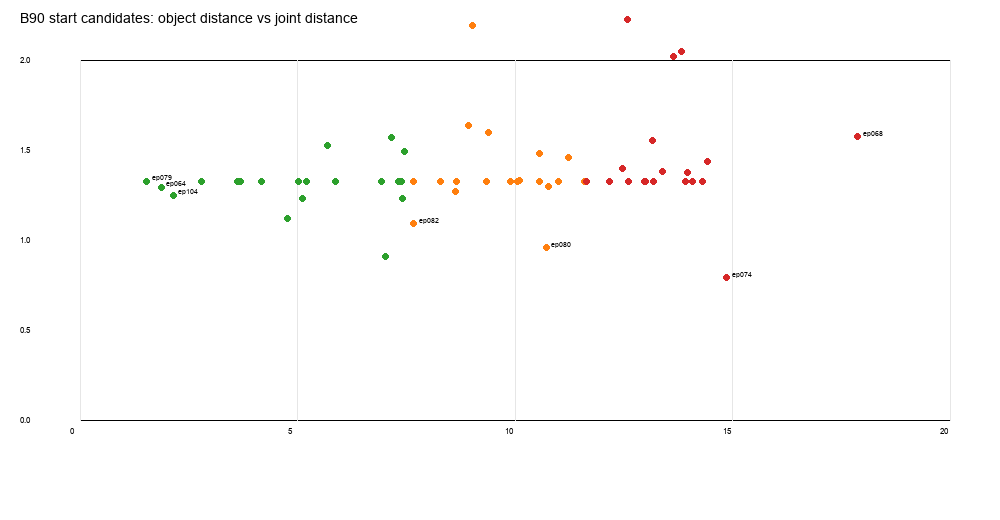

# 实验 3.1：60 个 B90 起点的联合状态兼容性审计

## 科学问题

在 60 个真实 B90 yaw90 训练起点中，哪些与当前唯一 A90 真实终态最接近？差异来自物体场景还是机器人构型？

## 数据与方法

- A 终态：唯一 `a90_40000000`；q 与物体固定。
- B 起点：`results/experiment_3/data/b_training_start_states.csv` 的 60 个真实 `observation.state[0]`。
- 四元数统一为 PyBullet `x,y,z,w`。
- 计算：
  - 物体位置差；
  - 完整 SO(3) 旋转差；
  - 180° 对称后的几何轴差；
  - q 距离；
  - **同一 qB** 下，A 场景与 B 场景的 EE–物体完整 SE(3) 相对位姿差（`same_q_rel_pos_mm` / `same_q_rel_rot_deg`）；
  - 旧 `rel_pos_diff_mm` 是 A 终态 qA 的 EE–物体与 B qB 的 EE–物体之差，混入了关节构型差异，**不得用于解释场景兼容性**；
  - 夹爪差；
  - A 场景中的目标静态碰撞和直线路径碰撞。

## 结果

- **60/60** qB 在 A 场景中静态有效；**60/60** 的 qA→qB 直线路径通过碰撞采样。
- 物体位置差范围：**1.53–17.88 mm**。
- 完整 SO(3) 差约 **174–179°**（由方块 180° 对称导致）；对称等价轴差 **0.94–6.02°**。
- **31 个唯一 q 向量**（按七关节四舍五入去重；多个 episode 共享相同 q，尤其 HOME 类）。
- 固定 qB 后，A/B 场景的 EE–物体相对平移差 **1.53–17.88 mm**；完整相对旋转差约 **174–179°**（180° 对称），对称轴差 0.94–6.02°。
- 旧 `rel_pos_diff_mm` 约 235–545 mm，是 qA 与 qB 构型不同造成的，**已不再用于场景兼容性结论**。
- 场景分层（按 60 个真实起点的三分位，预注册）：
  - Near ≤ **7.595 mm**：20 个；
  - Medium 7.595–**11.616 mm**：20 个；
  - Far >11.616 mm：20 个。

## 预注册目标

在查看任何新 D2 成功率之前固定：

| 层 | B 起点 | 模式 | 物体差 mm | q 距离 rad |
|---|---|---|---:|---:|
| Near | ep079_f000 | home | 1.53 | 1.325 |
| Near | ep104_f000 | multi_ik | 2.15 | 1.247 |
| Medium | ep082_f000 | task_relevant | 7.67 | 1.091 |
| Medium | ep080_f000 | multi_ik | 10.72 | 0.956 |
| Far | ep074_f000 | task_relevant | 14.87 | 0.789 |
| Far | ep068_f000 | home_neighborhood | 17.88 | 1.573 |
| Anchor | ep064_f000 | multi_ik | 1.86 | 1.293 |

选择规则：每层 2 个 + ep064 基线锚点；仅按场景距离和 q 模式选择，**未使用任何新 D2 成功率**。

## 回答

**找到了哪些类型的可连接候选？**

60 个 B 起点在当前 A 场景下均有静态合法的 qB 和碰撞采样通过的直线路径；差异主要是物体位置（1.5–17.9 mm）和物体/EE 相对几何。按物体距离存在 Near/Medium/Far 三个层次，q 只有 31 个唯一距离值，HOME 类大量重复。

**完整状态差异多大？**

- 物体位置差最大 17.88 mm；
- 完整 SO(3) 因对称显示约 177°，但几何轴差最大 6.02°；
- qB 与 qA 距离 0.79–2.36 rad；
- 夹爪差约 5 mm（A 终态 40 mm vs B 35 mm）。

## 边界

- 静态/直线路径“通过采样”不等于动态安全；
- 未做视觉差异的全量渲染；
- 候选选择基于场景距离，不代表 D2 成功率。

