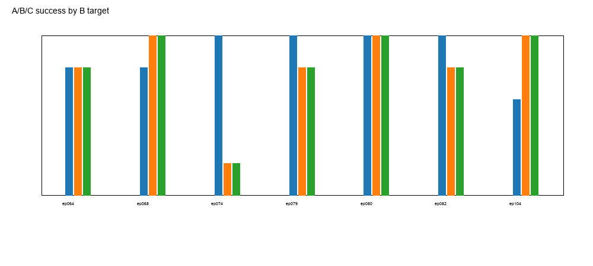

# 实验 3.2：跨 B 起点的 A/B/C 受控连接

## 科学问题

当目标 B 起点变化时，传统规划能否从真实 A90 终态到达 qB？到达后，场景改变（A/B）或到达方式（B/C）是否伴随后继 D2 行为变化？

## 数据规模

- 7 个 B 目标：Near ep079/ep104、Medium ep082/ep080、Far ep074/ep068、anchor ep064。
- 每个目标 3 组 A/B/C × 5 配对 seed = **105 次正式 rollout**。
- 所有目标 qB 在 A 场景中静态有效，qA→qB 直线路径通过碰撞采样；无 `PLANNING_FAILURE`。
- A/B/C 的所有启动均收敛；最大 q 误差 **1.55×10⁻⁵ rad**。

## 结果

| target | 层 | A success | B success | C success | A wall | B wall | C wall |
|---|---|---:|---:|---:|---:|---:|---:|
| ep079_f000 | Near | 5/5 | 4/5 | 4/5 | 0 | 0 | 0 |
| ep104_f000 | Near | 3/5 | 5/5 | 5/5 | 0 | 0 | 0 |
| ep082_f000 | Medium | 5/5 | 4/5 | 4/5 | 0 | 1 | 1 |
| ep080_f000 | Medium | 5/5 | 5/5 | 5/5 | 0 | 0 | 0 |
| ep074_f000 | Far | 5/5 | 1/5 | 1/5 | 0 | 1 | 1 |
| ep068_f000 | Far | 4/5 | 5/5 | 5/5 | 1 | 0 | 0 |
| ep064_f000 | anchor | 4/5 | 4/5 | 4/5 | 0 | 0 | 0 |
| **总计** | | **31/35** | **28/35** | **28/35** | **1** | **2** | **2** |

**所有 5 次 wall contact 都发生在失败 rollout 中；没有一次 `WALL_CONTACT_SUCCESS`。** v2.2 成功均是无墙接触的“距离判据成功”。

- **B 与 C 在 7 个目标、5 个 seed 上完全一致**：
  - success 28/35 对 28/35；
  - 每个 seed 的 success/gap/tilt 相同；
  - `BC_q_l2 = 0`，`BC_action7_l2 = 0`，`BC_top_mae = 0`；
  - B/C 实际夹爪、dq、接触也一致。
- **A 与 B 不同，而且不是单调依赖物体距离**：
  - Far ep074：A 5/5 vs B 1/5；
  - Near ep104：A 3/5 vs B 5/5；
  - Far ep068：A 4/5 vs B 5/5；
  - Medium ep082：A 5/5 vs B 4/5。
- **A/B 视觉输入差很小**：top MAE 0.0002–0.0022；但物体位置差 1.53–17.88 mm 改变了接触几何。
- **B/C 参考本身不稳定**：ep074 B/C 仅 1/5，ep082 4/5 且有一次 wall contact（仍是失败，tilt 90.9°）。

## C 组过渡轨迹审计

- 所有 C 组必须显式加载 `trajectories/planned/<target>.npy`；文件缺失会直接 `FileNotFoundError`，不再回退到直线插值。
- 对 7 个目标新增了状态审计（`transition_audit/`、`transition_audit.csv`）：
  - 每目标 80–159 个路径点；
  - 过渡过程中 **robot-object 接触 0 步**，**object-wall 接触 0 步**；
  - 物体漂移 **2.2×10⁻⁸–4.4×10⁻⁸ mm**；
  - 过渡终点 q 误差（稳定前）约 **7.2×10⁻⁴–7.5×10⁻⁴ rad**；
  - 收敛后目标 q 误差 **≤1.55×10⁻⁵ rad**。
- 原始过渡审计：`transition_audit/`、`transition_audit.csv`。
- 墙面接触校准：`wall_contact_audit.csv`；5 次接触均为 `block_base`–`wall_base`，法向沿 −X，有正法向力，但 5 次对应的 rollout 全部失败（tilt 或最终不达标），**`WALL_CONTACT_SUCCESS = 0`**。

## 关键回答

**1. 规划可达性是否随 B 变化？**  
在本组 7 个目标上全部静态有效、直线碰撞采样通过；没有规划失败。不能外推到全部 60 个起点。

**2. 规划成功后哪些状态仍不匹配？**  
A 组与 B/C 的物体场景不同（1.5–17.9 mm）；B/C 的 q/EE/grip/物体/输入完全匹配。  
A/B 的 top 图像差异很小，但接触几何不同；不能只用图像 MAE 判断场景相同。

**3. B/C 是否出现可重复行为差异？**  
**没有**：7 目标 ×5 seed 全部 B/C 相同。

**4. A/B 场景差异是否伴随接触行为变化？**  
有，但**方向依目标而变**：
- ep074：B/C 1/5，A 5/5；B/C 多次大 tilt（35.9°、48.5°、23.2°）；
- ep104：A 3/5，B/C 5/5；
- ep082：A 5/5，B/C 4/5，且 B/C wall contact 1/5；
- ep080：三者 5/5，无差异。
所以“物体距离越大越差”不成立。

**5. 参考 B 本身稳定吗？**  
不稳定：ep074 仅 1/5；ep082 4/5；不同目标差异显著。

## Observed / Supported / Not Identifiable

**Observed**
- B/C 105 次中 35 对完全一致；A 31/35，B/C 28/35。
- A/B 物体差 1.53–17.88 mm；A/B top MAE 很小。
- 105 次中 wall_contact 5 次（A1/B2/C2）；v2.2 成功不等于墙接触。

**Supported**
- 在到达同一 qB 且完整状态对齐后，**本组目标上没有观察到 transition 路径的额外影响**。
- 场景改变（A vs B）可伴随行为和成功率变化，但方向依目标，不是单调物体距离效应。
- 参考 B 本身不稳定，比较必须报告 A/B/C 三层，不能只看最终成功率。

**Not Identifiable**
- A/B 的物体位置、接触几何、top 微差各自贡献无法分离；
- 为什么 ep074 在 A 场景反而更好、ep104 在 A 场景更差，机制未识别；
- 跨 7 个目标的场景距离与成功率没有可拟合的单调关系；样本以目标为单位仅 7 个。

## 文件

- `data/rollout_results.csv`（105 行）
- `data/state_alignment.csv`（35 对）
- `data/first_action_comparison.csv`
- `data/planning_results.csv`
- `summaries/summary_by_target.csv`
- `b90_all_candidates.csv`、`candidate_selection.json`、`scene_compatibility.csv`
- `experiment_3_1_report.md`

## 限制

- 仅 7 个预注册目标；每组 5 个策略种子不是 5 个独立物理起点。
- B Reference 是重建场景，不是原始训练动态/视频。
- 直线路径只做碰撞采样，不是动态安全证书。
- 没有做 60 个起点的全量 rollout；不能把本结果外推为全部 B90 起点。
- `state_alignment.csv` 的 B/C 接触只比较启动接触总数；未逐点比较每个接触对的法向/力，除墙面接触审计外仍有限。
- `model_input.npz` 是入口重建的输入；尚未在每个 rollout 的 `PolicyRunner.act()` 调用处独立截获（受控 v4 已做单对 act 截获，但 3.2 未做）。

