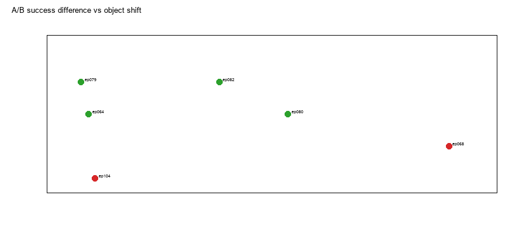

# 实验 3.3：场景改变的最小机制诊断

## 科学问题

固定同一个 B90 机器人构型时，改变物体场景（A90 真实物体 vs B90 参考物体）是否改变冻结 D2 的首段动作和实际接触行为？

## 设计

- 数据来自实验 3.2 的 A/B 35 对；不新增场景扫描。
- A：B 参考物体场景 object_B；B：A90 场景 object_A；qB、EE、夹爪、D2 权重、seed、执行协议相同。
- 这是**整体场景干预**：物体位置、EE–物体相对几何、top/wrist 图像同时改变。不能解释为纯视觉或纯物体位置的因果效应。

## Layer 1：首段策略动作

| target | 物体差 mm | top MAE | 首动作七关节 L2 rad | A success | B success |
|---|---:|---:|---:|---:|---:|
| ep079 | 1.53 | 0.00028 | 0.00705 | 5/5 | 4/5 |
| ep104 | 2.15 | 0.00038 | 0.00380 | 3/5 | 5/5 |
| ep082 | 7.67 | 0.00113 | 0.00224 | 5/5 | 4/5 |
| ep080 | 10.72 | 0.00152 | 0.00539 | 5/5 | 5/5 |
| ep074 | 14.87 | 0.00225 | 0.01081 | 5/5 | 1/5 |
| ep068 | 17.88 | 0.00224 | 0.00820 | 4/5 | 5/5 |
| ep064 | 1.86 | 0.00023 | 0.00917 | 4/5 | 4/5 |

- 首动作确实随场景改变，L2 0.0022–0.0108 rad；
- 但 **top 图像 MAE 非常小**（0.0002–0.0022），不能用图像差解释动作差；
- 首动作差与物体距离没有单调关系。

## Layer 2：实际接触与结果

- A/B 成功率差方向依目标而变：
  - ep074：A 5/5，B 1/5——B 场景更差；
  - ep104：A 3/5，B 5/5——A 场景更差；
  - ep068：A 4/5，B 5/5；
  - ep082：A 5/5，B 4/5，B 一次 wall contact；
  - ep080：两者 5/5。
- 失败以 tilt 为主：ep074 B 多次 23–48° tilt；ep082 B 一次 90.9° tilt。
- wall contact 不是成功必要条件；A/B 中多数成功没有墙接触。

## 回答

**不同场景下的失败能否定位到模型预测路径、首次接触或后续动力学？**

- **预测路径**：有可测的首动作差（0.002–0.011 rad），但幅度很小，且 top MAE 极小；
- **首次接触/后续动力学**：场景改变了物体接触位置，失败表现为 tilt；ep074/ep104 方向相反，说明不是单一“A 场景更差”规律；
- **无法识别**：物体位置、EE–物体相对几何、top/wrist 像素差、接触初始条件同时改变，无法分离哪个通道导致首动作或失败。

## 结论

**Supported**：物体场景改变伴随 D2 首动作与接触行为变化；变化方向依 B 目标，不是单调距离效应。

**Not Identifiable**：视觉通道 vs 物体几何/接触的独立贡献；ep074 与 ep104 的方向反转机制。

**不要声称**：图像 MAE 小就代表场景相同；首动作差小就代表后续一定成功；A 场景一定比 B 场景差。
