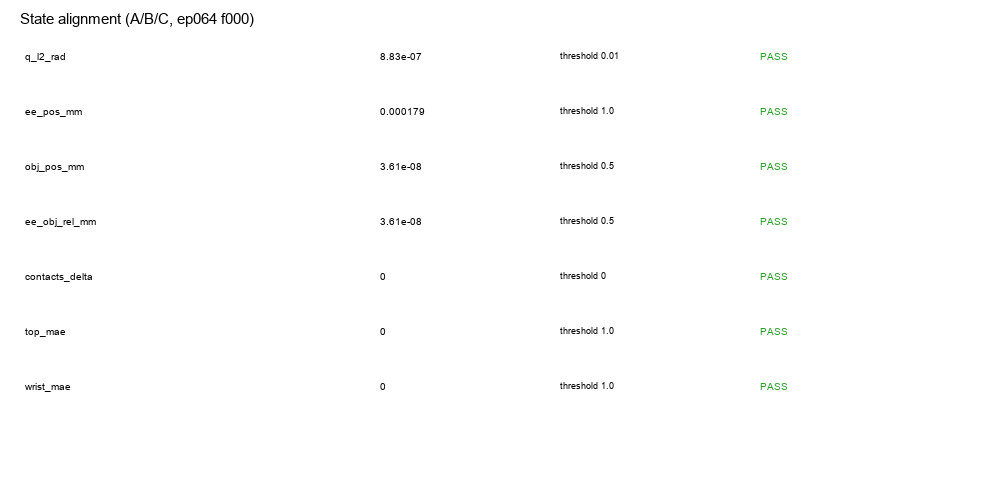
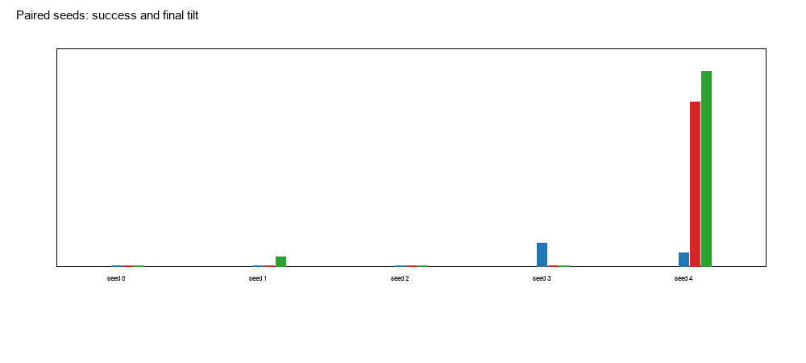
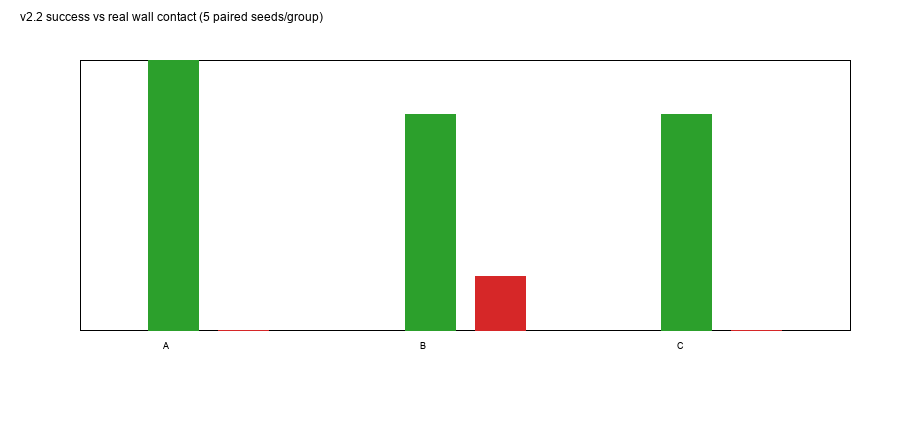
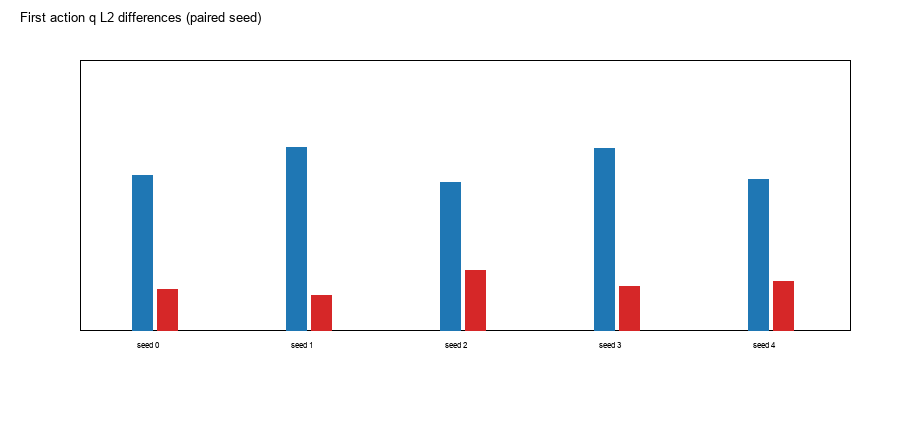
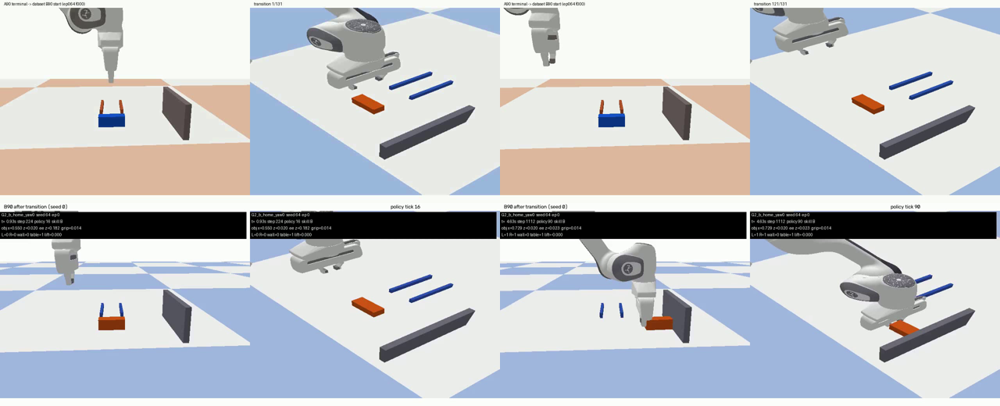

# 实验 3 受控诊断：A90 → B90 的启动状态等价性与冻结 D2 行为

## 0. 结论先行

**在 ep064 f000 上，控制 q、EE、夹爪、物体和图像之后，B（A 场景直接放置）与 C（真实规划过渡）的可记录启动状态没有差异；5 个配对随机种子下两者的 v2.2 成功率都是 4/5，失败都发生在 seed 4。A（B 参考场景）为 5/5。**

因此：

- 之前实验 3 的 **AtoB 3/9 vs Bref 6/9 没有复现**。旧 runner 没有显式设置 PyTorch/CUDA 策略种子，A/B/C 的实际采样流不同；这足以解释旧的组间差异。
- B/C 的差异不是最终状态差异；本状态下 **没有观察到 transition history 的额外影响**。
- A/B/C 的 **v2.2 成功不等于真实墙壁接触**：15 次中只有 1 次 wall_contact；v2.2 是距离/静态阈值判据。
- A/B 仍有 **1.864 mm 物体位置差**（Top RGB MAE 0.058）；A 比 B 多成功 1 个 seed，但样本只有 5 个配对种子，不能据此识别物体位置效应。

---

## 1. 源码与数据审计

审计对象：`576048a`，`scripts/run_b90_snapshot.py`、`run_experiment_2_4.py`、`run_experiment_2_6.py`、`run_b90_seeded.py`、`exp3_pilot.py`、`exp3_d2_prepare.py`。

| 检查项 | 实际实现 | 结论/影响 |
|---|---|---|
| A90 终态 | `SkillExpert.skill_a90()`，固定 PLACE；5 个种子终态 q 完全相同 | **1 个唯一 A 终态**，不是 5 个 |
| B90 起点 | `observation.state[0:7]` / `[7:9]`，绝对动作标签 | 正确；60 个 yaw90 起点 |
| 规划 | `q_A→q_B` 直线边，30 个碰撞采样；RRT fallback 存在但未触发 | 静态碰撞检查；不是完整动态安全证明 |
| 执行 | 0.01 rad 加密 + `sim.command`，12 physics steps/waypoint | q/EE 误差极小；不是速度限制控制器 |
| 夹爪 | 执行结束后 `resetJointState` 设置到 B 的 35 mm，再 settle | 诊断性设置；实际 grip 35 mm |
| B Reference | 不是原始训练快照；用 B 场景 seed/object 重建，再 set qB | q 来自数据；**RGB 是重建，不是原始训练帧** |
| 图像 | `CameraRig` 256，top/wrist；模型输入预处理 | 组间同配置 |
| D2 action | `predict_action_chunk`，50 步；`runner.reset()` 清队列 | 旧 runner **无显式 torch seed** |
| 旧 rollout 种子 | `run_b90_snapshot` 无 `--seed`；进程默认 RNG | **A/B/C 未配对** |
| 成功判据 | `task_ok('B')` v2.2（gap≤2cm、dy≤2cm、dyaw≤15°、tilt≤12°、speed<0.01） | 与 wall_contact 分离 |
| 接触 | 旧报告未把 wall_contact 单独作为主指标 | **v2.2 成功≠墙接触** |
| 未记录变量 | 控制器目标位置、完整 q 速度历史、内部 action 队列 | 本轮补 q/dq，但 **controller target 未保存** |

### 审计发现的两个关键问题

1. **旧 A/B/C rollout 没有显式策略种子，且 A 的行 seed=53050005、B/C=64；随机流不同。** 旧 3/9 vs 6/9 不能当作 transition 效应。
2. **旧 B Reference 是重建场景，图像不是原始训练帧。** 本轮明确标注为 B reference reconstruction；A 与 B 的 top 图像差 0.058 MAE。

---

## 2. 受控三组设计

目标 B 起点：**ep064 f000**（在查看新 rollout 前固定）。  
所有组使用同一 D2 checkpoint、同一 B90 指令、同一相机/预处理、同一 max ticks（260）、同一 v2.2 判据；显式配对种子 0–4。

| 组 | 场景 | 机器人启动 | 物体 | 说明 |
|---|---|---|---|---|
| **A** Original B Reference | B 场景（object_B） | q_B | object_B | 重建参考 |
| **B** A-Scene Direct Placement | A 场景（object_A） | q_B via diagnostic reset | object_A | 允许 reset，仅诊断 |
| **C** A-Scene Planned Transition | A 场景（object_A） | 真实 q_A→q_B 过渡 | object_A | 无 reset |

A/B 物体位置差 **1.864 mm**、yaw axis **2.54°**；B/C 物体完全相同。

---

## 3. 启动状态对齐

完整数值：`data/state_alignment.csv`；可读表：`state_alignment.md`。

### B vs C（关键因果对照）

| 变量 | 值 | 阈值 | 结果 |
|---|---:|---:|---|
| q L2 | **8.8×10⁻⁷ rad** | 0.01 | PASS |
| q max | 5.0×10⁻⁷ rad | 0.01 | PASS |
| dq L2 | 0 | 0.1 | PASS |
| EE position | **1.8×10⁻⁴ mm** | 1 mm | PASS |
| EE rotation | 0° | 1° | PASS |
| Gripper | **1.6×10⁻⁹ mm** | 0.5 mm | PASS |
| Object position | **3.6×10⁻⁸ mm** | 0.5 mm | PASS |
| Object yaw-axis | 0° | 10° | PASS |
| Object speed | 1.4×10⁻¹⁰ mm/s | 1 mm/s | PASS |
| EE–object relative position | 3.6×10⁻⁸ mm | 0.5 mm | PASS |
| Contacts | 0 vs 0 | equal | PASS |
| Top RGB MAE | **0.0** | 1.0 px | PASS |
| Wrist RGB MAE | **0.0** | 1.0 px | PASS |

**B/C: State-mismatch: NO。** 所有记录变量通过，top/wrist 图像逐像素相同。

### A vs B

| 变量 | 值 | 结果 |
|---|---:|---|
| q / dq / EE / gripper | <1e-6 / 0 / <1e-4 mm / ~0 | PASS |
| 物体位置 | **1.864 mm** | FAIL（阈值 0.5 mm） |
| EE–object 相对位置 | **1.864 mm** | FAIL |
| 物体 yaw-axis | 2.54° | PASS |
| Top RGB MAE | **0.058** | PASS |
| Wrist RGB MAE | 0.0 | PASS |

**A/B: 完整物理场景 mismatch（物体 1.864 mm）；视觉 top 有 0.058 MAE。** 因此 A vs B 识别的是“物体场景 + 对应 top 观测”的整体改变，不是单独物体位置。

### 未记录变量

- **控制器目标位置**未写入 `initial_state.json`；`initial_state.json` 有 q、dq、EE、object、velocities。
- `run_b` 清空 action queue；policy process 每次新建。
- 同状态重复测试（见下）首个 action 一致到 5 位小数，说明在该设置下策略采样可复现；但 B/C 首个 action 仍有 0.0013–0.0022 rad 差，原因未能完全分离（q 8.8e-7 + CUDA/数值），其幅度远小于动作变化。

---

## 4. 配对随机种子结果

显式种子覆盖 Python/NumPy/PyTorch/CUDA；每组同一 seed。  
数据：`data/b90_rollout_results.csv`、`summaries/group_summary.csv`、`summaries/paired_seed.csv`。

| Group | v2.2 success | wall contact | mean tilt | mean gap |
|---|---:|---:|---:|---:|
| A (B ref) | **5/5** | 0/5 | 0.67° | 16.73 mm |
| B (A + reset) | **4/5** | **1/5** | 3.03° | 8.79 mm |
| C (A + transition) | **4/5** | 0/5 | 3.75° | 12.29 mm |

逐 seed：

| seed | A | B | C | B/C 失败原因 |
|---:|---|---|---|---|
| 0 | ✅ | ✅ | ✅ | — |
| 1 | ✅ | ✅ | ✅ | — |
| 2 | ✅ | ✅ | ✅ | — |
| 3 | ✅ | ✅ | ✅ | — |
| 4 | ✅ | ❌ | ❌ | tilt 15.1° / 17.9° |

- **B 与 C 的成功模式完全相同**；失败都在 seed 4，且都表现为倾斜超限，不是 wall contact。
- A 的 seed 4 成功；A/B 唯一差异是物体 1.864 mm + top 0.058，但单个 seed 不能识别。
- 15 次中 **14 次没有 wall_contact**，但 13 次 v2.2 success：**v2.2 不是墙接触成功**。

### 首段动作

`data/first_action.csv`、`summaries/first_action_diff.csv`：

- A/B q L2 首动作差 0.0055–0.0068 rad；
- B/C 首动作差 0.0013–0.0022 rad；
- 同状态 B seed0 重复运行，首个 action 在 5 位小数完全一致。

B/C 的首动作差非常小，但并非严格为零；由于 B/C 输入图像完全相同、q 差 <1e-6，这属于**数值/未记录控制器状态**的残余，不足以解释 seed 4 的成败差异。

---

## 5. 为什么旧结果不同

旧实验 3：
- AtoB 3/9，B ref 6/9；
- 每个条件 3 个进程，没有 `--seed`；
- A 的 summary seed 是 row seed 53050005，B/C 是 64；策略采样流不同。

受控重跑：
- 同一 checkpoint、同一状态、显式配对种子；
- A 5/5，B 4/5，C 4/5。

**旧 3/9 vs6/9 的组间差在本状态没有复现。** 不能把旧差异归因于 transition；它至少部分来自未配对随机性。  
这不是说所有历史实验都无效；而是说明 **旧 3/9 vs6/9 不能作为 transition 因果证据**。

---

## 6. 必须回答的问题

**1. 规划能否可靠到达 B90 记录构型？**  
**Pilot 可以**：3/3 规划，q L2 ≤8×10⁻⁶ rad，EE ≤0.0037 mm；但只有 3 个 B 目标、1 个唯一 A 终态。静态碰撞检查通过，不等于动态安全证明。

**2. 匹配 q 后哪些状态变量仍未匹配？**  
- B/C：**没有记录到差异**（q、dq、EE、grip、object、EE-object、contact、top/wrist 均通过；图像逐像素相同）。
- A/B：**物体位置 1.864 mm、EE-object 1.864 mm、top 0.058 MAE**。
- 控制器目标未记录。

**3. B/C 是否具备可比较完整启动状态？**  
**是（在可记录变量和阈值内）**：B/C 的 q/EE/grip/object/images/contacts 全部通过；无速度残留。  
但仍不能声称包含所有内部控制器状态；action queue 已重置，重复同状态首动作一致。

**4. 物体场景改变是否伴随 D2 首段动作变化？**  
A/B 首动作 q L2 差 0.0055–0.0068 rad；top MAE 0.058；A 5/5 vs B4/5 仅 seed4 不同。**有小的首动作差异，但没有可识别的成功率效应**（n=5，且物体与 top 观测同时改变）。

**5. 是否观察到与真实 transition 相关的残余状态差异？**  
**没有**：B/C 所有记录变量通过，图像逐像素相同；成功率相同 4/5，失败同 seed4。  
可能存在未记录的 controller target 差；当前不能证明，也没有证据显示其影响结果。

**6. B90 原始参考起点本身有多稳定？**  
A（重建 B ref）**5/5**；但历史 Bref 6/9；且 B/C 都在 seed4 失败。说明 B90 起点成功率对策略随机种子/动力学敏感，5 个 seed 不能给出稳定边界。

**7. 哪些差异可能解释首次接触错误？**  
- seed4 B/C 的首次接触仍是 `robot_link10`（手指/夹爪），最终 tilt 15.1°/17.9°；不是墙接触。
- B/C 启动状态无差异，因此该失败更可能是**策略/动力学在该 seed 下的执行**，不是 transition 遗留。
- A/B 的 1.864 mm 物体差与 top 差是候选，但只有一个 seed 差异，不能识别。
- 没有证据支持“顶部接触由启动状态差异直接造成”。

**8. 下一步最值得单独控制的变量？**  
**物体位置/场景与原始训练帧图像**。  
A/B 的唯一显著差异就是物体 1.864 mm + top 0.058；B/C 已经对齐。下一步应构造 **object 完全相同的 A/B**（允许显式物体重定位，但作为独立变量）和 **同一物体位置下的原始训练帧 vs 重建帧**，再用更多配对种子区分：
- 物体位置（毫米级）；
- 原始训练 RGB vs 重建 RGB；
- B90 固有 seed 方差。

---

## 7. Observed / Supported / Not Identifiable / Weakened

### Observed

- B/C 启动状态：q 8.8×10⁻⁷ rad、object 3.6×10⁻⁸ mm、图像 MAE 0、contacts 0。
- 配对 5 seeds：A 5/5，B 4/5，C 4/5；B/C 同失败 seed4；wall contact 仅 B seed0。
- A/B 物体差 1.864 mm，top MAE 0.058，q/EE/grip 相同。
- 首动作 A/B 差 0.0055–0.0068 rad，B/C 差 0.0013–0.0022 rad。
- v2.2 成功 13/15，wall contact 1/15。

### Supported

- 在本状态下，**B/C 达到可记录状态等价**；没有观察到 transition 残余对 v2.2 成功的影响。
- 旧 3/9 vs6/9 的差异可由**未配对策略随机种子**解释至少一部分；受控配对后未复现。
- v2.2 成功不能当作真实墙接触成功。

### Not Identifiable

- A/B 的 1.864 mm 物体差与 top 0.058 对 seed4 成功的独立贡献（物体与视觉同时改变，n=5）。
- 未记录的 controller target/内部状态对 B/C 首动作 0.0015 rad 差的贡献。
- B90 固有随机性边界：5 seeds/状态不足以估计稳定成功率。

### Contradicted / Weakened

- **“AtoB 3/9 vs Bref 6/9 证明 transition 有害”**：受控配对未复现；该解释被削弱。
- **“q 匹配就足以恢复 B90”**：B/C q/EE 匹配且成功 4/5，但 A 5/5 与 seed4 差异说明还受场景/随机性影响；不能仅凭 q 匹配宣称进入训练联合分布。
- **“v2.2 成功=墙接触”**：14/15 成功无 wall contact，明确被削弱。

---

## 8. 完整 A→B 视频

`videos/AtoB_full.mp4`（1280×520，20 fps，约 6.8 s）：

- 左：side view；右：top view；
- 第一段：A90 终态 → 规划过渡（44 帧展示）；
- 第二段：C 条件（真实 transition）冻结 D2 B90 seed 0（91 个 policy tick）；
- 包含 A 终态、过渡、B90 接近/接触/推动。

---

## 9. 限制

- 只有 **1 个 B 目标（ep064 f000）×5 个配对 seed**；不是统计泛化。
- 只有 **1 个唯一 A 终态**。
- 控制器目标位置未保存；不能完全证明 B/C 控制器内部状态相同。
- B/C 首动作仍有 0.0013–0.0022 rad 差；同状态重复测试一致到 5 位小数，但 B/C 差未完全解释。
- A/B 的物体差与 top 图像差同时存在；不能分离。
- 规划为碰撞采样直线，不是连续时间动态可行轨迹；执行使用位置命令。
- B Reference 是重建场景，不是原始训练状态；原始训练 RGB 未直接使用。
- v2.2 成功与 wall_contact 已分开，但 wall_contact 判定基于仿真接触日志；未做力/穿透审计。
