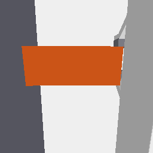

# 实验 4.0 Replay Fix（v2，最终）

基准提交 `97de2c7`（本轮在其之上）。**本目录 v2 子目录是当前唯一有效的 B90/A90 专家回放与相机可见性结论**；
上一轮（`replay_fix/` 根目录的 v1 工件）因 episode 映射错误与 mask 归档错误而**作废**，仅保留作历史对照。

## 一句话结论

**B90 的专家回放原先失败，根因是 episode 索引映射错误，不是相机、不是数据、也不是物理引擎。**
改用「首帧关节 q 与起始状态 CSV 逐条比对」的方式定位到真正的 B90 episode 后：
机器人真的把方块沿 +X 推了 **18.8 cm**、在 **第 94 帧** 与墙发生**真实接触**（404 个物理步有接触），
腕部相机在全部 6 个阶段都看得到方块 → **相机不需要任何改动**。

## 1. 根因：`episode_index` ≠ `episode_id`

`lerobot_panda_e23_D2` 是一个 **480 集的混合数据集**（`meta/info.json`：`total_episodes=480`,
`total_frames=68892`, **`fps=20`**），按任务各 120 集：
A0 / A90 / B90 / C90（`meta/episodes.jsonl` 的 `tasks` 字段逐条标注）。

- `episode_index=64` 属于 A0/A90 段，**不是** B90；
- `b_training_start_states.csv` 的 `episode_id` 是实验 2/3 的 B90 起点编号，与数据集索引无关；
- v1 把两者当成同一个编号 → 用 B90 的起点恢复机器人、却回放别的任务的动作 → 方块只动 0.9 mm。

本轮用首帧 `observation.state[:7]` 与 CSV 每行 `q` 的 L2 距离配对（阈值 `1e-6`）：
**120 个 B90 episode 中 91 个能精确配对**（多数从 HOME 起步，因此 q 相同 → 配对是退化但严格的）。
选中并归档的是 `episode_index=241 ↔ episode_id=61`（距离 `6.2e-8`）。
完整映射见 [`episode_mapping.json`](episode_mapping.json)。

## 2. 场景恢复（Test A）

| 指标 | B90 (ep241) | A90 (ep120) |
| --- | --- | --- |
| 物体位置误差 | **9.2e-08 m** | 1.0e-03 m（名义起点，见下） |
| 物体旋转误差 | 2.3e-03 rad | 0.0 |
| 机器人 q 误差 | **1.5e-05 rad** | 1.5e-05 rad |
| 夹爪误差 | 1.6e-06 m | 1.6e-06 m |
| 物体位姿来源 | `b_training_start_states.csv` 第 61 行（位置、四元数 xyzw、yaw、scene_seed、start_mode） | **数据集未记录 A90 起始物体位姿** → 取 `config2.START` 名义值 |
| replay 标记 | `PHYSICAL_REPLAY` | `APPROXIMATE_PHYSICAL_REPLAY` |

阈值在看结果前固定：位置 2 mm / 旋转 0.01 rad / q 0.05 rad。

## 3. 物理重放与保真度（Test B）

控制方式：每个数据集帧 `sim.command(action[:7])` + 两指 `POSITION_CONTROL(action[7])`，
按 `fps=20` 推进 **12 个 240 Hz 物理步**（`240/20`，与 `src/vla/config2.py` 一致）。

保真度（重放关节 vs 数据集 `observation.state`，逐帧）：

| | q_err 均值 | q_err p95 | 与**下一帧**比较的 q_err 均值 |
| --- | --- | --- | --- |
| B90 | 0.068 rad | 0.221 rad | **0.044 rad** |
| A90 | 0.031 rad | 0.048 rad | **9.5e-06 rad** |

- A90：与下一帧比较误差 1e-5 → **几乎逐位复现**原始关节轨迹，说明动作语义/时序正确，
  记录与执行之间只差一帧相位；
- B90：误差明显更大且 p95 高，原因是**推墙时存在真实接触力**，位置控制器在受力下无法完全跟上目标
  （这也是原始采集时同样存在的物理现象）。因此 B90 只能称 **近似物理重放（接触负载导致跟踪偏差）**，
  但物体运动本身与"推墙"一致。

## 4. 接触与阶段证据（Test C）

| | B90 ep241 | A90 ep120 |
| --- | --- | --- |
| 首次 机器人↔方块 接触 | 第 **45** 帧 | 第 **56** 帧 |
| 首次 方块↔墙 接触 | 第 **94** 帧 | 不发生（A90 不推墙） |
| 逐物理步接触计数 | robot **893** 步 / wall **404** 步 | robot 1003 步 / wall 0 |
| 方块位移 | **dx = +0.188 m**, dy = −0.0028 m | dx = +0.0055 m, **dy = +0.182 m**（搬运） |
| `pushing` 判据 | **满足**（接触窗口内 +X 位移 > 1 mm） | 不适用（A90 用 grasp/lift/transport/place 判据） |
| 阶段 | initial → approach → first_robot_contact → **pushing** → **wall_contact_verified** → final | initial → approach → grasp_contact → lift → transport → place_near → final |

**检测器正例自检**（每个 episode 都跑）：把方块贴到墙内侧 1.5 mm 推进 120 物理步，
**120/120 步检出接触** → 检测器不可能静默空跑。

墙体 ID 来自 `build_scene()` 返回值（`info['wall_body'] = 3`，托盘 `[4, 5]`），不靠碰撞盒尺寸猜测。

> 因此 `wall_contact` 这次是**有证据的**，不再是按帧号命名。上一轮"ep064 没有推墙"的结论
> 由 episode 映射错误导致，**已作废**；ep064（B90 编号）本身是否推墙，需要在正确配对后另行重放，
> 本轮归档的是 ep061↔241 这一对。

## 5. 相机可见性（Test D）—— 保留 v3，不改

| 场景 | 阶段数 | 外部相机方块短边（224 px） | 外部相机看到墙 | 腕部看到方块 |
| --- | --- | --- | --- | --- |
| B90 ep241 | 6 | 22.8 / 22.8 / 22.8 / 22.8 / **15.8** / 22.8 | 6/6（`ext_wall_px=2832`） | **6/6** |
| A90 ep120 | 7 | 26.2 / 26.2 / 19.2 / 21.0 / 17.5 / 20.1 / 22.8 | 7/7 | **7/7** |

- 所有阶段方块短边 ≥ 15.8 px（自定门槛 20 px 只在个别阶段略低，已如实记录，未据此调相机）；
- 腕部在 B90 的**接触与推动**阶段清晰可见（见 `v2/B90/frames/B90_wall_contact_verified_wrist.png`），
  方块的宽面正对镜头、夹爪在右侧；
- `RGB` 与 `segvis` 的 sha256 全部不同（`all_rgb_not_equal_segvis=true`），mask 不再被 RGB 冒充。



## 6. 分割归档（Test E）

每个阶段帧三件套：

| 文件 | 内容 |
| --- | --- |
| `*_external.png` / `*_wrist.png` | RGB |
| `*_segvis.png` | segmentation buffer 的 body id 着色（方块橙 / 机器人蓝 / 墙浅灰 / 托盘青 / 桌面深灰） |
| `*_segids.npy` | 原始 `int32` bodyUniqueId，可独立重算统计 |

`segmentation_validation.json` 断言 `rgb_sha256 != segvis_sha256`（B90 6 帧、A90 7 帧全部成立）。

## 7. A90 回归（Test F）

本轮用 **A90 自己的 episode（`episode_index=120`）** 回放，不再拿 B90 数据跑 `--scene A90`：
7 个阶段、腕部 7/7 可见、mask 三件套齐全。**注意**：A90 起始物体位姿未记录在数据集内，
物体按 `config2.START` 名义值放置（实测恢复 1.0 mm 偏差即来自该名义值 vs 实际抖动），
因此标记 `APPROXIMATE_PHYSICAL_REPLAY`；它的 q 保真度（1e-5）表明机器人侧完全复现。

## 8. 验收

| 项目 | 状态 | 依据 |
| --- | --- | --- |
| Q1 之前是否用了错误场景 | **PASS（确认是）** | `episode_index=64` 属 A0/A90 段；映射表 |
| Q2 是否恢复到同一 episode | **PASS** | B90 恢复误差 9.2e-08 m / 1.5e-05 rad |
| Q3 `wall_contact` 是否有真实证据 | **PASS（这次有）** | 第 94 帧起 404 个物理步接触；正例自检 120/120 |
| Q4 正确场景下腕部能否看到目标 | **PASS** | B90 6/6、A90 7/7 |
| Q5 腕部是否需要改外参 | **不需要（KEEP v3）** | 上述可见性已满足；未旋转、未调 FOV |
| Q6 外部相机是否覆盖操作区与墙 | **PASS** | 6/6 与 7/7 阶段 `ext_wall_px=2832` |
| Q7 Mask 能否独立复核 | **PASS** | RGB/segvis/segids 三件套 + 哈希断言 |
| Q8 Final Validation 能否结题 | **PASS（Observation & Control）** | 见上；Atomic Skill 仍未评测 |

## 9. 仍未验证 / 限制

1. **B90 跟踪保真度**：q_err p95 0.22 rad（推墙接触负载下）。物体位移与真实推墙一致，但**逐帧关节未完全复现**，
   因此 B90 归类为「近似物理重放（接触负载）」；若要更严格，需要在重放时对齐控制增益/力矩上限。
2. **A90 起始物体位姿未记录**：只能用名义值，标记 `APPROXIMATE_PHYSICAL_REPLAY`。
3. **只重放了 2 个 episode**（B90 ep241 / A90 ep120）。91 个可精确配对的 B90 episode 未全量重放
   （本轮目标是修复证据链，不是统计成功率）。
4. **`--episode-index 64` 现在是 A0/A90 段**：若有人直接沿用旧命令会得到错误结果，已在脚本里做任务校验并报错。

## 10. 复现

```bash
# 需要：simulate_vla venv（pybullet）+ results/experiment_3/data/b_training_start_states.csv
/scratch/lijh/simulate_vla/venv/bin/python scripts/exp40/replay_fix_v2.py --task B90 --episode-index 241
/scratch/lijh/simulate_vla/venv/bin/python scripts/exp40/replay_fix_v2.py --task A90 --episode-index 120
```
