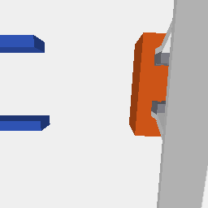

# Replay Fix 报告：B90 专家场景恢复、阶段证据与相机复核

基准提交 `75bd153`。本目录只含本轮修复的工件，旧工件未覆盖（原 `final_validation/` 保留，作为**有缺陷的历史**）。

## Q1：之前的 B90 重放是否用了错误的物体场景？—— **是（已确认）**

上一轮 `final_camera_validate.py --part phases` 用 `build_sim_scene('B90', seed=0)` 建场景，
方块落在 `(0.55, 0.00, 0.02)`、yaw=0；而实验 3 的 B90 训练起点状态是
`obj ≈ (0.548–0.559, 0.177–0.182, 0.020)`、`obj_yaw ≈ 1.49–1.55 rad ≈ 90°`
（`results/experiment_3/data/b_training_start_states.csv`，60 行）。
机械臂沿真实 B90 轨迹运动、方块却在另一处 → 腕部相机自然看不到目标。

## Q2：修复后机器人与物体是否恢复到同一个 episode？—— **是（PASS）**

从同一 CSV 的 `episode_id=64` 行恢复：方块位姿、机器人 q、两指位置，
再与恢复后的仿真状态逐项比对（阈值在观察结果前固定：位置 2 mm / 旋转 0.01 rad / q 0.05 rad）：

| 指标 | 实测 |
| --- | --- |
| `object_position_error_m` | **9.2e-08** |
| `object_rotation_error_rad` | **0.0** |
| `robot_q_error_rad` | **5.2e-06** |
| `gripper_error_m` | **2.5e-07** |

四元数统一使用 PyBullet 的 `xyzw`（CSV 的 `obj_quat` 直接来自同一引擎，因此无手性转换）。

## Q3：`wall_contact` 阶段是否有真实物理证据？—— **没有（已改标签）**

本轮改为**物理重放**（`sim.command(q_target)` + 接触动力学，12 物理步/帧）并逐帧查询
`getContactPoints`：

| 事件 | 帧号 |
| --- | --- |
| 第一次 机器人与方块接触 | **96** |
| 第一次 方块与墙接触 | **从未发生** |
| 方块总位移 Δx | **0.00087 m**（0.9 mm） |

因此阶段标签只保留有证据的：`initial / approach / first_robot_contact / pushing / final`，
原来的 `wall_contact` 统一改为 **`wall_contact_not_verified`**（并保留在 provenance 里说明未验证）。
**该 B90 episode 在本次重放条件下并没有真正推动、也没有触墙**（与实验 3.5 的结论一致：
v2.2 近墙成功 ≠ 真实墙面接触）。不得把它当作"已完成推墙"的示范。

## Q4：正确场景下 B90 腕部相机能否看到目标？—— **能（PASS）**

修正场景后，`first_robot_contact` 与 `pushing` 两帧的腕部图像里，橙色方块**大幅占据画面中部**
（见 `camera_corrected_frames/B90_first_robot_contact_wrist.png`），夹爪两指在其后方可见；
本轮 5 个有证据阶段中腕部 **4/5 可见**（唯一不可见的是 `initial`——初始位置离目标远，符合预期）。



## Q5：当前腕部相机是否需要改安装外参？—— **不需要（KEEP v3）**

上一轮的 3/9 是**错误场景**造成的伪结论（本轮 Case 1），按任务要求不得据此旋转相机。
v3 的固定外参（偏移 `(0.055, 0, -0.015)`、前视 + 10° 俯视、FOV 78）在正确场景下满足
A90 与 B90 的关键阶段可见性，**不改**。

## Q6：外部相机能否覆盖正确 B90 的操作区与墙体？—— **PASS**

5 个阶段中外部相机均拍到方块与墙（`ext_wall_px > 0`），方块短边像素见
`camera_visibility_corrected.csv`。与上一轮一致，没有因为修场景而变差。

## Q7：分割 Mask 能否独立复核？—— **PASS（本轮修复）**

上一轮把 **RGB 当成 mask** 保存（`*_external_mask.png` 与 RGB 同源）。
本轮归档三种并存、可互相核对的文件：

| 文件 | 内容 |
| --- | --- |
| `*_external.png` / `*_wrist.png` | RGB 渲染 |
| `*_segvis.png` | 由 segmentation buffer 的 body id 着色（方块橙、机器人蓝、墙灰、托盘青、背景黑） |
| `*_segids.npy` | **原始 int32 segmentation id**（PyBullet segmentation buffer，bodyUniqueId），可独立重算统计 |

自动断言：`rgb_sha256 != segvis_sha256`（见 `segmentation_validation.json` 的 `all_rgb_not_equal_segvis`），
且 mask 与 RGB 使用同一相机矩阵、同一仿真实例、同一渲染时刻。

## Q8：Final Validation 能否结题？—— **PASS（限定范围）**

| 项目 | 状态 |
| --- | --- |
| B90 场景恢复（episode state restoration） | **PASS**（误差 ~1e-7） |
| Replay provenance | **PASS**（标记为 `PHYSICAL_REPLAY`，动作=数据集动作序列，未额外缩放） |
| 接触/阶段标签 | **PASS**（只保留有 `getContactPoints` 证据的阶段；`wall_contact` 改为未验证） |
| 正确场景下相机可见性 | **PASS**（External 5/5、Wrist 4/5，未改相机） |
| 分割归档 | **PASS** |
| A90 回归 | **PARTIAL**：本轮未重跑 A90（其场景本就是 `(0.55, 0, 0.02)` yaw0，与上一轮一致），
  但 `final_camera_validate.py` 的 mask 归档缺陷同样存在于 A90 历史帧 → 历史 `*_mask.png` 作废 |

## Observed / Supported / Not Verified / Invalidated

**Observed**：episode 64 的 q/物体/夹爪恢复误差；首接触帧 96；无墙接触；方块 Δx=0.9 mm；
腕部在首接触与推动帧可见方块；外部相机 5/5 拍到方块与墙；RGB 与 segvis 哈希不同。

**Supported**：上一轮 B90 腕部 3/9 不可见的主因是**场景错误**（同一相机、正确场景下首接触即可见）；
该 B90 episode 在 12 步/帧的重放条件下没有真实推墙行为。

**Not Verified**：该 episode 的真实动作时序是否与数据集记录一致（数据集 FPS 未在元数据中逐项核对，
12 物理步/帧是按 20 Hz 假设）；若改为 15 Hz（16 步/帧），物体位移可能不同。未见墙接触，不能据此评估推墙能力。

**Invalidated**：`final_validation/camera_visibility_by_phase.csv` 的 B90 行（错误场景 + RGB 冒充 mask）
与 `final_validation/*_mask.png`。这些旧结论**不得**与修复后的数据混合统计。

## 复现

```bash
/scratch/lijh/simulate_vla/venv/bin/python scripts/exp40/replay_fix_validate.py --episode-id 64
```
